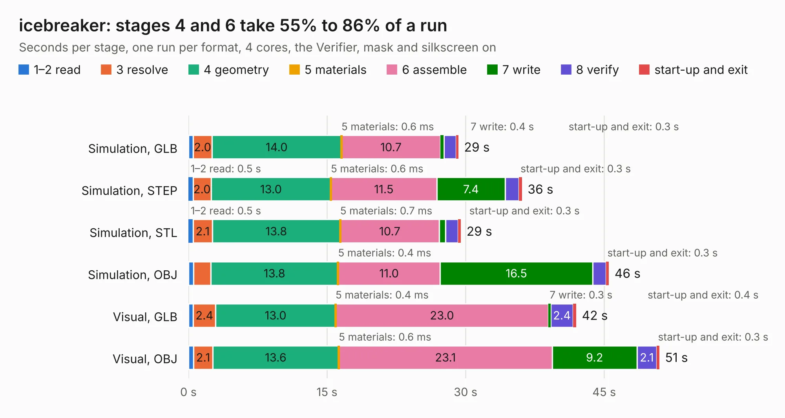

# 927. icebreaker

Board 927 of the 3,100 of [Corpus Testing](../Corpus-Testing.md), on [Corpus Page 9](../CorpusTestingPages/Corpus-Testing-09.md#927-icebreaker).

| Mode and format | 1–2 read | 3 resolve | 4 geometry | 5 materials | 6 assemble | 7 write | 8 verify | start-up and exit | Total |
|---|---:|---:|---:|---:|---:|---:|---:|---:|---:|
| Simulation, GLB | 0.5 | 2.0 | 14.0 | 0.6&nbsp;ms | 10.7 | 0.4 | 1.3 | 0.3 | 29.2 |
| Simulation, STEP | 0.5 | 2.0 | 13.0 | 0.6&nbsp;ms | 11.5 | 7.4 | 1.5 | 0.3 | 36.1 |
| Simulation, STL | 0.5 | 2.1 | 13.8 | 0.7&nbsp;ms | 10.7 | 0.7 | 1.3 | 0.3 | 29.5 |
| Simulation, OBJ | 0.5 | 1.9 | 13.8 | 0.4&nbsp;ms | 11.0 | 16.5 | 1.4 | 0.3 | 45.5 |
| Visual, GLB | 0.5 | 2.4 | 13.0 | 0.4&nbsp;ms | 23.0 | 0.3 | 2.4 | 0.4 | 42.0 |
| Visual, OBJ | 0.6 | 2.1 | 13.6 | 0.6&nbsp;ms | 23.1 | 9.2 | 2.1 | 0.3 | 51.0 |

<table align="center"><tr><td valign="top">

| Board | Repo: [esden/icebreaker](https://github.com/esden/icebreaker) Board: `icebreaker.kicad_pcb` |
|---|---|
| Folder | hardware / v0.1a |
| Complexity | 307&nbsp;/&nbsp;1000 (size&nbsp;252, features&nbsp;55) |
| KESE&nbsp;features | through vias, rounded, trapezoid or chamfered pads, filled zones, curved board outline |
| Tested | 9th November 2026 |
| Copper&nbsp;layers | 4 |
| File&nbsp;format | KiCad 5 (20171130) |
| Parts,&nbsp;tracks,&nbsp;vias | 108, 1,183, 141 |
| Triangles,&nbsp;simulation | 2,183,702 in 113 parts |
| Verifier | PASS in all six runs |

</td><td valign="top">

<table>
<tr><th>File type</th><th>File size</th><th>Peak memory used</th></tr>
<tr><th colspan="3" align="left">Simulation</th></tr>
<tr><td>GLB</td><td align="right">76&nbsp;MB</td><td align="right">850&nbsp;MB</td></tr>
<tr><td>STEP</td><td align="right">388&nbsp;MB</td><td align="right">922&nbsp;MB</td></tr>
<tr><td>STL</td><td align="right">109&nbsp;MB</td><td align="right">796&nbsp;MB</td></tr>
<tr><td>OBJ</td><td align="right">232&nbsp;MB</td><td align="right">1.5&nbsp;GB</td></tr>
<tr><th colspan="3" align="left">Visual</th></tr>
<tr><td>GLB</td><td align="right">49&nbsp;MB</td><td align="right">885&nbsp;MB</td></tr>
<tr><td>OBJ</td><td align="right">151&nbsp;MB</td><td align="right">1.1&nbsp;GB</td></tr>
</table>

</td></tr></table>

| Previous | Next |
|:---|---:|
| [926. icebreaker-bitsy](b0926b_icebreaker_hardware-bitsy-v1-1a_icebreaker-bitsy.md) | [928. icebreaker](b0928b_icebreaker_hardware-v0-2a_icebreaker.md) |
