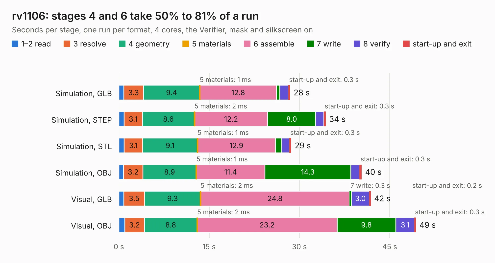

# 927. rv1106

Board 927 of the 3,112 of [Corpus Testing](../Corpus-Testing.md), on [Corpus Page 9](../CorpusTestingPages/Corpus-Testing-09.md#927-rv1106).

| Mode and format | 1–2 read | 3 resolve | 4 geometry | 5 materials | 6 assemble | 7 write | 8 verify | start-up and exit | Total |
|---|---:|---:|---:|---:|---:|---:|---:|---:|---:|
| Simulation, GLB | 0.8 | 3.3 | 9.4 | 1&nbsp;ms | 12.8 | 0.5 | 1.4 | 0.3 | 28.5 |
| Simulation, STEP | 0.8 | 3.1 | 8.6 | 2&nbsp;ms | 12.2 | 8.0 | 1.4 | 0.3 | 34.4 |
| Simulation, STL | 0.9 | 3.1 | 9.1 | 1&nbsp;ms | 12.9 | 1.1 | 1.3 | 0.3 | 28.6 |
| Simulation, OBJ | 0.8 | 3.2 | 8.9 | 1&nbsp;ms | 11.4 | 14.3 | 1.4 | 0.3 | 40.3 |
| Visual, GLB | 0.8 | 3.5 | 9.3 | 2&nbsp;ms | 24.8 | 0.3 | 3.0 | 0.2 | 41.8 |
| Visual, OBJ | 1.0 | 3.2 | 8.8 | 2&nbsp;ms | 23.2 | 9.8 | 3.1 | 0.3 | 49.3 |

<table align="center"><tr><td valign="top">

| Board | Repo: [epsilon0-dev/raven1106](https://github.com/epsilon0-dev/raven1106) Board: `rv1106.kicad_pcb` |
|---|---|
| Folder | pcb / v1.0 |
| Complexity | 415&nbsp;/&nbsp;1000 (size&nbsp;265, features&nbsp;150) |
| KESE&nbsp;features | through vias, slotted holes, rounded, trapezoid or chamfered pads, arc tracks, filled zones, copper text, curved board outline, knockout text, TrueType text, stack-up, dielectric εr and tanδ |
| Tested | 9th November 2026 |
| Copper&nbsp;layers | 4 |
| File&nbsp;format | KiCad 10 (20260206) |
| Parts,&nbsp;tracks,&nbsp;vias | 209, 2,225, 415 |
| Triangles,&nbsp;simulation | 3,150,404 in 257 parts |
| Verifier | PASS in all six runs |

</td><td valign="top">

<table>
<tr><th>File type</th><th>File size</th><th>Peak memory used</th></tr>
<tr><th colspan="3" align="left">Simulation</th></tr>
<tr><td>GLB</td><td align="right">107&nbsp;MB</td><td align="right">1.0&nbsp;GB</td></tr>
<tr><td>STEP</td><td align="right">462&nbsp;MB</td><td align="right">1.3&nbsp;GB</td></tr>
<tr><td>STL</td><td align="right">158&nbsp;MB</td><td align="right">981&nbsp;MB</td></tr>
<tr><td>OBJ</td><td align="right">335&nbsp;MB</td><td align="right">2.0&nbsp;GB</td></tr>
<tr><th colspan="3" align="left">Visual</th></tr>
<tr><td>GLB</td><td align="right">69&nbsp;MB</td><td align="right">1.2&nbsp;GB</td></tr>
<tr><td>OBJ</td><td align="right">222&nbsp;MB</td><td align="right">1.5&nbsp;GB</td></tr>
</table>

</td></tr></table>

| Previous | Next |
|:---|---:|
| [926. icehat](b0926b_icehat_icehat.md) | [928. rv1106](b0928b_raven1106_pcb-v1-1_rv1106.md) |
