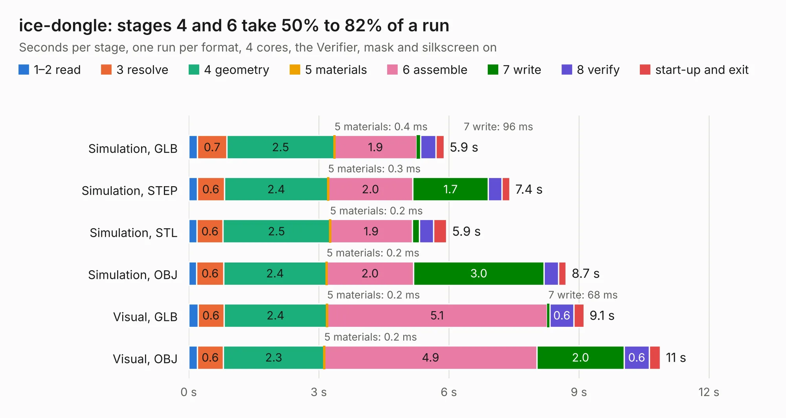

# 931. ice-dongle

Board 931 of the 3,138 of [Corpus Testing](../Corpus-Testing.md), on [Corpus Page 9](../CorpusTestingPages/Corpus-Testing-09.md#931-ice-dongle).

| Mode and format | 1–2 read | 3 resolve | 4 geometry | 5 materials | 6 assemble | 7 write | 8 verify | start-up and exit | Total |
|---|---:|---:|---:|---:|---:|---:|---:|---:|---:|
| Simulation, GLB | 0.2 | 0.7 | 2.5 | 0.4&nbsp;ms | 1.9 | 96&nbsp;ms | 0.3 | 0.2 | 5.9 |
| Simulation, STEP | 0.2 | 0.6 | 2.4 | 0.3&nbsp;ms | 2.0 | 1.7 | 0.3 | 0.2 | 7.4 |
| Simulation, STL | 0.2 | 0.6 | 2.5 | 0.2&nbsp;ms | 1.9 | 0.2 | 0.3 | 0.3 | 5.9 |
| Simulation, OBJ | 0.2 | 0.6 | 2.4 | 0.2&nbsp;ms | 2.0 | 3.0 | 0.3 | 0.2 | 8.7 |
| Visual, GLB | 0.2 | 0.6 | 2.4 | 0.2&nbsp;ms | 5.1 | 68&nbsp;ms | 0.6 | 0.2 | 9.1 |
| Visual, OBJ | 0.2 | 0.6 | 2.3 | 0.2&nbsp;ms | 4.9 | 2.0 | 0.6 | 0.3 | 10.9 |

<table align="center"><tr><td valign="top">

| Board | Repo: [emeb/ice-dongle](https://github.com/emeb/ice-dongle) Board: `ice-dongle.kicad_pcb` |
|---|---|
| Folder | Hardware / ice-dongle |
| Complexity | 336&nbsp;/&nbsp;1000 (size&nbsp;226, features&nbsp;110) |
| KESE&nbsp;features | through vias, slotted holes, custom pads, rounded, trapezoid or chamfered pads, filled zones, copper drawings, stack-up, dielectric εr and tanδ |
| Tested | 9th November 2026 |
| Copper&nbsp;layers | 4 |
| File&nbsp;format | KiCad 6 (20211014) |
| Parts,&nbsp;tracks,&nbsp;vias | 45, 613, 95 |
| Triangles,&nbsp;simulation | 730,502 in 73 parts |
| Verifier | PASS in all six runs |

</td><td valign="top">

<table>
<tr><th>File type</th><th>File size</th><th>Peak memory used</th></tr>
<tr><th colspan="3" align="left">Simulation</th></tr>
<tr><td>GLB</td><td align="right">25&nbsp;MB</td><td align="right">380&nbsp;MB</td></tr>
<tr><td>STEP</td><td align="right">117&nbsp;MB</td><td align="right">417&nbsp;MB</td></tr>
<tr><td>STL</td><td align="right">37&nbsp;MB</td><td align="right">363&nbsp;MB</td></tr>
<tr><td>OBJ</td><td align="right">76&nbsp;MB</td><td align="right">543&nbsp;MB</td></tr>
<tr><th colspan="3" align="left">Visual</th></tr>
<tr><td>GLB</td><td align="right">17&nbsp;MB</td><td align="right">425&nbsp;MB</td></tr>
<tr><td>OBJ</td><td align="right">52&nbsp;MB</td><td align="right">434&nbsp;MB</td></tr>
</table>

</td></tr></table>

| Previous | Next |
|:---|---:|
| [930. ulx3s](b0930b_ulx3s_ulx3s.md) | [932. ice-fpc-pmod](b0932b_ice-dongle_ice-fpc-pmod.md) |
