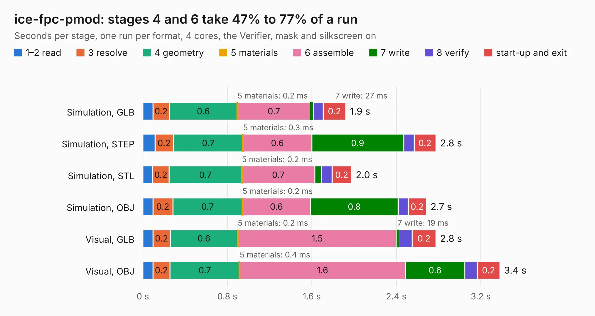

# 931. ice-fpc-pmod

Board 931 of the 3,127 of [Corpus Testing](../Corpus-Testing.md), on [Corpus Page 9](../CorpusTestingPages/Corpus-Testing-09.md#931-ice-fpc-pmod).

| Mode and format | 1–2 read | 3 resolve | 4 geometry | 5 materials | 6 assemble | 7 write | 8 verify | start-up and exit | Total |
|---|---:|---:|---:|---:|---:|---:|---:|---:|---:|
| Simulation, GLB | 96&nbsp;ms | 0.2 | 0.6 | 0.2&nbsp;ms | 0.7 | 27&nbsp;ms | 94&nbsp;ms | 0.2 | 1.9 |
| Simulation, STEP | 0.1 | 0.2 | 0.7 | 0.3&nbsp;ms | 0.6 | 0.9 | 99&nbsp;ms | 0.2 | 2.8 |
| Simulation, STL | 94&nbsp;ms | 0.2 | 0.7 | 0.2&nbsp;ms | 0.7 | 62&nbsp;ms | 0.1 | 0.2 | 2.0 |
| Simulation, OBJ | 95&nbsp;ms | 0.2 | 0.7 | 0.2&nbsp;ms | 0.6 | 0.8 | 95&nbsp;ms | 0.2 | 2.7 |
| Visual, GLB | 95&nbsp;ms | 0.2 | 0.6 | 0.2&nbsp;ms | 1.5 | 19&nbsp;ms | 0.1 | 0.2 | 2.8 |
| Visual, OBJ | 96&nbsp;ms | 0.2 | 0.7 | 0.4&nbsp;ms | 1.6 | 0.6 | 0.1 | 0.2 | 3.4 |

<table align="center"><tr><td valign="top">

| Board | Repo: [emeb/ice-dongle](https://github.com/emeb/ice-dongle) Board: `ice-fpc-pmod.kicad_pcb` |
|---|---|
| Folder | Hardware / ice-fpc-pmod |
| Complexity | 203&nbsp;/&nbsp;1000 (size&nbsp;113, features&nbsp;90) |
| KESE&nbsp;features | through vias, custom pads, filled zones, copper drawings, stack-up, dielectric εr and tanδ |
| Tested | 9th November 2026 |
| Copper&nbsp;layers | 2 |
| File&nbsp;format | KiCad 6 (20211014) |
| Parts,&nbsp;tracks,&nbsp;vias | 5, 97, 3 |
| Triangles,&nbsp;simulation | 162,208 in 32 parts |
| Verifier | PASS in all six runs |

</td><td valign="top">

<table>
<tr><th>File type</th><th>File size</th><th>Peak memory used</th></tr>
<tr><th colspan="3" align="left">Simulation</th></tr>
<tr><td>GLB</td><td align="right">5.5&nbsp;MB</td><td align="right">195&nbsp;MB</td></tr>
<tr><td>STEP</td><td align="right">24&nbsp;MB</td><td align="right">207&nbsp;MB</td></tr>
<tr><td>STL</td><td align="right">8.1&nbsp;MB</td><td align="right">201&nbsp;MB</td></tr>
<tr><td>OBJ</td><td align="right">16&nbsp;MB</td><td align="right">192&nbsp;MB</td></tr>
<tr><th colspan="3" align="left">Visual</th></tr>
<tr><td>GLB</td><td align="right">3.9&nbsp;MB</td><td align="right">171&nbsp;MB</td></tr>
<tr><td>OBJ</td><td align="right">11&nbsp;MB</td><td align="right">176&nbsp;MB</td></tr>
</table>

</td></tr></table>

| Previous | Next |
|:---|---:|
| [930. ice-dongle](b0930b_ice-dongle_ice-dongle.md) | [932. ice-prog-adapt](b0932b_ice-dongle_ice-prog-adapt.md) |
