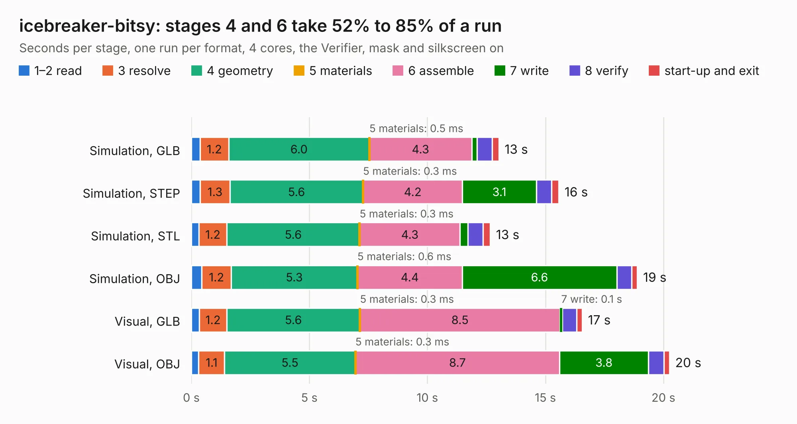

# 931. icebreaker-bitsy

Board 931 of the 3,108 of [Corpus Testing](../Corpus-Testing.md), on [Corpus Page 9](../CorpusTestingPages/Corpus-Testing-09.md#931-icebreaker-bitsy).

| Mode and format | 1–2 read | 3 resolve | 4 geometry | 5 materials | 6 assemble | 7 write | 8 verify | start-up and exit | Total |
|---|---:|---:|---:|---:|---:|---:|---:|---:|---:|
| Simulation, GLB | 0.4 | 1.2 | 6.0 | 0.5&nbsp;ms | 4.3 | 0.2 | 0.7 | 0.3 | 13.0 |
| Simulation, STEP | 0.4 | 1.3 | 5.6 | 0.3&nbsp;ms | 4.2 | 3.1 | 0.7 | 0.3 | 15.6 |
| Simulation, STL | 0.3 | 1.2 | 5.6 | 0.3&nbsp;ms | 4.3 | 0.3 | 0.6 | 0.3 | 12.7 |
| Simulation, OBJ | 0.4 | 1.2 | 5.3 | 0.6&nbsp;ms | 4.4 | 6.6 | 0.6 | 0.3 | 18.9 |
| Visual, GLB | 0.3 | 1.2 | 5.6 | 0.3&nbsp;ms | 8.5 | 0.1 | 0.6 | 0.2 | 16.6 |
| Visual, OBJ | 0.3 | 1.1 | 5.5 | 0.3&nbsp;ms | 8.7 | 3.8 | 0.7 | 0.2 | 20.3 |

<table align="center"><tr><td valign="top">

| Board | Repo: [esden/icebreaker](https://github.com/esden/icebreaker) Board: `icebreaker-bitsy.kicad_pcb` |
|---|---|
| Folder | hardware / bitsy-v1.1a |
| Complexity | 288&nbsp;/&nbsp;1000 (size&nbsp;233, features&nbsp;55) |
| KESE&nbsp;features | through vias, slotted holes, rounded, trapezoid or chamfered pads, filled zones |
| Tested | 9th November 2026 |
| Copper&nbsp;layers | 4 |
| File&nbsp;format | KiCad 5 (20171130) |
| Parts,&nbsp;tracks,&nbsp;vias | 84, 665, 73 |
| Triangles,&nbsp;simulation | 1,101,462 in 85 parts |
| Verifier | PASS in all six runs |

</td><td valign="top">

<table>
<tr><th>File type</th><th>File size</th><th>Peak memory used</th></tr>
<tr><th colspan="3" align="left">Simulation</th></tr>
<tr><td>GLB</td><td align="right">39&nbsp;MB</td><td align="right">418&nbsp;MB</td></tr>
<tr><td>STEP</td><td align="right">186&nbsp;MB</td><td align="right">498&nbsp;MB</td></tr>
<tr><td>STL</td><td align="right">55&nbsp;MB</td><td align="right">430&nbsp;MB</td></tr>
<tr><td>OBJ</td><td align="right">114&nbsp;MB</td><td align="right">784&nbsp;MB</td></tr>
<tr><th colspan="3" align="left">Visual</th></tr>
<tr><td>GLB</td><td align="right">21&nbsp;MB</td><td align="right">519&nbsp;MB</td></tr>
<tr><td>OBJ</td><td align="right">64&nbsp;MB</td><td align="right">537&nbsp;MB</td></tr>
</table>

</td></tr></table>

| Previous | Next |
|:---|---:|
| [930. icebreaker-bitsy](b0930b_icebreaker_hardware-bitsy-v1-0a_icebreaker-bitsy.md) | [932. icebreaker](b0932b_icebreaker_hardware-v0-1a_icebreaker.md) |
