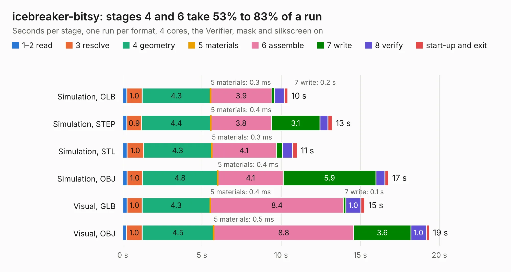

# 932. icebreaker-bitsy

Board 932 of the 3,116 of [Corpus Testing](../Corpus-Testing.md), on [Corpus Page 9](../CorpusTestingPages/Corpus-Testing-09.md#932-icebreaker-bitsy).

| Mode and format | 1–2 read | 3 resolve | 4 geometry | 5 materials | 6 assemble | 7 write | 8 verify | start-up and exit | Total |
|---|---:|---:|---:|---:|---:|---:|---:|---:|---:|
| Simulation, GLB | 0.3 | 1.0 | 4.3 | 0.3&nbsp;ms | 3.9 | 0.2 | 0.6 | 0.2 | 10.4 |
| Simulation, STEP | 0.3 | 0.9 | 4.4 | 0.4&nbsp;ms | 3.8 | 3.1 | 0.5 | 0.3 | 13.2 |
| Simulation, STL | 0.3 | 1.0 | 4.3 | 0.3&nbsp;ms | 4.1 | 0.4 | 0.6 | 0.3 | 11.0 |
| Simulation, OBJ | 0.3 | 1.0 | 4.8 | 0.4&nbsp;ms | 4.1 | 5.9 | 0.6 | 0.2 | 16.8 |
| Visual, GLB | 0.3 | 1.0 | 4.3 | 0.4&nbsp;ms | 8.4 | 0.1 | 1.0 | 0.2 | 15.3 |
| Visual, OBJ | 0.2 | 1.0 | 4.5 | 0.5&nbsp;ms | 8.8 | 3.6 | 1.0 | 0.2 | 19.4 |

<table align="center"><tr><td valign="top">

| Board | Repo: [esden/icebreaker](https://github.com/esden/icebreaker) Board: `icebreaker-bitsy.kicad_pcb` |
|---|---|
| Folder | hardware / bitsy-v0.1a |
| Complexity | 283&nbsp;/&nbsp;1000 (size&nbsp;228, features&nbsp;55) |
| KESE&nbsp;features | through vias, rounded, trapezoid or chamfered pads, filled zones, curved board outline |
| Tested | 9th November 2026 |
| Copper&nbsp;layers | 4 |
| File&nbsp;format | KiCad 5 (20171130) |
| Parts,&nbsp;tracks,&nbsp;vias | 54, 570, 99 |
| Triangles,&nbsp;simulation | 1,272,178 in 73 parts |
| Verifier | PASS in all six runs |

</td><td valign="top">

<table>
<tr><th>File type</th><th>File size</th><th>Peak memory used</th></tr>
<tr><th colspan="3" align="left">Simulation</th></tr>
<tr><td>GLB</td><td align="right">44&nbsp;MB</td><td align="right">510&nbsp;MB</td></tr>
<tr><td>STEP</td><td align="right">211&nbsp;MB</td><td align="right">576&nbsp;MB</td></tr>
<tr><td>STL</td><td align="right">64&nbsp;MB</td><td align="right">498&nbsp;MB</td></tr>
<tr><td>OBJ</td><td align="right">131&nbsp;MB</td><td align="right">876&nbsp;MB</td></tr>
<tr><th colspan="3" align="left">Visual</th></tr>
<tr><td>GLB</td><td align="right">28&nbsp;MB</td><td align="right">676&nbsp;MB</td></tr>
<tr><td>OBJ</td><td align="right">83&nbsp;MB</td><td align="right">679&nbsp;MB</td></tr>
</table>

</td></tr></table>

| Previous | Next |
|:---|---:|
| [931. rv1106](b0931b_raven1106_pcb-v1-1_rv1106.md) | [933. icebreaker-bitsy](b0933b_icebreaker_hardware-bitsy-v0-2a_icebreaker-bitsy.md) |
