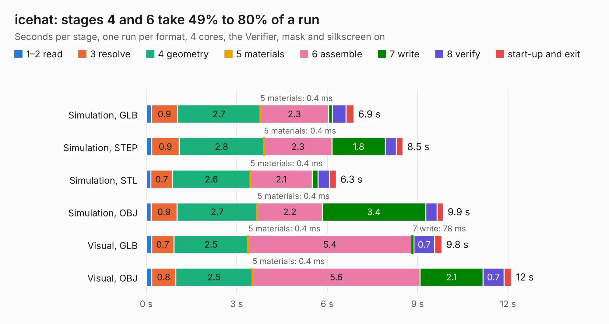

# 932. icehat

Board 932 of the 3,120 of [Corpus Testing](../Corpus-Testing.md), on [Corpus Page 9](../CorpusTestingPages/Corpus-Testing-09.md#932-icehat).

| Mode and format | 1–2 read | 3 resolve | 4 geometry | 5 materials | 6 assemble | 7 write | 8 verify | start-up and exit | Total |
|---|---:|---:|---:|---:|---:|---:|---:|---:|---:|
| Simulation, GLB | 0.2 | 0.9 | 2.7 | 0.4&nbsp;ms | 2.3 | 0.1 | 0.5 | 0.3 | 6.9 |
| Simulation, STEP | 0.2 | 0.9 | 2.8 | 0.4&nbsp;ms | 2.3 | 1.8 | 0.4 | 0.2 | 8.5 |
| Simulation, STL | 0.2 | 0.7 | 2.6 | 0.4&nbsp;ms | 2.1 | 0.2 | 0.4 | 0.2 | 6.3 |
| Simulation, OBJ | 0.2 | 0.9 | 2.7 | 0.4&nbsp;ms | 2.2 | 3.4 | 0.4 | 0.2 | 9.9 |
| Visual, GLB | 0.2 | 0.7 | 2.5 | 0.4&nbsp;ms | 5.4 | 78&nbsp;ms | 0.7 | 0.2 | 9.8 |
| Visual, OBJ | 0.2 | 0.8 | 2.5 | 0.4&nbsp;ms | 5.6 | 2.1 | 0.7 | 0.3 | 12.1 |

<table align="center"><tr><td valign="top">

| Board | Repo: [emeb/icehat](https://github.com/emeb/icehat) Board: `icehat.kicad_pcb` |
|---|---|
| Folder | kicad |
| Complexity | 262&nbsp;/&nbsp;1000 (size&nbsp;217, features&nbsp;45) |
| KESE&nbsp;features | through vias, filled zones, curved board outline |
| Tested | 9th November 2026 |
| Copper&nbsp;layers | 4 |
| File&nbsp;format | KiCad 4 (4) |
| Parts,&nbsp;tracks,&nbsp;vias | 33, 519, 41 |
| Triangles,&nbsp;simulation | 839,602 in 88 parts |
| Verifier | PASS in all six runs |

</td><td valign="top">

<table>
<tr><th>File type</th><th>File size</th><th>Peak memory used</th></tr>
<tr><th colspan="3" align="left">Simulation</th></tr>
<tr><td>GLB</td><td align="right">28&nbsp;MB</td><td align="right">350&nbsp;MB</td></tr>
<tr><td>STEP</td><td align="right">104&nbsp;MB</td><td align="right">409&nbsp;MB</td></tr>
<tr><td>STL</td><td align="right">42&nbsp;MB</td><td align="right">352&nbsp;MB</td></tr>
<tr><td>OBJ</td><td align="right">85&nbsp;MB</td><td align="right">576&nbsp;MB</td></tr>
<tr><th colspan="3" align="left">Visual</th></tr>
<tr><td>GLB</td><td align="right">17&nbsp;MB</td><td align="right">459&nbsp;MB</td></tr>
<tr><td>OBJ</td><td align="right">51&nbsp;MB</td><td align="right">464&nbsp;MB</td></tr>
</table>

</td></tr></table>

| Previous | Next |
|:---|---:|
| [931. ice-prog-adapt](b0931b_ice-dongle_ice-prog-adapt.md) | [933. board_presignal](b0933b_discrete6502_board-presignal.md) |
