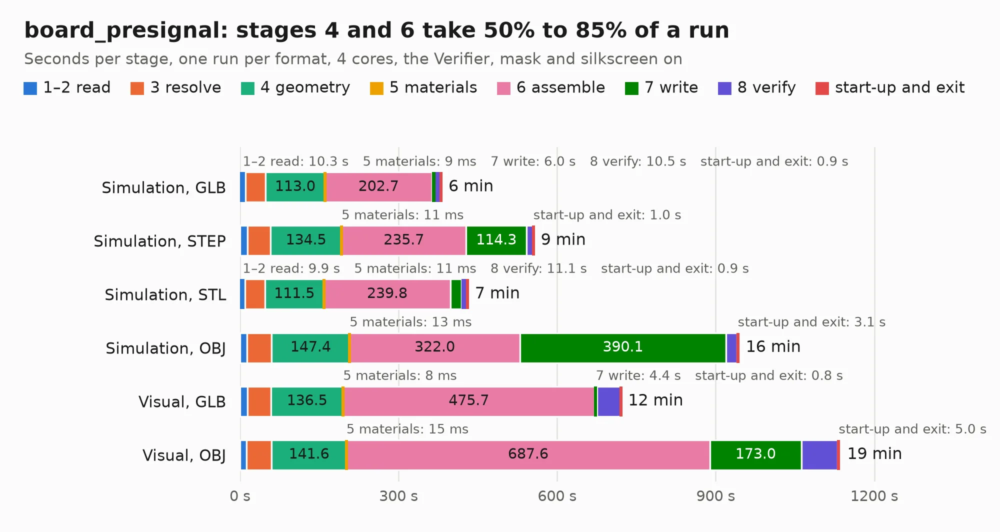

# 935. board_presignal

Board 935 of the 3,132 of [Corpus Testing](../Corpus-Testing.md), on [Corpus Page 9](../CorpusTestingPages/Corpus-Testing-09.md#935-board_presignal).

| Mode and format | 1–2 read | 3 resolve | 4 geometry | 5 materials | 6 assemble | 7 write | 8 verify | start-up and exit | Total |
|---|---:|---:|---:|---:|---:|---:|---:|---:|---:|
| Simulation, GLB | 10.3 | 37.5 | 113.0 | 9&nbsp;ms | 202.7 | 6.0 | 10.5 | 0.9 | 380.8 |
| Simulation, STEP | 13.7 | 43.8 | 134.5 | 11&nbsp;ms | 235.7 | 114.3 | 12.4 | 1.0 | 555.4 |
| Simulation, STL | 9.9 | 37.1 | 111.5 | 11&nbsp;ms | 239.8 | 20.4 | 11.1 | 0.9 | 430.7 |
| Simulation, OBJ | 13.0 | 46.8 | 147.4 | 13&nbsp;ms | 322.0 | 390.1 | 20.7 | 3.1 | 943.3 |
| Visual, GLB | 14.5 | 44.0 | 136.5 | 8&nbsp;ms | 475.7 | 4.4 | 44.8 | 0.8 | 720.7 |
| Visual, OBJ | 12.5 | 47.2 | 141.6 | 15&nbsp;ms | 687.6 | 173.0 | 68.2 | 5.0 | 1135.1 |

<table align="center"><tr><td valign="top">

| Board | Repo: [epatel/discrete6502](https://github.com/epatel/discrete6502) Board: `board_presignal.kicad_pcb` |
|---|---|
| Folder | gen |
| Complexity | 378&nbsp;/&nbsp;1000 (size&nbsp;298, features&nbsp;80) |
| KESE&nbsp;features | through vias, custom pads, rounded, trapezoid or chamfered pads, drill offsets, filled zones, copper drawings |
| Tested | 9th November 2026 to 11th November 2026 |
| Copper&nbsp;layers | 6 |
| File&nbsp;format | KiCad 10 (20260206) |
| Parts,&nbsp;tracks,&nbsp;vias | 5,385, 7,252, 3,852 |
| Triangles,&nbsp;simulation | 37,350,070 in 2640 parts |
| Verifier | PASS in all six runs |
| Run&nbsp;again | Simulation, STEP; Visual, GLB: failed in the corpus run, run again with the memory cap raised from 11 GB to 14.5 GB, and passed |
| Run&nbsp;again | Simulation, OBJ; Visual, OBJ: failed in the corpus run, run again with no memory cap and no time limit (swap added to a 16 GB machine), and passed |

</td><td valign="top">

<table>
<tr><th>File type</th><th>File size</th><th>Peak memory used</th></tr>
<tr><th colspan="3" align="left">Simulation</th></tr>
<tr><td>GLB</td><td align="right">1.2&nbsp;GB</td><td align="right">9.8&nbsp;GB</td></tr>
<tr><td>STEP</td><td align="right">4.8&nbsp;GB</td><td align="right">12&nbsp;GB</td></tr>
<tr><td>STL</td><td align="right">1.9&nbsp;GB</td><td align="right">9.8&nbsp;GB</td></tr>
<tr><td>OBJ</td><td align="right">4.1&nbsp;GB</td><td align="right">23&nbsp;GB</td></tr>
<tr><th colspan="3" align="left">Visual</th></tr>
<tr><td>GLB</td><td align="right">839&nbsp;MB</td><td align="right">12&nbsp;GB</td></tr>
<tr><td>OBJ</td><td align="right">2.8&nbsp;GB</td><td align="right">16&nbsp;GB</td></tr>
</table>

</td></tr></table>

| Previous | Next |
|:---|---:|
| [934. icehat](b0934b_icehat_icehat.md) | [936. rv1106](b0936b_raven1106_pcb-v1-0_rv1106.md) |
