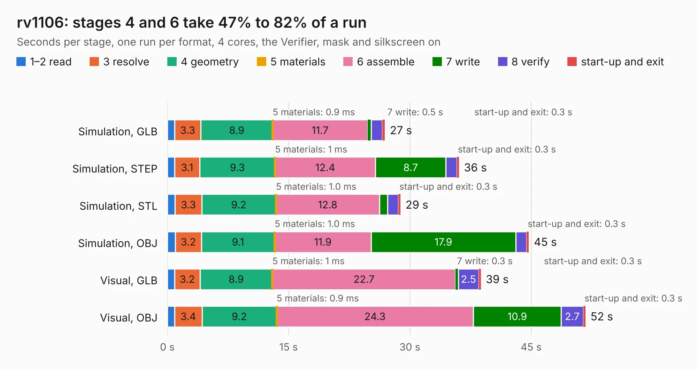

# 935. rv1106

Board 935 of the 3,121 of [Corpus Testing](../Corpus-Testing.md), on [Corpus Page 9](../CorpusTestingPages/Corpus-Testing-09.md#935-rv1106).

| Mode and format | 1–2 read | 3 resolve | 4 geometry | 5 materials | 6 assemble | 7 write | 8 verify | start-up and exit | Total |
|---|---:|---:|---:|---:|---:|---:|---:|---:|---:|
| Simulation, GLB | 0.9 | 3.3 | 8.9 | 0.9&nbsp;ms | 11.7 | 0.5 | 1.4 | 0.3 | 26.9 |
| Simulation, STEP | 0.9 | 3.1 | 9.3 | 1&nbsp;ms | 12.4 | 8.7 | 1.4 | 0.3 | 36.1 |
| Simulation, STL | 1.0 | 3.3 | 9.2 | 1.0&nbsp;ms | 12.8 | 1.0 | 1.3 | 0.3 | 28.8 |
| Simulation, OBJ | 1.0 | 3.2 | 9.1 | 1.0&nbsp;ms | 11.9 | 17.9 | 1.4 | 0.3 | 44.7 |
| Visual, GLB | 0.9 | 3.2 | 8.9 | 1&nbsp;ms | 22.7 | 0.3 | 2.5 | 0.3 | 38.8 |
| Visual, OBJ | 0.9 | 3.4 | 9.2 | 0.9&nbsp;ms | 24.3 | 10.9 | 2.7 | 0.3 | 51.7 |

<table align="center"><tr><td valign="top">

| Board | Repo: [epsilon0-dev/raven1106](https://github.com/epsilon0-dev/raven1106) Board: `rv1106.kicad_pcb` |
|---|---|
| Folder | pcb / v1.1 |
| Complexity | 415&nbsp;/&nbsp;1000 (size&nbsp;265, features&nbsp;150) |
| KESE&nbsp;features | through vias, slotted holes, rounded, trapezoid or chamfered pads, arc tracks, filled zones, copper text, curved board outline, knockout text, TrueType text, stack-up, dielectric εr and tanδ |
| Tested | 9th November 2026 |
| Copper&nbsp;layers | 4 |
| File&nbsp;format | KiCad 10 (20260206) |
| Parts,&nbsp;tracks,&nbsp;vias | 209, 2,225, 415 |
| Triangles,&nbsp;simulation | 3,143,474 in 257 parts |
| Verifier | PASS in all six runs |

</td><td valign="top">

<table>
<tr><th>File type</th><th>File size</th><th>Peak memory used</th></tr>
<tr><th colspan="3" align="left">Simulation</th></tr>
<tr><td>GLB</td><td align="right">107&nbsp;MB</td><td align="right">1.0&nbsp;GB</td></tr>
<tr><td>STEP</td><td align="right">460&nbsp;MB</td><td align="right">1.3&nbsp;GB</td></tr>
<tr><td>STL</td><td align="right">157&nbsp;MB</td><td align="right">985&nbsp;MB</td></tr>
<tr><td>OBJ</td><td align="right">334&nbsp;MB</td><td align="right">2.0&nbsp;GB</td></tr>
<tr><th colspan="3" align="left">Visual</th></tr>
<tr><td>GLB</td><td align="right">69&nbsp;MB</td><td align="right">1.2&nbsp;GB</td></tr>
<tr><td>OBJ</td><td align="right">221&nbsp;MB</td><td align="right">1.5&nbsp;GB</td></tr>
</table>

</td></tr></table>

| Previous | Next |
|:---|---:|
| [934. rv1106](b0934b_raven1106_pcb-v1-0_rv1106.md) | [936. icebreaker-bitsy](b0936b_icebreaker_hardware-bitsy-v0-1a_icebreaker-bitsy.md) |
