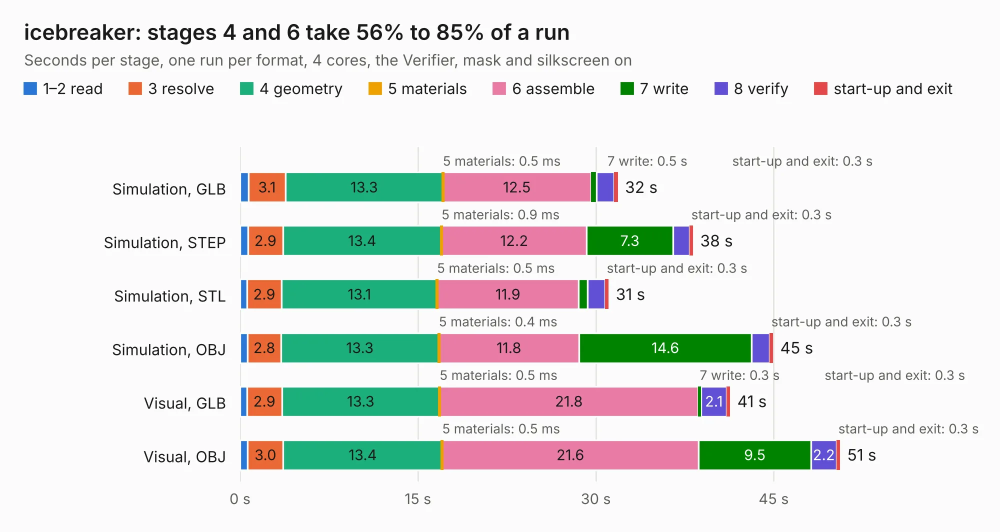

# 936. icebreaker

Board 936 of the 3,110 of [Corpus Testing](../Corpus-Testing.md), on [Corpus Page 9](../CorpusTestingPages/Corpus-Testing-09.md#936-icebreaker).

| Mode and format | 1–2 read | 3 resolve | 4 geometry | 5 materials | 6 assemble | 7 write | 8 verify | start-up and exit | Total |
|---|---:|---:|---:|---:|---:|---:|---:|---:|---:|
| Simulation, GLB | 0.7 | 3.1 | 13.3 | 0.5&nbsp;ms | 12.5 | 0.5 | 1.5 | 0.3 | 31.9 |
| Simulation, STEP | 0.7 | 2.9 | 13.4 | 0.9&nbsp;ms | 12.2 | 7.3 | 1.4 | 0.3 | 38.2 |
| Simulation, STL | 0.6 | 2.9 | 13.1 | 0.5&nbsp;ms | 11.9 | 0.7 | 1.5 | 0.3 | 31.1 |
| Simulation, OBJ | 0.7 | 2.8 | 13.3 | 0.4&nbsp;ms | 11.8 | 14.6 | 1.5 | 0.3 | 44.9 |
| Visual, GLB | 0.6 | 2.9 | 13.3 | 0.5&nbsp;ms | 21.8 | 0.3 | 2.1 | 0.3 | 41.3 |
| Visual, OBJ | 0.6 | 3.0 | 13.4 | 0.5&nbsp;ms | 21.6 | 9.5 | 2.2 | 0.3 | 50.6 |

<table align="center"><tr><td valign="top">

| Board | Repo: [esden/icebreaker](https://github.com/esden/icebreaker) Board: `icebreaker.kicad_pcb` |
|---|---|
| Folder | hardware / v1.0b |
| Complexity | 309&nbsp;/&nbsp;1000 (size&nbsp;254, features&nbsp;55) |
| KESE&nbsp;features | through vias, rounded, trapezoid or chamfered pads, filled zones, curved board outline |
| Tested | 9th November 2026 |
| Copper&nbsp;layers | 4 |
| File&nbsp;format | KiCad 5 (20171130) |
| Parts,&nbsp;tracks,&nbsp;vias | 117, 1,330, 148 |
| Triangles,&nbsp;simulation | 2,375,498 in 147 parts |
| Verifier | PASS in all six runs |

</td><td valign="top">

<table>
<tr><th>File type</th><th>File size</th><th>Peak memory used</th></tr>
<tr><th colspan="3" align="left">Simulation</th></tr>
<tr><td>GLB</td><td align="right">83&nbsp;MB</td><td align="right">782&nbsp;MB</td></tr>
<tr><td>STEP</td><td align="right">430&nbsp;MB</td><td align="right">969&nbsp;MB</td></tr>
<tr><td>STL</td><td align="right">119&nbsp;MB</td><td align="right">775&nbsp;MB</td></tr>
<tr><td>OBJ</td><td align="right">253&nbsp;MB</td><td align="right">1.6&nbsp;GB</td></tr>
<tr><th colspan="3" align="left">Visual</th></tr>
<tr><td>GLB</td><td align="right">55&nbsp;MB</td><td align="right">1.1&nbsp;GB</td></tr>
<tr><td>OBJ</td><td align="right">168&nbsp;MB</td><td align="right">1.2&nbsp;GB</td></tr>
</table>

</td></tr></table>

| Previous | Next |
|:---|---:|
| [935. icebreaker](b0935b_icebreaker_hardware-v1-0a_icebreaker.md) | [937. icebreaker](b0937b_icebreaker_hardware-v1-0c_icebreaker.md) |
