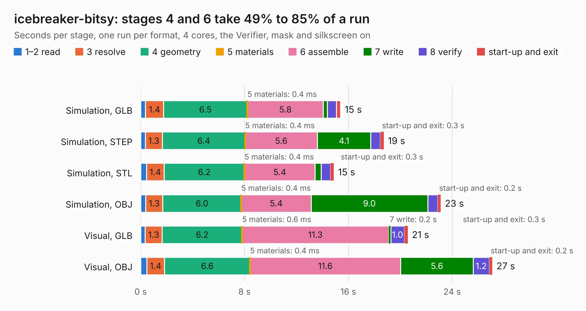

# 939. icebreaker-bitsy

Board 939 of the 3,126 of [Corpus Testing](../Corpus-Testing.md), on [Corpus Page 9](../CorpusTestingPages/Corpus-Testing-09.md#939-icebreaker-bitsy).

| Mode and format | 1–2 read | 3 resolve | 4 geometry | 5 materials | 6 assemble | 7 write | 8 verify | start-up and exit | Total |
|---|---:|---:|---:|---:|---:|---:|---:|---:|---:|
| Simulation, GLB | 0.4 | 1.4 | 6.5 | 0.4&nbsp;ms | 5.8 | 0.3 | 0.7 | 0.3 | 15.4 |
| Simulation, STEP | 0.4 | 1.3 | 6.4 | 0.4&nbsp;ms | 5.6 | 4.1 | 0.7 | 0.3 | 18.7 |
| Simulation, STL | 0.4 | 1.4 | 6.2 | 0.4&nbsp;ms | 5.4 | 0.5 | 0.7 | 0.3 | 14.9 |
| Simulation, OBJ | 0.4 | 1.3 | 6.0 | 0.4&nbsp;ms | 5.4 | 9.0 | 0.8 | 0.2 | 23.1 |
| Visual, GLB | 0.3 | 1.3 | 6.2 | 0.6&nbsp;ms | 11.3 | 0.2 | 1.0 | 0.3 | 20.6 |
| Visual, OBJ | 0.5 | 1.4 | 6.6 | 0.4&nbsp;ms | 11.6 | 5.6 | 1.2 | 0.2 | 27.1 |

<table align="center"><tr><td valign="top">

| Board | Repo: [esden/icebreaker](https://github.com/esden/icebreaker) Board: `icebreaker-bitsy.kicad_pcb` |
|---|---|
| Folder | hardware / bitsy-v0.3a |
| Complexity | 285&nbsp;/&nbsp;1000 (size&nbsp;230, features&nbsp;55) |
| KESE&nbsp;features | through vias, rounded, trapezoid or chamfered pads, filled zones, curved board outline |
| Tested | 9th November 2026 |
| Copper&nbsp;layers | 4 |
| File&nbsp;format | KiCad 5 (20171130) |
| Parts,&nbsp;tracks,&nbsp;vias | 56, 629, 113 |
| Triangles,&nbsp;simulation | 1,465,352 in 80 parts |
| Verifier | PASS in all six runs |

</td><td valign="top">

<table>
<tr><th>File type</th><th>File size</th><th>Peak memory used</th></tr>
<tr><th colspan="3" align="left">Simulation</th></tr>
<tr><td>GLB</td><td align="right">51&nbsp;MB</td><td align="right">565&nbsp;MB</td></tr>
<tr><td>STEP</td><td align="right">230&nbsp;MB</td><td align="right">643&nbsp;MB</td></tr>
<tr><td>STL</td><td align="right">73&nbsp;MB</td><td align="right">560&nbsp;MB</td></tr>
<tr><td>OBJ</td><td align="right">152&nbsp;MB</td><td align="right">997&nbsp;MB</td></tr>
<tr><th colspan="3" align="left">Visual</th></tr>
<tr><td>GLB</td><td align="right">31&nbsp;MB</td><td align="right">706&nbsp;MB</td></tr>
<tr><td>OBJ</td><td align="right">95&nbsp;MB</td><td align="right">732&nbsp;MB</td></tr>
</table>

</td></tr></table>

| Previous | Next |
|:---|---:|
| [938. icebreaker-bitsy](b0938b_icebreaker_hardware-bitsy-v0-2a_icebreaker-bitsy.md) | [940. icebreaker-bitsy](b0940b_icebreaker_hardware-bitsy-v1-0a_icebreaker-bitsy.md) |
