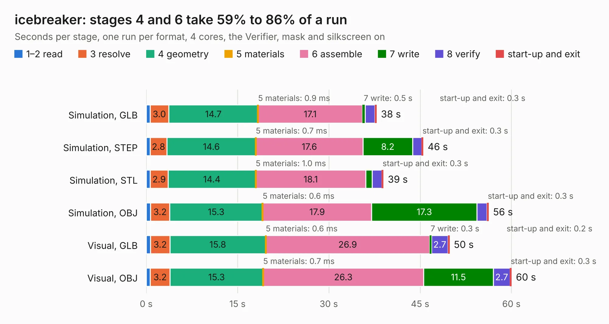

# 939. icebreaker

Board 939 of the 3,111 of [Corpus Testing](../Corpus-Testing.md), on [Corpus Page 9](../CorpusTestingPages/Corpus-Testing-09.md#939-icebreaker).

| Mode and format | 1–2 read | 3 resolve | 4 geometry | 5 materials | 6 assemble | 7 write | 8 verify | start-up and exit | Total |
|---|---:|---:|---:|---:|---:|---:|---:|---:|---:|
| Simulation, GLB | 0.6 | 3.0 | 14.7 | 0.9&nbsp;ms | 17.1 | 0.5 | 1.6 | 0.3 | 37.9 |
| Simulation, STEP | 0.6 | 2.8 | 14.6 | 0.7&nbsp;ms | 17.6 | 8.2 | 1.5 | 0.3 | 45.5 |
| Simulation, STL | 0.7 | 2.9 | 14.4 | 1.0&nbsp;ms | 18.1 | 1.0 | 1.6 | 0.3 | 39.0 |
| Simulation, OBJ | 0.7 | 3.2 | 15.3 | 0.6&nbsp;ms | 17.9 | 17.3 | 1.6 | 0.3 | 56.3 |
| Visual, GLB | 0.7 | 3.2 | 15.8 | 0.6&nbsp;ms | 26.9 | 0.3 | 2.7 | 0.2 | 49.8 |
| Visual, OBJ | 0.7 | 3.2 | 15.3 | 0.7&nbsp;ms | 26.3 | 11.5 | 2.7 | 0.3 | 60.0 |

<table align="center"><tr><td valign="top">

| Board | Repo: [esden/icebreaker](https://github.com/esden/icebreaker) Board: `icebreaker.kicad_pcb` |
|---|---|
| Folder | hardware / v1.0e |
| Complexity | 311&nbsp;/&nbsp;1000 (size&nbsp;256, features&nbsp;55) |
| KESE&nbsp;features | through vias, rounded, trapezoid or chamfered pads, filled zones, curved board outline |
| Tested | 9th November 2026 |
| Copper&nbsp;layers | 4 |
| File&nbsp;format | KiCad 5 (20171130) |
| Parts,&nbsp;tracks,&nbsp;vias | 128, 1,394, 157 |
| Triangles,&nbsp;simulation | 3,033,694 in 140 parts |
| Verifier | PASS in all six runs |

</td><td valign="top">

<table>
<tr><th>File type</th><th>File size</th><th>Peak memory used</th></tr>
<tr><th colspan="3" align="left">Simulation</th></tr>
<tr><td>GLB</td><td align="right">106&nbsp;MB</td><td align="right">932&nbsp;MB</td></tr>
<tr><td>STEP</td><td align="right">504&nbsp;MB</td><td align="right">1.2&nbsp;GB</td></tr>
<tr><td>STL</td><td align="right">152&nbsp;MB</td><td align="right">959&nbsp;MB</td></tr>
<tr><td>OBJ</td><td align="right">325&nbsp;MB</td><td align="right">2.1&nbsp;GB</td></tr>
<tr><th colspan="3" align="left">Visual</th></tr>
<tr><td>GLB</td><td align="right">68&nbsp;MB</td><td align="right">1.3&nbsp;GB</td></tr>
<tr><td>OBJ</td><td align="right">210&nbsp;MB</td><td align="right">1.4&nbsp;GB</td></tr>
</table>

</td></tr></table>

| Previous | Next |
|:---|---:|
| [938. icebreaker](b0938b_icebreaker_hardware-v1-0d_icebreaker.md) | [940. esp-rust-board](b0940b_esp-rust-board_esp-rust-board.md) |
