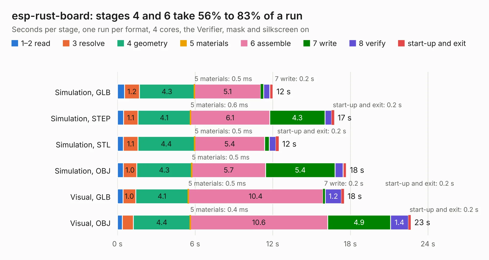

# 940. esp-rust-board

Board 940 of the 3,111 of [Corpus Testing](../Corpus-Testing.md), on [Corpus Page 9](../CorpusTestingPages/Corpus-Testing-09.md#940-esp-rust-board).

| Mode and format | 1–2 read | 3 resolve | 4 geometry | 5 materials | 6 assemble | 7 write | 8 verify | start-up and exit | Total |
|---|---:|---:|---:|---:|---:|---:|---:|---:|---:|
| Simulation, GLB | 0.5 | 1.2 | 4.3 | 0.5&nbsp;ms | 5.1 | 0.2 | 0.5 | 0.2 | 12.0 |
| Simulation, STEP | 0.5 | 1.1 | 4.1 | 0.6&nbsp;ms | 6.1 | 4.3 | 0.5 | 0.2 | 16.8 |
| Simulation, STL | 0.5 | 1.1 | 4.4 | 0.5&nbsp;ms | 5.4 | 0.4 | 0.5 | 0.2 | 12.5 |
| Simulation, OBJ | 0.5 | 1.0 | 4.3 | 0.5&nbsp;ms | 5.7 | 5.4 | 0.6 | 0.3 | 17.7 |
| Visual, GLB | 0.4 | 1.0 | 4.1 | 0.5&nbsp;ms | 10.4 | 0.2 | 1.2 | 0.2 | 17.5 |
| Visual, OBJ | 0.4 | 0.8 | 4.4 | 0.4&nbsp;ms | 10.6 | 4.9 | 1.4 | 0.2 | 22.7 |

<table align="center"><tr><td valign="top">

| Board | Repo: [esp-rs/esp-rust-board](https://github.com/esp-rs/esp-rust-board) Board: `esp-rust-board.kicad_pcb` |
|---|---|
| Folder | hardware / esp-rust-board |
| Complexity | 316&nbsp;/&nbsp;1000 (size&nbsp;176, features&nbsp;140) |
| KESE&nbsp;features | through vias, slotted holes, custom pads, rounded, trapezoid or chamfered pads, filled zones, copper drawings, curved board outline, stack-up, dielectric εr and tanδ, copper finish, mask and silkscreen colours |
| Tested | 9th November 2026 |
| Copper&nbsp;layers | 2 |
| File&nbsp;format | KiCad 6 (20211014) |
| Parts,&nbsp;tracks,&nbsp;vias | 54, 543, 216 |
| Triangles,&nbsp;simulation | 1,142,746 in 75 parts |
| Verifier | PASS in all six runs |

</td><td valign="top">

<table>
<tr><th>File type</th><th>File size</th><th>Peak memory used</th></tr>
<tr><th colspan="3" align="left">Simulation</th></tr>
<tr><td>GLB</td><td align="right">40&nbsp;MB</td><td align="right">547&nbsp;MB</td></tr>
<tr><td>STEP</td><td align="right">225&nbsp;MB</td><td align="right">648&nbsp;MB</td></tr>
<tr><td>STL</td><td align="right">57&nbsp;MB</td><td align="right">533&nbsp;MB</td></tr>
<tr><td>OBJ</td><td align="right">117&nbsp;MB</td><td align="right">792&nbsp;MB</td></tr>
<tr><th colspan="3" align="left">Visual</th></tr>
<tr><td>GLB</td><td align="right">33&nbsp;MB</td><td align="right">629&nbsp;MB</td></tr>
<tr><td>OBJ</td><td align="right">100&nbsp;MB</td><td align="right">724&nbsp;MB</td></tr>
</table>

</td></tr></table>

| Previous | Next |
|:---|---:|
| [939. icebreaker](b0939b_icebreaker_hardware-v1-0e_icebreaker.md) | [941. Home Assistant Voice PE](b0941b_home-assistant-voice-pe_Home-Assistant-Voice-PE.md) |
