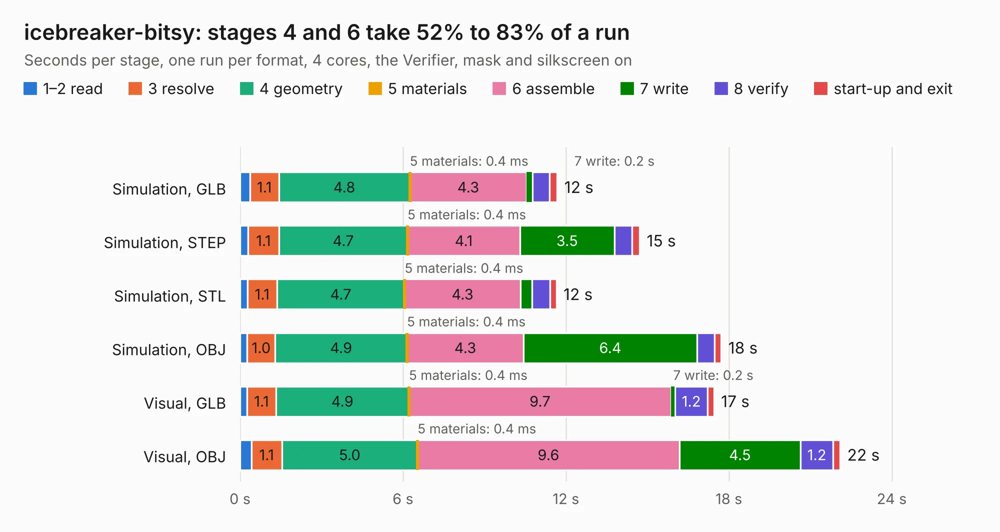

# 940. icebreaker-bitsy

Board 940 of the 3,139 of [Corpus Testing](../Corpus-Testing.md), on [Corpus Page 9](../CorpusTestingPages/Corpus-Testing-09.md#940-icebreaker-bitsy).

| Mode and format | 1–2 read | 3 resolve | 4 geometry | 5 materials | 6 assemble | 7 write | 8 verify | start-up and exit | Total |
|---|---:|---:|---:|---:|---:|---:|---:|---:|---:|
| Simulation, GLB | 0.4 | 1.1 | 4.8 | 0.4&nbsp;ms | 4.3 | 0.2 | 0.6 | 0.3 | 11.7 |
| Simulation, STEP | 0.3 | 1.1 | 4.7 | 0.4&nbsp;ms | 4.1 | 3.5 | 0.7 | 0.3 | 14.7 |
| Simulation, STL | 0.3 | 1.1 | 4.7 | 0.4&nbsp;ms | 4.3 | 0.4 | 0.7 | 0.2 | 11.6 |
| Simulation, OBJ | 0.3 | 1.0 | 4.9 | 0.4&nbsp;ms | 4.3 | 6.4 | 0.6 | 0.2 | 17.7 |
| Visual, GLB | 0.3 | 1.1 | 4.9 | 0.4&nbsp;ms | 9.7 | 0.2 | 1.2 | 0.2 | 17.4 |
| Visual, OBJ | 0.4 | 1.1 | 5.0 | 0.4&nbsp;ms | 9.6 | 4.5 | 1.2 | 0.3 | 22.1 |

<table align="center"><tr><td valign="top">

| Board | Repo: [esden/icebreaker](https://github.com/esden/icebreaker) Board: `icebreaker-bitsy.kicad_pcb` |
|---|---|
| Folder | hardware / bitsy-v0.2a |
| Complexity | 283&nbsp;/&nbsp;1000 (size&nbsp;228, features&nbsp;55) |
| KESE&nbsp;features | through vias, rounded, trapezoid or chamfered pads, filled zones, curved board outline |
| Tested | 9th November 2026 |
| Copper&nbsp;layers | 4 |
| File&nbsp;format | KiCad 5 (20171130) |
| Parts,&nbsp;tracks,&nbsp;vias | 54, 594, 102 |
| Triangles,&nbsp;simulation | 1,303,736 in 73 parts |
| Verifier | PASS in all six runs |

</td><td valign="top">

<table>
<tr><th>File type</th><th>File size</th><th>Peak memory used</th></tr>
<tr><th colspan="3" align="left">Simulation</th></tr>
<tr><td>GLB</td><td align="right">45&nbsp;MB</td><td align="right">507&nbsp;MB</td></tr>
<tr><td>STEP</td><td align="right">217&nbsp;MB</td><td align="right">611&nbsp;MB</td></tr>
<tr><td>STL</td><td align="right">65&nbsp;MB</td><td align="right">520&nbsp;MB</td></tr>
<tr><td>OBJ</td><td align="right">135&nbsp;MB</td><td align="right">875&nbsp;MB</td></tr>
<tr><th colspan="3" align="left">Visual</th></tr>
<tr><td>GLB</td><td align="right">28&nbsp;MB</td><td align="right">636&nbsp;MB</td></tr>
<tr><td>OBJ</td><td align="right">86&nbsp;MB</td><td align="right">648&nbsp;MB</td></tr>
</table>

</td></tr></table>

| Previous | Next |
|:---|---:|
| [939. icebreaker-bitsy](b0939b_icebreaker_hardware-bitsy-v0-1a_icebreaker-bitsy.md) | [941. icebreaker-bitsy](b0941b_icebreaker_hardware-bitsy-v0-3a_icebreaker-bitsy.md) |
