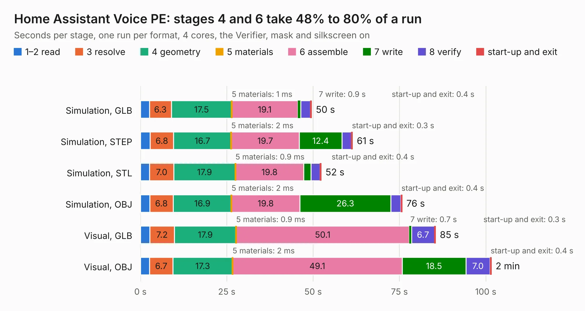

# 941. Home Assistant Voice PE

Board 941 of the 3,111 of [Corpus Testing](../Corpus-Testing.md), on [Corpus Page 9](../CorpusTestingPages/Corpus-Testing-09.md#941-home-assistant-voice-pe).

| Mode and format | 1–2 read | 3 resolve | 4 geometry | 5 materials | 6 assemble | 7 write | 8 verify | start-up and exit | Total |
|---|---:|---:|---:|---:|---:|---:|---:|---:|---:|
| Simulation, GLB | 2.6 | 6.3 | 17.5 | 1&nbsp;ms | 19.1 | 0.9 | 2.8 | 0.4 | 49.6 |
| Simulation, STEP | 2.8 | 6.8 | 16.7 | 2&nbsp;ms | 19.7 | 12.4 | 2.7 | 0.3 | 61.4 |
| Simulation, STL | 2.7 | 7.0 | 17.9 | 0.9&nbsp;ms | 19.8 | 2.1 | 2.7 | 0.4 | 52.4 |
| Simulation, OBJ | 2.7 | 6.8 | 16.9 | 2&nbsp;ms | 19.8 | 26.3 | 2.9 | 0.4 | 75.8 |
| Visual, GLB | 2.7 | 7.2 | 17.9 | 0.9&nbsp;ms | 50.1 | 0.7 | 6.7 | 0.3 | 85.5 |
| Visual, OBJ | 2.7 | 6.7 | 17.3 | 2&nbsp;ms | 49.1 | 18.5 | 7.0 | 0.4 | 101.6 |

<table align="center"><tr><td valign="top">

| Board | Repo: [esphome/home-assistant-voice-pe](https://github.com/esphome/home-assistant-voice-pe) Board: `Home Assistant Voice PE.kicad_pcb` |
|---|---|
| Folder | hardware / KiCad |
| Complexity | 417&nbsp;/&nbsp;1000 (size&nbsp;282, features&nbsp;135) |
| KESE&nbsp;features | through vias, slotted holes, custom pads, rounded, trapezoid or chamfered pads, arc tracks, filled zones, copper drawings, curved board outline, stack-up, dielectric εr and tanδ |
| Tested | 9th November 2026 |
| Copper&nbsp;layers | 4 |
| File&nbsp;format | KiCad 9 (20241229) |
| Parts,&nbsp;tracks,&nbsp;vias | 398, 3,481, 932 |
| Triangles,&nbsp;simulation | 5,197,348 in 277 parts |
| Verifier | PASS in all six runs |

</td><td valign="top">

<table>
<tr><th>File type</th><th>File size</th><th>Peak memory used</th></tr>
<tr><th colspan="3" align="left">Simulation</th></tr>
<tr><td>GLB</td><td align="right">178&nbsp;MB</td><td align="right">1.7&nbsp;GB</td></tr>
<tr><td>STEP</td><td align="right">846&nbsp;MB</td><td align="right">2.0&nbsp;GB</td></tr>
<tr><td>STL</td><td align="right">260&nbsp;MB</td><td align="right">1.7&nbsp;GB</td></tr>
<tr><td>OBJ</td><td align="right">555&nbsp;MB</td><td align="right">3.4&nbsp;GB</td></tr>
<tr><th colspan="3" align="left">Visual</th></tr>
<tr><td>GLB</td><td align="right">123&nbsp;MB</td><td align="right">1.9&nbsp;GB</td></tr>
<tr><td>OBJ</td><td align="right">393&nbsp;MB</td><td align="right">2.6&nbsp;GB</td></tr>
</table>

</td></tr></table>

| Previous | Next |
|:---|---:|
| [940. esp-rust-board](b0940b_esp-rust-board_esp-rust-board.md) | [942. bms](b0942b_ducktop2_bms.md) |
