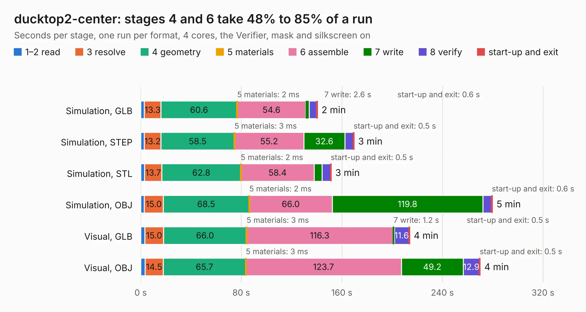

# 942. ducktop2-center

Board 942 of the 3,109 of [Corpus Testing](../Corpus-Testing.md), on [Corpus Page 9](../CorpusTestingPages/Corpus-Testing-09.md#942-ducktop2-center).

| Mode and format | 1–2 read | 3 resolve | 4 geometry | 5 materials | 6 assemble | 7 write | 8 verify | start-up and exit | Total |
|---|---:|---:|---:|---:|---:|---:|---:|---:|---:|
| Simulation, GLB | 2.8 | 13.3 | 60.6 | 2&nbsp;ms | 54.6 | 2.6 | 6.0 | 0.6 | 140.5 |
| Simulation, STEP | 2.9 | 13.2 | 58.5 | 3&nbsp;ms | 55.2 | 32.6 | 6.8 | 0.5 | 169.6 |
| Simulation, STL | 3.1 | 13.7 | 62.8 | 2&nbsp;ms | 58.4 | 6.3 | 6.6 | 0.5 | 151.5 |
| Simulation, OBJ | 2.9 | 15.0 | 68.5 | 2&nbsp;ms | 66.0 | 119.8 | 6.9 | 0.6 | 279.7 |
| Visual, GLB | 3.2 | 15.0 | 66.0 | 3&nbsp;ms | 116.3 | 1.2 | 11.6 | 0.5 | 213.9 |
| Visual, OBJ | 3.4 | 14.5 | 65.7 | 3&nbsp;ms | 123.7 | 49.2 | 12.9 | 0.5 | 270.0 |

<table align="center"><tr><td valign="top">

| Board | Repo: [ewoudvv/ducktop2](https://github.com/ewoudvv/ducktop2) Board: `ducktop2-center.kicad_pcb` |
|---|---|
| Complexity | 481&nbsp;/&nbsp;1000 (size&nbsp;331, features&nbsp;150) |
| KESE&nbsp;features | through vias, slotted holes, custom pads, rounded, trapezoid or chamfered pads, arc tracks, filled zones, copper drawings, curved board outline, stack-up, dielectric εr and tanδ, copper finish |
| Tested | 9th November 2026 |
| Copper&nbsp;layers | 8 |
| File&nbsp;format | KiCad 10 (20260206) |
| Parts,&nbsp;tracks,&nbsp;vias | 840, 5,710, 1,165 |
| Triangles,&nbsp;simulation | 12,421,056 in 703 parts |
| Verifier | PASS in all six runs |

</td><td valign="top">

<table>
<tr><th>File type</th><th>File size</th><th>Peak memory used</th></tr>
<tr><th colspan="3" align="left">Simulation</th></tr>
<tr><td>GLB</td><td align="right">419&nbsp;MB</td><td align="right">2.8&nbsp;GB</td></tr>
<tr><td>STEP</td><td align="right">1.6&nbsp;GB</td><td align="right">4.0&nbsp;GB</td></tr>
<tr><td>STL</td><td align="right">621&nbsp;MB</td><td align="right">2.6&nbsp;GB</td></tr>
<tr><td>OBJ</td><td align="right">1.4&nbsp;GB</td><td align="right">7.9&nbsp;GB</td></tr>
<tr><th colspan="3" align="left">Visual</th></tr>
<tr><td>GLB</td><td align="right">207&nbsp;MB</td><td align="right">3.4&nbsp;GB</td></tr>
<tr><td>OBJ</td><td align="right">682&nbsp;MB</td><td align="right">4.5&nbsp;GB</td></tr>
</table>

</td></tr></table>

| Previous | Next |
|:---|---:|
| [941. bms](b0941b_ducktop2_bms.md) | [943. 12_keyboard_daughterboard](b0943b_ducktop2_12-keyboard-daughterboard.md) |
