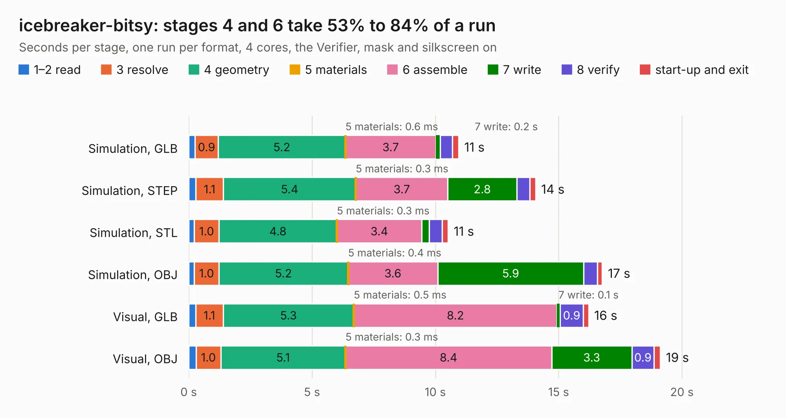

# 942 icebreaker-bitsy

Board 942 of the 3,138 of [Corpus Testing](../Corpus-Testing.md), on [Corpus Page 9](../CorpusTestingPages/Corpus-Testing-09.md#942-icebreaker-bitsy).

| Mode and format | 1–2 read | 3 resolve | 4 geometry | 5 materials | 6 assemble | 7 write | 8 verify | start-up and exit | Total |
|---|---:|---:|---:|---:|---:|---:|---:|---:|---:|
| Simulation, GLB | 0.3 | 0.9 | 5.2 | 0.6&nbsp;ms | 3.7 | 0.2 | 0.5 | 0.3 | 10.9 |
| Simulation, STEP | 0.3 | 1.1 | 5.4 | 0.3&nbsp;ms | 3.7 | 2.8 | 0.5 | 0.2 | 14.1 |
| Simulation, STL | 0.2 | 1.0 | 4.8 | 0.3&nbsp;ms | 3.4 | 0.3 | 0.5 | 0.2 | 10.5 |
| Simulation, OBJ | 0.2 | 1.0 | 5.2 | 0.4&nbsp;ms | 3.6 | 5.9 | 0.6 | 0.2 | 16.8 |
| Visual, GLB | 0.3 | 1.1 | 5.3 | 0.5&nbsp;ms | 8.2 | 0.1 | 0.9 | 0.2 | 16.2 |
| Visual, OBJ | 0.3 | 1.0 | 5.1 | 0.3&nbsp;ms | 8.4 | 3.3 | 0.9 | 0.3 | 19.1 |

<table align="center"><tr><td valign="top">

| Board | Repo: [esden/icebreaker](https://github.com/esden/icebreaker) Board: `icebreaker-bitsy.kicad_pcb` |
|---|---|
| Folder | hardware / bitsy-v1.0a |
| Complexity | 297&nbsp;/&nbsp;1000 (size&nbsp;232, features&nbsp;65) |
| KESE&nbsp;features | through vias, slotted holes, rounded, trapezoid or chamfered pads, filled zones, curved board outline |
| Tested | 9th November 2026 |
| Copper&nbsp;layers | 4 |
| File&nbsp;format | KiCad 5 (20171130) |
| Parts,&nbsp;tracks,&nbsp;vias | 85, 644, 74 |
| Triangles,&nbsp;simulation | 1,107,654 in 85 parts |
| Verifier | PASS in all six runs |

</td><td valign="top">

<table>
<tr><th>File type</th><th>File size</th><th>Peak memory used</th></tr>
<tr><th colspan="3" align="left">Simulation</th></tr>
<tr><td>GLB</td><td align="right">39&nbsp;MB</td><td align="right">420&nbsp;MB</td></tr>
<tr><td>STEP</td><td align="right">181&nbsp;MB</td><td align="right">487&nbsp;MB</td></tr>
<tr><td>STL</td><td align="right">55&nbsp;MB</td><td align="right">395&nbsp;MB</td></tr>
<tr><td>OBJ</td><td align="right">115&nbsp;MB</td><td align="right">776&nbsp;MB</td></tr>
<tr><th colspan="3" align="left">Visual</th></tr>
<tr><td>GLB</td><td align="right">21&nbsp;MB</td><td align="right">495&nbsp;MB</td></tr>
<tr><td>OBJ</td><td align="right">64&nbsp;MB</td><td align="right">547&nbsp;MB</td></tr>
</table>

</td></tr></table>

| Previous | Next |
|:---|---:|
| [941 icebreaker-bitsy](b0941b_icebreaker_hardware-bitsy-v0-3a_icebreaker-bitsy.md) | [943 icebreaker-bitsy](b0943b_icebreaker_hardware-bitsy-v1-1a_icebreaker-bitsy.md) |
