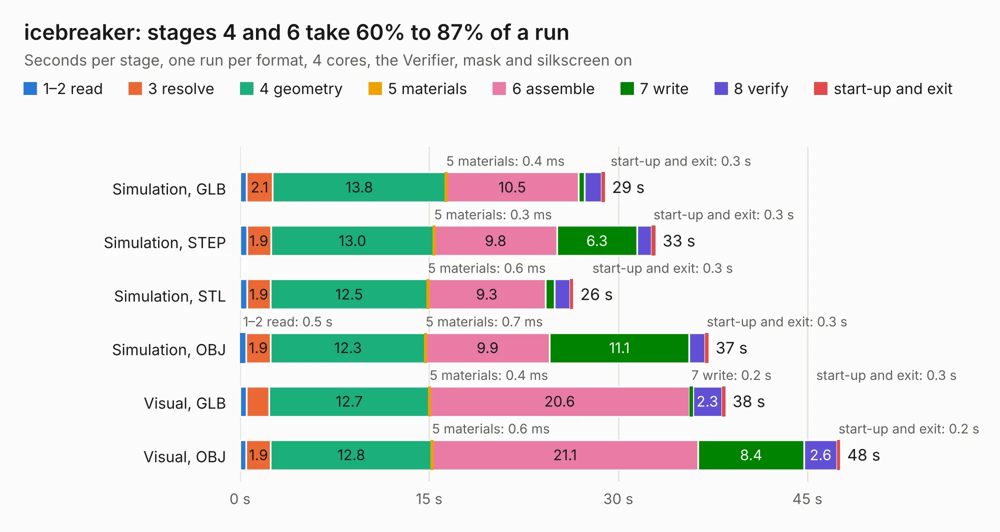

# 943. icebreaker

Board 943 of the 3,126 of [Corpus Testing](../Corpus-Testing.md), on [Corpus Page 9](../CorpusTestingPages/Corpus-Testing-09.md#943-icebreaker).

| Mode and format | 1–2 read | 3 resolve | 4 geometry | 5 materials | 6 assemble | 7 write | 8 verify | start-up and exit | Total |
|---|---:|---:|---:|---:|---:|---:|---:|---:|---:|
| Simulation, GLB | 0.5 | 2.1 | 13.8 | 0.4&nbsp;ms | 10.5 | 0.5 | 1.3 | 0.3 | 28.9 |
| Simulation, STEP | 0.5 | 1.9 | 13.0 | 0.3&nbsp;ms | 9.8 | 6.3 | 1.2 | 0.3 | 33.0 |
| Simulation, STL | 0.5 | 1.9 | 12.5 | 0.6&nbsp;ms | 9.3 | 0.7 | 1.2 | 0.3 | 26.4 |
| Simulation, OBJ | 0.5 | 1.9 | 12.3 | 0.7&nbsp;ms | 9.9 | 11.1 | 1.3 | 0.3 | 37.2 |
| Visual, GLB | 0.5 | 1.8 | 12.7 | 0.4&nbsp;ms | 20.6 | 0.2 | 2.3 | 0.3 | 38.5 |
| Visual, OBJ | 0.5 | 1.9 | 12.8 | 0.6&nbsp;ms | 21.1 | 8.4 | 2.6 | 0.2 | 47.6 |

<table align="center"><tr><td valign="top">

| Board | Repo: [esden/icebreaker](https://github.com/esden/icebreaker) Board: `icebreaker.kicad_pcb` |
|---|---|
| Folder | hardware / v0.2a |
| Complexity | 308&nbsp;/&nbsp;1000 (size&nbsp;253, features&nbsp;55) |
| KESE&nbsp;features | through vias, rounded, trapezoid or chamfered pads, filled zones, curved board outline |
| Tested | 9th November 2026 |
| Copper&nbsp;layers | 4 |
| File&nbsp;format | KiCad 5 (20171130) |
| Parts,&nbsp;tracks,&nbsp;vias | 114, 1,260, 144 |
| Triangles,&nbsp;simulation | 2,325,360 in 138 parts |
| Verifier | PASS in all six runs |

</td><td valign="top">

<table>
<tr><th>File type</th><th>File size</th><th>Peak memory used</th></tr>
<tr><th colspan="3" align="left">Simulation</th></tr>
<tr><td>GLB</td><td align="right">81&nbsp;MB</td><td align="right">857&nbsp;MB</td></tr>
<tr><td>STEP</td><td align="right">420&nbsp;MB</td><td align="right">942&nbsp;MB</td></tr>
<tr><td>STL</td><td align="right">116&nbsp;MB</td><td align="right">907&nbsp;MB</td></tr>
<tr><td>OBJ</td><td align="right">248&nbsp;MB</td><td align="right">1.6&nbsp;GB</td></tr>
<tr><th colspan="3" align="left">Visual</th></tr>
<tr><td>GLB</td><td align="right">53&nbsp;MB</td><td align="right">947&nbsp;MB</td></tr>
<tr><td>OBJ</td><td align="right">164&nbsp;MB</td><td align="right">1.1&nbsp;GB</td></tr>
</table>

</td></tr></table>

| Previous | Next |
|:---|---:|
| [942. icebreaker](b0942b_icebreaker_hardware-v0-1a_icebreaker.md) | [944. icebreaker](b0944b_icebreaker_hardware-v1-0a_icebreaker.md) |
