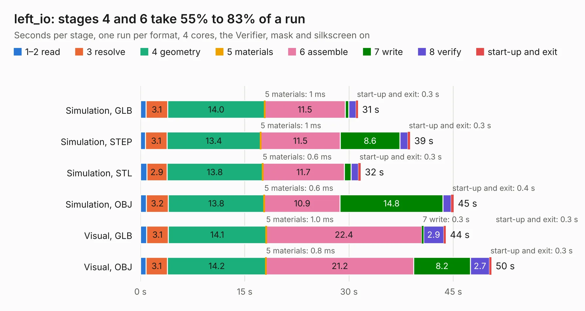

# 944. left_io

Board 944 of the 3,107 of [Corpus Testing](../Corpus-Testing.md), on [Corpus Page 9](../CorpusTestingPages/Corpus-Testing-09.md#944-left_io).

| Mode and format | 1–2 read | 3 resolve | 4 geometry | 5 materials | 6 assemble | 7 write | 8 verify | start-up and exit | Total |
|---|---:|---:|---:|---:|---:|---:|---:|---:|---:|
| Simulation, GLB | 0.8 | 3.1 | 14.0 | 1&nbsp;ms | 11.5 | 0.5 | 1.1 | 0.3 | 31.3 |
| Simulation, STEP | 0.7 | 3.1 | 13.4 | 1&nbsp;ms | 11.5 | 8.6 | 1.1 | 0.3 | 38.8 |
| Simulation, STL | 0.9 | 2.9 | 13.8 | 0.6&nbsp;ms | 11.7 | 1.0 | 1.1 | 0.3 | 31.7 |
| Simulation, OBJ | 0.9 | 3.2 | 13.8 | 0.6&nbsp;ms | 10.9 | 14.8 | 1.2 | 0.4 | 45.1 |
| Visual, GLB | 0.9 | 3.1 | 14.1 | 1.0&nbsp;ms | 22.4 | 0.3 | 2.9 | 0.3 | 43.9 |
| Visual, OBJ | 0.8 | 3.1 | 14.2 | 0.8&nbsp;ms | 21.2 | 8.2 | 2.7 | 0.3 | 50.5 |

<table align="center"><tr><td valign="top">

| Board | Repo: [ewoudvv/ducktop2](https://github.com/ewoudvv/ducktop2) Board: `left_io.kicad_pcb` |
|---|---|
| Folder | left_io |
| Complexity | 388&nbsp;/&nbsp;1000 (size&nbsp;263, features&nbsp;125) |
| KESE&nbsp;features | through vias, slotted holes, custom pads, rounded, trapezoid or chamfered pads, filled zones, copper drawings, stack-up, dielectric εr and tanδ, copper finish |
| Tested | 9th November 2026 |
| Copper&nbsp;layers | 8 |
| File&nbsp;format | KiCad 10 (20260206) |
| Parts,&nbsp;tracks,&nbsp;vias | 328, 181, 38 |
| Triangles,&nbsp;simulation | 3,133,228 in 238 parts |
| Verifier | PASS in all six runs |

</td><td valign="top">

<table>
<tr><th>File type</th><th>File size</th><th>Peak memory used</th></tr>
<tr><th colspan="3" align="left">Simulation</th></tr>
<tr><td>GLB</td><td align="right">108&nbsp;MB</td><td align="right">930&nbsp;MB</td></tr>
<tr><td>STEP</td><td align="right">542&nbsp;MB</td><td align="right">1.3&nbsp;GB</td></tr>
<tr><td>STL</td><td align="right">157&nbsp;MB</td><td align="right">994&nbsp;MB</td></tr>
<tr><td>OBJ</td><td align="right">337&nbsp;MB</td><td align="right">2.2&nbsp;GB</td></tr>
<tr><th colspan="3" align="left">Visual</th></tr>
<tr><td>GLB</td><td align="right">56&nbsp;MB</td><td align="right">1.1&nbsp;GB</td></tr>
<tr><td>OBJ</td><td align="right">175&nbsp;MB</td><td align="right">1.3&nbsp;GB</td></tr>
</table>

</td></tr></table>

| Previous | Next |
|:---|---:|
| [943. 12_keyboard_daughterboard](b0943b_ducktop2_12-keyboard-daughterboard.md) | [945. radio_daughterboard](b0945b_ducktop2_radio-daughterboard.md) |
