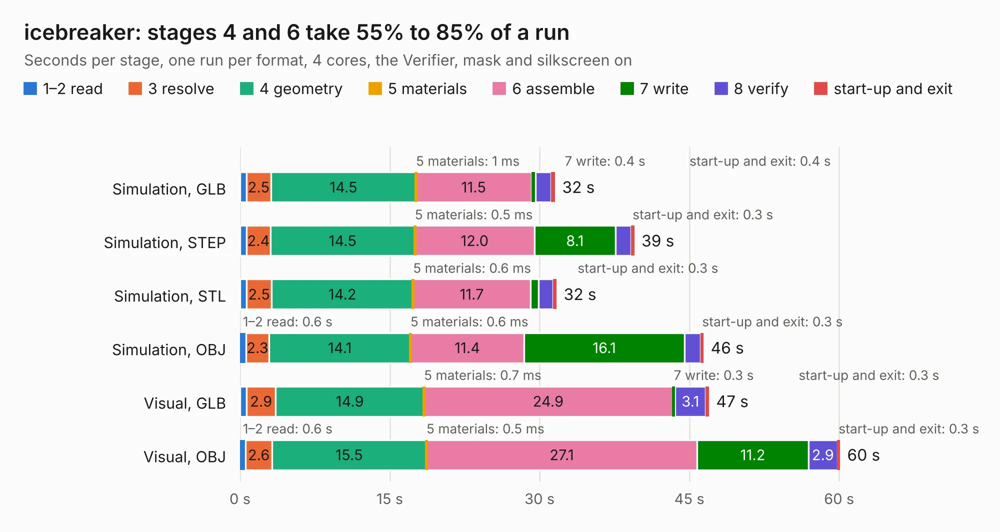

# 946. icebreaker

Board 946 of the 3,139 of [Corpus Testing](../Corpus-Testing.md), on [Corpus Page 9](../CorpusTestingPages/Corpus-Testing-09.md#946-icebreaker).

| Mode and format | 1–2 read | 3 resolve | 4 geometry | 5 materials | 6 assemble | 7 write | 8 verify | start-up and exit | Total |
|---|---:|---:|---:|---:|---:|---:|---:|---:|---:|
| Simulation, GLB | 0.6 | 2.5 | 14.5 | 1&nbsp;ms | 11.5 | 0.4 | 1.6 | 0.4 | 31.5 |
| Simulation, STEP | 0.7 | 2.4 | 14.5 | 0.5&nbsp;ms | 12.0 | 8.1 | 1.5 | 0.3 | 39.5 |
| Simulation, STL | 0.7 | 2.5 | 14.2 | 0.6&nbsp;ms | 11.7 | 0.8 | 1.4 | 0.3 | 31.7 |
| Simulation, OBJ | 0.6 | 2.3 | 14.1 | 0.6&nbsp;ms | 11.4 | 16.1 | 1.6 | 0.3 | 46.4 |
| Visual, GLB | 0.7 | 2.9 | 14.9 | 0.7&nbsp;ms | 24.9 | 0.3 | 3.1 | 0.3 | 47.0 |
| Visual, OBJ | 0.6 | 2.6 | 15.5 | 0.5&nbsp;ms | 27.1 | 11.2 | 2.9 | 0.3 | 60.1 |

<table align="center"><tr><td valign="top">

| Board | Repo: [esden/icebreaker](https://github.com/esden/icebreaker) Board: `icebreaker.kicad_pcb` |
|---|---|
| Folder | hardware / v1.0a |
| Complexity | 309&nbsp;/&nbsp;1000 (size&nbsp;254, features&nbsp;55) |
| KESE&nbsp;features | through vias, rounded, trapezoid or chamfered pads, filled zones, curved board outline |
| Tested | 9th November 2026 |
| Copper&nbsp;layers | 4 |
| File&nbsp;format | KiCad 5 (20171130) |
| Parts,&nbsp;tracks,&nbsp;vias | 117, 1,319, 148 |
| Triangles,&nbsp;simulation | 2,403,204 in 147 parts |
| Verifier | PASS in all six runs |

</td><td valign="top">

<table>
<tr><th>File type</th><th>File size</th><th>Peak memory used</th></tr>
<tr><th colspan="3" align="left">Simulation</th></tr>
<tr><td>GLB</td><td align="right">84&nbsp;MB</td><td align="right">892&nbsp;MB</td></tr>
<tr><td>STEP</td><td align="right">436&nbsp;MB</td><td align="right">991&nbsp;MB</td></tr>
<tr><td>STL</td><td align="right">120&nbsp;MB</td><td align="right">908&nbsp;MB</td></tr>
<tr><td>OBJ</td><td align="right">256&nbsp;MB</td><td align="right">1.6&nbsp;GB</td></tr>
<tr><th colspan="3" align="left">Visual</th></tr>
<tr><td>GLB</td><td align="right">56&nbsp;MB</td><td align="right">967&nbsp;MB</td></tr>
<tr><td>OBJ</td><td align="right">171&nbsp;MB</td><td align="right">1.2&nbsp;GB</td></tr>
</table>

</td></tr></table>

| Previous | Next |
|:---|---:|
| [945. icebreaker](b0945b_icebreaker_hardware-v0-2a_icebreaker.md) | [947. icebreaker](b0947b_icebreaker_hardware-v1-0b_icebreaker.md) |
