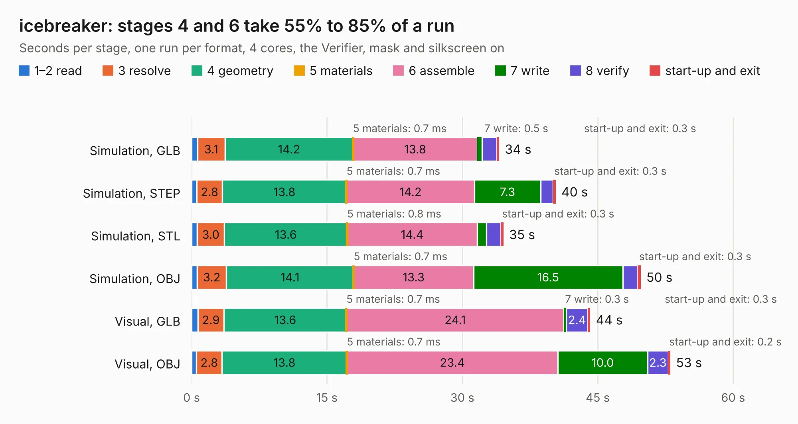

# 948. icebreaker

Board 948 of the 3,138 of [Corpus Testing](../Corpus-Testing.md), on [Corpus Page 9](../CorpusTestingPages/Corpus-Testing-09.md#948-icebreaker).

| Mode and format | 1–2 read | 3 resolve | 4 geometry | 5 materials | 6 assemble | 7 write | 8 verify | start-up and exit | Total |
|---|---:|---:|---:|---:|---:|---:|---:|---:|---:|
| Simulation, GLB | 0.6 | 3.1 | 14.2 | 0.7&nbsp;ms | 13.8 | 0.5 | 1.7 | 0.3 | 34.1 |
| Simulation, STEP | 0.6 | 2.8 | 13.8 | 0.7&nbsp;ms | 14.2 | 7.3 | 1.4 | 0.3 | 40.3 |
| Simulation, STL | 0.6 | 3.0 | 13.6 | 0.8&nbsp;ms | 14.4 | 1.0 | 1.6 | 0.3 | 34.6 |
| Simulation, OBJ | 0.6 | 3.2 | 14.1 | 0.7&nbsp;ms | 13.3 | 16.5 | 1.6 | 0.3 | 49.8 |
| Visual, GLB | 0.7 | 2.9 | 13.6 | 0.7&nbsp;ms | 24.1 | 0.3 | 2.4 | 0.3 | 44.2 |
| Visual, OBJ | 0.5 | 2.8 | 13.8 | 0.7&nbsp;ms | 23.4 | 10.0 | 2.3 | 0.2 | 53.0 |

<table align="center"><tr><td valign="top">

| Board | Repo: [esden/icebreaker](https://github.com/esden/icebreaker) Board: `icebreaker.kicad_pcb` |
|---|---|
| Folder | hardware / v1.0c |
| Complexity | 311&nbsp;/&nbsp;1000 (size&nbsp;256, features&nbsp;55) |
| KESE&nbsp;features | through vias, rounded, trapezoid or chamfered pads, filled zones, curved board outline |
| Tested | 9th November 2026 |
| Copper&nbsp;layers | 4 |
| File&nbsp;format | KiCad 5 (20171130) |
| Parts,&nbsp;tracks,&nbsp;vias | 128, 1,403, 157 |
| Triangles,&nbsp;simulation | 2,762,312 in 163 parts |
| Verifier | PASS in all six runs |

</td><td valign="top">

<table>
<tr><th>File type</th><th>File size</th><th>Peak memory used</th></tr>
<tr><th colspan="3" align="left">Simulation</th></tr>
<tr><td>GLB</td><td align="right">96&nbsp;MB</td><td align="right">868&nbsp;MB</td></tr>
<tr><td>STEP</td><td align="right">491&nbsp;MB</td><td align="right">1.1&nbsp;GB</td></tr>
<tr><td>STL</td><td align="right">138&nbsp;MB</td><td align="right">870&nbsp;MB</td></tr>
<tr><td>OBJ</td><td align="right">295&nbsp;MB</td><td align="right">1.8&nbsp;GB</td></tr>
<tr><th colspan="3" align="left">Visual</th></tr>
<tr><td>GLB</td><td align="right">63&nbsp;MB</td><td align="right">1.1&nbsp;GB</td></tr>
<tr><td>OBJ</td><td align="right">195&nbsp;MB</td><td align="right">1.4&nbsp;GB</td></tr>
</table>

</td></tr></table>

| Previous | Next |
|:---|---:|
| [947. icebreaker](b0947b_icebreaker_hardware-v1-0b_icebreaker.md) | [949. icebreaker](b0949b_icebreaker_hardware-v1-0d_icebreaker.md) |
