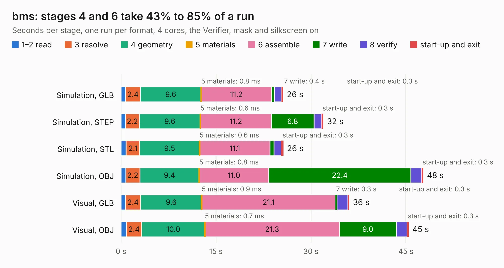

# 951. bms

Board 951 of the 3,123 of [Corpus Testing](../Corpus-Testing.md), on [Corpus Page 9](../CorpusTestingPages/Corpus-Testing-09.md#951-bms).

| Mode and format | 1–2 read | 3 resolve | 4 geometry | 5 materials | 6 assemble | 7 write | 8 verify | start-up and exit | Total |
|---|---:|---:|---:|---:|---:|---:|---:|---:|---:|
| Simulation, GLB | 0.7 | 2.4 | 9.6 | 0.8&nbsp;ms | 11.2 | 0.4 | 1.1 | 0.3 | 25.6 |
| Simulation, STEP | 0.7 | 2.2 | 9.6 | 0.6&nbsp;ms | 11.2 | 6.8 | 1.2 | 0.3 | 32.0 |
| Simulation, STL | 0.8 | 2.1 | 9.5 | 0.6&nbsp;ms | 11.1 | 0.6 | 1.2 | 0.3 | 25.7 |
| Simulation, OBJ | 0.7 | 2.2 | 9.4 | 0.8&nbsp;ms | 11.0 | 22.4 | 1.7 | 0.3 | 47.8 |
| Visual, GLB | 0.7 | 2.4 | 9.6 | 0.9&nbsp;ms | 21.1 | 0.3 | 1.7 | 0.3 | 36.1 |
| Visual, OBJ | 0.9 | 2.4 | 10.0 | 0.7&nbsp;ms | 21.3 | 9.0 | 1.7 | 0.3 | 45.4 |

<table align="center"><tr><td valign="top">

| Board | Repo: [ewoudvv/ducktop2](https://github.com/ewoudvv/ducktop2) Board: `bms.kicad_pcb` |
|---|---|
| Folder | bms |
| Complexity | 392&nbsp;/&nbsp;1000 (size&nbsp;267, features&nbsp;125) |
| KESE&nbsp;features | through vias, custom pads, rounded, trapezoid or chamfered pads, filled zones, copper drawings, curved board outline, stack-up, dielectric εr and tanδ, copper finish |
| Tested | 9th November 2026 |
| Copper&nbsp;layers | 4 |
| File&nbsp;format | KiCad 10 (20260206) |
| Parts,&nbsp;tracks,&nbsp;vias | 171, 2,100, 280 |
| Triangles,&nbsp;simulation | 2,326,810 in 113 parts |
| Verifier | PASS in all six runs |

</td><td valign="top">

<table>
<tr><th>File type</th><th>File size</th><th>Peak memory used</th></tr>
<tr><th colspan="3" align="left">Simulation</th></tr>
<tr><td>GLB</td><td align="right">81&nbsp;MB</td><td align="right">787&nbsp;MB</td></tr>
<tr><td>STEP</td><td align="right">424&nbsp;MB</td><td align="right">997&nbsp;MB</td></tr>
<tr><td>STL</td><td align="right">116&nbsp;MB</td><td align="right">743&nbsp;MB</td></tr>
<tr><td>OBJ</td><td align="right">250&nbsp;MB</td><td align="right">1.6&nbsp;GB</td></tr>
<tr><th colspan="3" align="left">Visual</th></tr>
<tr><td>GLB</td><td align="right">51&nbsp;MB</td><td align="right">1.1&nbsp;GB</td></tr>
<tr><td>OBJ</td><td align="right">160&nbsp;MB</td><td align="right">1.1&nbsp;GB</td></tr>
</table>

</td></tr></table>

| Previous | Next |
|:---|---:|
| [950. Home Assistant Voice PE](b0950b_home-assistant-voice-pe_Home-Assistant-Voice-PE.md) | [952. ducktop2-center](b0952b_ducktop2_ducktop2-center.md) |
