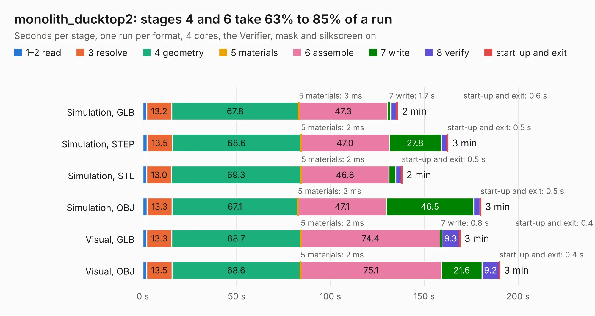

# 952. monolith_ducktop2

Board 952 of the 3,117 of [Corpus Testing](../Corpus-Testing.md), on [Corpus Page 9](../CorpusTestingPages/Corpus-Testing-09.md#952-monolith_ducktop2).

| Mode and format | 1–2 read | 3 resolve | 4 geometry | 5 materials | 6 assemble | 7 write | 8 verify | start-up and exit | Total |
|---|---:|---:|---:|---:|---:|---:|---:|---:|---:|
| Simulation, GLB | 2.1 | 13.2 | 67.8 | 3&nbsp;ms | 47.3 | 1.7 | 3.2 | 0.6 | 135.9 |
| Simulation, STEP | 2.2 | 13.5 | 68.6 | 2&nbsp;ms | 47.0 | 27.8 | 3.2 | 0.5 | 162.7 |
| Simulation, STL | 2.1 | 13.0 | 69.3 | 2&nbsp;ms | 46.8 | 3.5 | 3.0 | 0.5 | 138.3 |
| Simulation, OBJ | 2.2 | 13.3 | 67.1 | 3&nbsp;ms | 47.1 | 46.5 | 3.4 | 0.5 | 180.3 |
| Visual, GLB | 2.1 | 13.3 | 68.7 | 2&nbsp;ms | 74.4 | 0.8 | 9.3 | 0.4 | 169.1 |
| Visual, OBJ | 2.0 | 13.5 | 68.6 | 2&nbsp;ms | 75.1 | 21.6 | 9.2 | 0.4 | 190.3 |

<table align="center"><tr><td valign="top">

| Board | Repo: [ewoudvv/ducktop2](https://github.com/ewoudvv/ducktop2) Board: `monolith_ducktop2.kicad_pcb` |
|---|---|
| Folder | reference / monolith |
| Complexity | 420&nbsp;/&nbsp;1000 (size&nbsp;295, features&nbsp;125) |
| KESE&nbsp;features | through vias, slotted holes, custom pads, rounded, trapezoid or chamfered pads, filled zones, copper drawings, stack-up, dielectric εr and tanδ, copper finish |
| Tested | 9th November 2026 |
| Copper&nbsp;layers | 8 |
| File&nbsp;format | KiCad 10 (20260206) |
| Parts,&nbsp;tracks,&nbsp;vias | 1,193, 254, 70 |
| Triangles,&nbsp;simulation | 9,070,318 in 930 parts |
| Note | mostly unrouted |
| Verifier | PASS in all six runs |

</td><td valign="top">

<table>
<tr><th>File type</th><th>File size</th><th>Peak memory used</th></tr>
<tr><th colspan="3" align="left">Simulation</th></tr>
<tr><td>GLB</td><td align="right">307&nbsp;MB</td><td align="right">2.6&nbsp;GB</td></tr>
<tr><td>STEP</td><td align="right">1.6&nbsp;GB</td><td align="right">3.9&nbsp;GB</td></tr>
<tr><td>STL</td><td align="right">454&nbsp;MB</td><td align="right">2.6&nbsp;GB</td></tr>
<tr><td>OBJ</td><td align="right">981&nbsp;MB</td><td align="right">6.0&nbsp;GB</td></tr>
<tr><th colspan="3" align="left">Visual</th></tr>
<tr><td>GLB</td><td align="right">165&nbsp;MB</td><td align="right">3.3&nbsp;GB</td></tr>
<tr><td>OBJ</td><td align="right">523&nbsp;MB</td><td align="right">3.4&nbsp;GB</td></tr>
</table>

</td></tr></table>

| Previous | Next |
|:---|---:|
| [951. radio_daughterboard](b0951b_ducktop2_radio-daughterboard.md) | [953. right_io](b0953b_ducktop2_right-io.md) |
