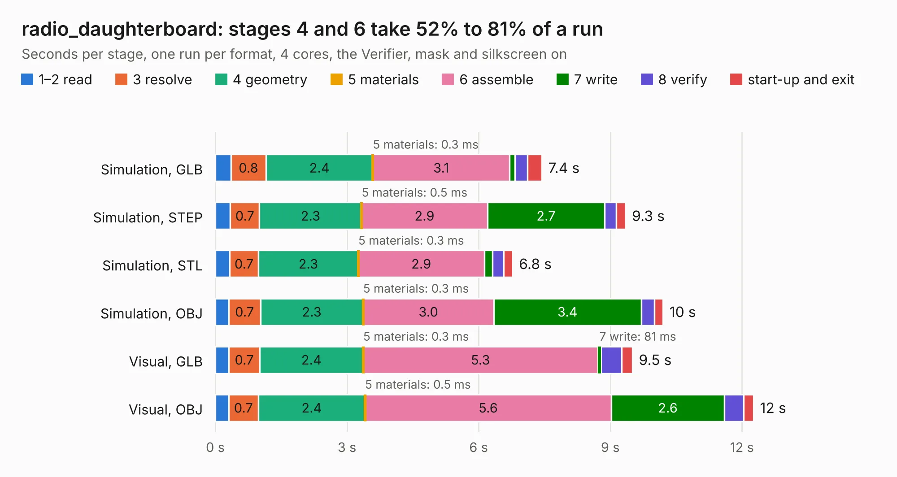

# 952. radio_daughterboard

Board 952 of the 3,118 of [Corpus Testing](../Corpus-Testing.md), on [Corpus Page 9](../CorpusTestingPages/Corpus-Testing-09.md#952-radio_daughterboard).

| Mode and format | 1–2 read | 3 resolve | 4 geometry | 5 materials | 6 assemble | 7 write | 8 verify | start-up and exit | Total |
|---|---:|---:|---:|---:|---:|---:|---:|---:|---:|
| Simulation, GLB | 0.4 | 0.8 | 2.4 | 0.3&nbsp;ms | 3.1 | 0.1 | 0.3 | 0.3 | 7.4 |
| Simulation, STEP | 0.3 | 0.7 | 2.3 | 0.5&nbsp;ms | 2.9 | 2.7 | 0.3 | 0.2 | 9.3 |
| Simulation, STL | 0.3 | 0.7 | 2.3 | 0.3&nbsp;ms | 2.9 | 0.2 | 0.3 | 0.2 | 6.8 |
| Simulation, OBJ | 0.3 | 0.7 | 2.3 | 0.3&nbsp;ms | 3.0 | 3.4 | 0.3 | 0.2 | 10.2 |
| Visual, GLB | 0.3 | 0.7 | 2.4 | 0.3&nbsp;ms | 5.3 | 81&nbsp;ms | 0.5 | 0.2 | 9.5 |
| Visual, OBJ | 0.3 | 0.7 | 2.4 | 0.5&nbsp;ms | 5.6 | 2.6 | 0.4 | 0.2 | 12.3 |

<table align="center"><tr><td valign="top">

| Board | Repo: [ewoudvv/ducktop2](https://github.com/ewoudvv/ducktop2) Board: `radio_daughterboard.kicad_pcb` |
|---|---|
| Folder | radio_daughterboard |
| Complexity | 142&nbsp;/&nbsp;1000 (size&nbsp;132, features&nbsp;10) |
| KESE&nbsp;features | rounded, trapezoid or chamfered pads |
| Tested | 9th November 2026 |
| Copper&nbsp;layers | 4 |
| File&nbsp;format | KiCad 10 (20260206) |
| Parts,&nbsp;tracks,&nbsp;vias | 122, 0, 0 |
| Triangles,&nbsp;simulation | 661,740 in 109 parts |
| Note | mostly unrouted |
| Verifier | PASS in all six runs |

</td><td valign="top">

<table>
<tr><th>File type</th><th>File size</th><th>Peak memory used</th></tr>
<tr><th colspan="3" align="left">Simulation</th></tr>
<tr><td>GLB</td><td align="right">22&nbsp;MB</td><td align="right">395&nbsp;MB</td></tr>
<tr><td>STEP</td><td align="right">115&nbsp;MB</td><td align="right">481&nbsp;MB</td></tr>
<tr><td>STL</td><td align="right">33&nbsp;MB</td><td align="right">420&nbsp;MB</td></tr>
<tr><td>OBJ</td><td align="right">67&nbsp;MB</td><td align="right">462&nbsp;MB</td></tr>
<tr><th colspan="3" align="left">Visual</th></tr>
<tr><td>GLB</td><td align="right">18&nbsp;MB</td><td align="right">500&nbsp;MB</td></tr>
<tr><td>OBJ</td><td align="right">53&nbsp;MB</td><td align="right">487&nbsp;MB</td></tr>
</table>

</td></tr></table>

| Previous | Next |
|:---|---:|
| [951. left_io](b0951b_ducktop2_left-io.md) | [953. monolith_ducktop2](b0953b_ducktop2_monolith-ducktop2.md) |
