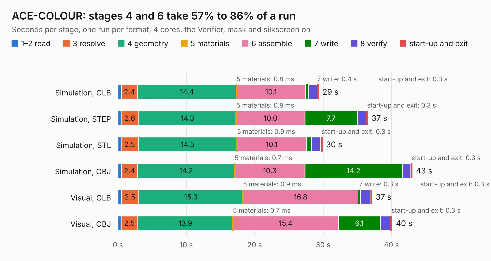

# 953. ACE-COLOUR

Board 953 of the 3,116 of [Corpus Testing](../Corpus-Testing.md), on [Corpus Page 9](../CorpusTestingPages/Corpus-Testing-09.md#953-ace-colour).

| Mode and format | 1–2 read | 3 resolve | 4 geometry | 5 materials | 6 assemble | 7 write | 8 verify | start-up and exit | Total |
|---|---:|---:|---:|---:|---:|---:|---:|---:|---:|
| Simulation, GLB | 0.5 | 2.4 | 14.4 | 0.8&nbsp;ms | 10.1 | 0.4 | 1.2 | 0.3 | 29.4 |
| Simulation, STEP | 0.5 | 2.6 | 14.3 | 0.8&nbsp;ms | 10.0 | 7.7 | 1.3 | 0.3 | 36.6 |
| Simulation, STL | 0.5 | 2.5 | 14.5 | 0.9&nbsp;ms | 10.1 | 0.8 | 1.3 | 0.3 | 29.9 |
| Simulation, OBJ | 0.5 | 2.4 | 14.2 | 0.7&nbsp;ms | 10.3 | 14.2 | 1.2 | 0.3 | 43.1 |
| Visual, GLB | 0.5 | 2.5 | 15.3 | 0.9&nbsp;ms | 16.8 | 0.3 | 1.5 | 0.3 | 37.2 |
| Visual, OBJ | 0.5 | 2.5 | 13.9 | 0.7&nbsp;ms | 15.4 | 6.1 | 1.5 | 0.3 | 40.1 |

<table align="center"><tr><td valign="top">

| Board | Repo: [flypie/Ace-2019](https://github.com/flypie/Ace-2019) Board: `ACE-COLOUR.kicad_pcb` |
|---|---|
| Folder | KiCad / ACE-COLOUR |
| Complexity | 210&nbsp;/&nbsp;1000 (size&nbsp;185, features&nbsp;25) |
| KESE&nbsp;features | through vias, slotted holes |
| Tested | 9th November 2026 |
| Copper&nbsp;layers | 2 |
| File&nbsp;format | KiCad 6 (20211014) |
| Parts,&nbsp;tracks,&nbsp;vias | 95, 1,389, 13 |
| Triangles,&nbsp;simulation | 2,408,720 in 137 parts |
| Verifier | PASS in all six runs |

</td><td valign="top">

<table>
<tr><th>File type</th><th>File size</th><th>Peak memory used</th></tr>
<tr><th colspan="3" align="left">Simulation</th></tr>
<tr><td>GLB</td><td align="right">83&nbsp;MB</td><td align="right">852&nbsp;MB</td></tr>
<tr><td>STEP</td><td align="right">408&nbsp;MB</td><td align="right">977&nbsp;MB</td></tr>
<tr><td>STL</td><td align="right">120&nbsp;MB</td><td align="right">859&nbsp;MB</td></tr>
<tr><td>OBJ</td><td align="right">256&nbsp;MB</td><td align="right">1.6&nbsp;GB</td></tr>
<tr><th colspan="3" align="left">Visual</th></tr>
<tr><td>GLB</td><td align="right">41&nbsp;MB</td><td align="right">957&nbsp;MB</td></tr>
<tr><td>OBJ</td><td align="right">124&nbsp;MB</td><td align="right">949&nbsp;MB</td></tr>
</table>

</td></tr></table>

| Previous | Next |
|:---|---:|
| [952. right_io](b0952b_ducktop2_right-io.md) | [954. ACE-COLOUR2](b0954b_Ace-2019_ACE-COLOUR2.md) |
