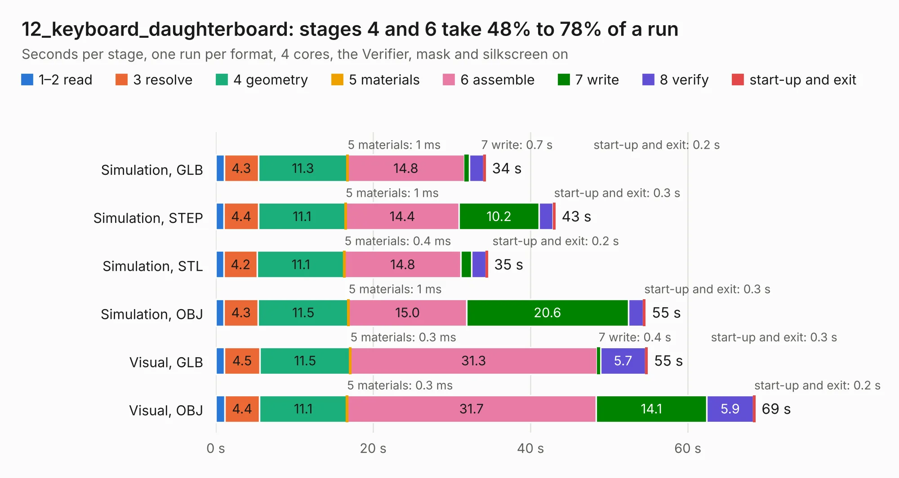

# 955. 12_keyboard_daughterboard

Board 955 of the 3,138 of [Corpus Testing](../Corpus-Testing.md), on [Corpus Page 9](../CorpusTestingPages/Corpus-Testing-09.md#955-12_keyboard_daughterboard).

| Mode and format | 1–2 read | 3 resolve | 4 geometry | 5 materials | 6 assemble | 7 write | 8 verify | start-up and exit | Total |
|---|---:|---:|---:|---:|---:|---:|---:|---:|---:|
| Simulation, GLB | 1.1 | 4.3 | 11.3 | 1&nbsp;ms | 14.8 | 0.7 | 1.8 | 0.2 | 34.3 |
| Simulation, STEP | 1.0 | 4.4 | 11.1 | 1&nbsp;ms | 14.4 | 10.2 | 1.8 | 0.3 | 43.1 |
| Simulation, STL | 1.0 | 4.2 | 11.1 | 0.4&nbsp;ms | 14.8 | 1.3 | 1.8 | 0.2 | 34.6 |
| Simulation, OBJ | 1.0 | 4.3 | 11.5 | 1&nbsp;ms | 15.0 | 20.6 | 1.9 | 0.3 | 54.6 |
| Visual, GLB | 1.1 | 4.5 | 11.5 | 0.3&nbsp;ms | 31.3 | 0.4 | 5.7 | 0.3 | 54.9 |
| Visual, OBJ | 1.1 | 4.4 | 11.1 | 0.3&nbsp;ms | 31.7 | 14.1 | 5.9 | 0.2 | 68.6 |

<table align="center"><tr><td valign="top">

| Board | Repo: [ewoudvv/ducktop2](https://github.com/ewoudvv/ducktop2) Board: `12_keyboard_daughterboard.kicad_pcb` |
|---|---|
| Folder | keyboard |
| Complexity | 319&nbsp;/&nbsp;1000 (size&nbsp;274, features&nbsp;45) |
| KESE&nbsp;features | through vias, rounded, trapezoid or chamfered pads, filled zones |
| Tested | 9th November 2026 |
| Copper&nbsp;layers | 4 |
| File&nbsp;format | KiCad 10 (20260206) |
| Parts,&nbsp;tracks,&nbsp;vias | 215, 3,335, 830 |
| Triangles,&nbsp;simulation | 4,762,772 in 147 parts |
| Verifier | PASS in all six runs |

</td><td valign="top">

<table>
<tr><th>File type</th><th>File size</th><th>Peak memory used</th></tr>
<tr><th colspan="3" align="left">Simulation</th></tr>
<tr><td>GLB</td><td align="right">165&nbsp;MB</td><td align="right">1.4&nbsp;GB</td></tr>
<tr><td>STEP</td><td align="right">659&nbsp;MB</td><td align="right">2.0&nbsp;GB</td></tr>
<tr><td>STL</td><td align="right">238&nbsp;MB</td><td align="right">1.5&nbsp;GB</td></tr>
<tr><td>OBJ</td><td align="right">517&nbsp;MB</td><td align="right">3.2&nbsp;GB</td></tr>
<tr><th colspan="3" align="left">Visual</th></tr>
<tr><td>GLB</td><td align="right">109&nbsp;MB</td><td align="right">1.8&nbsp;GB</td></tr>
<tr><td>OBJ</td><td align="right">342&nbsp;MB</td><td align="right">2.3&nbsp;GB</td></tr>
</table>

</td></tr></table>

| Previous | Next |
|:---|---:|
| [954. ducktop2-center](b0954b_ducktop2_ducktop2-center.md) | [956. left_io](b0956b_ducktop2_left-io.md) |
