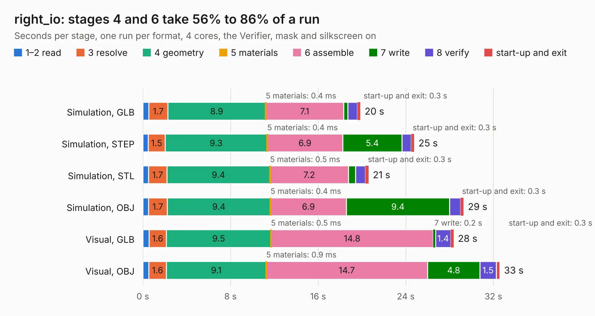

# 956. right_io

Board 956 of the 3,122 of [Corpus Testing](../Corpus-Testing.md), on [Corpus Page 9](../CorpusTestingPages/Corpus-Testing-09.md#956-right_io).

| Mode and format | 1–2 read | 3 resolve | 4 geometry | 5 materials | 6 assemble | 7 write | 8 verify | start-up and exit | Total |
|---|---:|---:|---:|---:|---:|---:|---:|---:|---:|
| Simulation, GLB | 0.6 | 1.7 | 8.9 | 0.4&nbsp;ms | 7.1 | 0.4 | 0.9 | 0.3 | 19.9 |
| Simulation, STEP | 0.5 | 1.5 | 9.3 | 0.4&nbsp;ms | 6.9 | 5.4 | 0.9 | 0.3 | 24.8 |
| Simulation, STL | 0.5 | 1.7 | 9.4 | 0.5&nbsp;ms | 7.2 | 0.7 | 0.9 | 0.3 | 20.6 |
| Simulation, OBJ | 0.5 | 1.7 | 9.4 | 0.4&nbsp;ms | 6.9 | 9.4 | 1.0 | 0.3 | 29.3 |
| Visual, GLB | 0.6 | 1.6 | 9.5 | 0.5&nbsp;ms | 14.8 | 0.2 | 1.4 | 0.3 | 28.4 |
| Visual, OBJ | 0.6 | 1.6 | 9.1 | 0.9&nbsp;ms | 14.7 | 4.8 | 1.5 | 0.3 | 32.6 |

<table align="center"><tr><td valign="top">

| Board | Repo: [ewoudvv/ducktop2](https://github.com/ewoudvv/ducktop2) Board: `right_io.kicad_pcb` |
|---|---|
| Folder | right_io |
| Complexity | 382&nbsp;/&nbsp;1000 (size&nbsp;257, features&nbsp;125) |
| KESE&nbsp;features | through vias, slotted holes, custom pads, rounded, trapezoid or chamfered pads, filled zones, copper drawings, stack-up, dielectric εr and tanδ, copper finish |
| Tested | 9th November 2026 |
| Copper&nbsp;layers | 8 |
| File&nbsp;format | KiCad 10 (20260206) |
| Parts,&nbsp;tracks,&nbsp;vias | 169, 295, 57 |
| Triangles,&nbsp;simulation | 1,901,546 in 146 parts |
| Verifier | PASS in all six runs |

</td><td valign="top">

<table>
<tr><th>File type</th><th>File size</th><th>Peak memory used</th></tr>
<tr><th colspan="3" align="left">Simulation</th></tr>
<tr><td>GLB</td><td align="right">66&nbsp;MB</td><td align="right">779&nbsp;MB</td></tr>
<tr><td>STEP</td><td align="right">334&nbsp;MB</td><td align="right">839&nbsp;MB</td></tr>
<tr><td>STL</td><td align="right">95&nbsp;MB</td><td align="right">763&nbsp;MB</td></tr>
<tr><td>OBJ</td><td align="right">202&nbsp;MB</td><td align="right">1.3&nbsp;GB</td></tr>
<tr><th colspan="3" align="left">Visual</th></tr>
<tr><td>GLB</td><td align="right">37&nbsp;MB</td><td align="right">835&nbsp;MB</td></tr>
<tr><td>OBJ</td><td align="right">111&nbsp;MB</td><td align="right">852&nbsp;MB</td></tr>
</table>

</td></tr></table>

| Previous | Next |
|:---|---:|
| [955. monolith_ducktop2](b0955b_ducktop2_monolith-ducktop2.md) | [957. ACE-COLOUR](b0957b_Ace-2019_ACE-COLOUR.md) |
