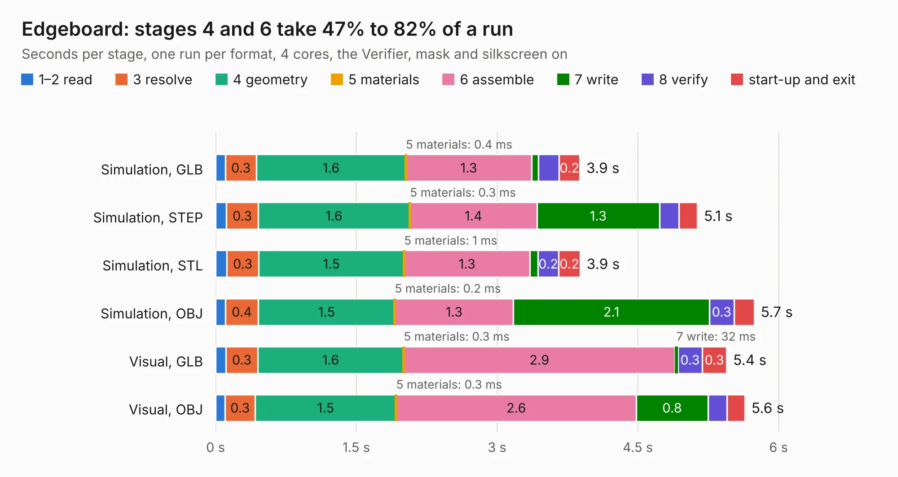

# 958. Edgeboard

Board 958 of the 3,101 of [Corpus Testing](../Corpus-Testing.md), on [Corpus Page 9](../CorpusTestingPages/Corpus-Testing-09.md#958-edgeboard).

| Mode and format | 1–2 read | 3 resolve | 4 geometry | 5 materials | 6 assemble | 7 write | 8 verify | start-up and exit | Total |
|---|---:|---:|---:|---:|---:|---:|---:|---:|---:|
| Simulation, GLB | 0.1 | 0.3 | 1.6 | 0.4&nbsp;ms | 1.3 | 73&nbsp;ms | 0.2 | 0.2 | 3.9 |
| Simulation, STEP | 0.1 | 0.3 | 1.6 | 0.3&nbsp;ms | 1.4 | 1.3 | 0.2 | 0.2 | 5.1 |
| Simulation, STL | 0.1 | 0.3 | 1.5 | 1&nbsp;ms | 1.3 | 85&nbsp;ms | 0.2 | 0.2 | 3.9 |
| Simulation, OBJ | 0.1 | 0.4 | 1.5 | 0.2&nbsp;ms | 1.3 | 2.1 | 0.3 | 0.2 | 5.7 |
| Visual, GLB | 0.1 | 0.3 | 1.6 | 0.3&nbsp;ms | 2.9 | 32&nbsp;ms | 0.3 | 0.3 | 5.4 |
| Visual, OBJ | 0.1 | 0.3 | 1.5 | 0.3&nbsp;ms | 2.6 | 0.8 | 0.2 | 0.2 | 5.6 |

<table align="center"><tr><td valign="top">

| Board | Repo: [flypie/Ace-2019](https://github.com/flypie/Ace-2019) Board: `Edgeboard.kicad_pcb` |
|---|---|
| Folder | KiCad / Edgeboard |
| Complexity | 145&nbsp;/&nbsp;1000 (size&nbsp;115, features&nbsp;30) |
| KESE&nbsp;features | rounded, trapezoid or chamfered pads, filled zones |
| Tested | 9th November 2026 |
| Copper&nbsp;layers | 2 |
| File&nbsp;format | KiCad 7 (20221018) |
| Parts,&nbsp;tracks,&nbsp;vias | 2, 191, 0 |
| Triangles,&nbsp;simulation | 349,290 in 56 parts |
| Verifier | PASS in all six runs |

</td><td valign="top">

<table>
<tr><th>File type</th><th>File size</th><th>Peak memory used</th></tr>
<tr><th colspan="3" align="left">Simulation</th></tr>
<tr><td>GLB</td><td align="right">12&nbsp;MB</td><td align="right">242&nbsp;MB</td></tr>
<tr><td>STEP</td><td align="right">62&nbsp;MB</td><td align="right">270&nbsp;MB</td></tr>
<tr><td>STL</td><td align="right">17&nbsp;MB</td><td align="right">240&nbsp;MB</td></tr>
<tr><td>OBJ</td><td align="right">35&nbsp;MB</td><td align="right">288&nbsp;MB</td></tr>
<tr><th colspan="3" align="left">Visual</th></tr>
<tr><td>GLB</td><td align="right">6.1&nbsp;MB</td><td align="right">213&nbsp;MB</td></tr>
<tr><td>OBJ</td><td align="right">18&nbsp;MB</td><td align="right">216&nbsp;MB</td></tr>
</table>

</td></tr></table>

| Previous | Next |
|:---|---:|
| [957. eBigRam](b0957b_Ace-2019_eBigRam.md) | [959. eMultiUniBoard](b0959b_Ace-2019_eMultiUniBoard.md) |
