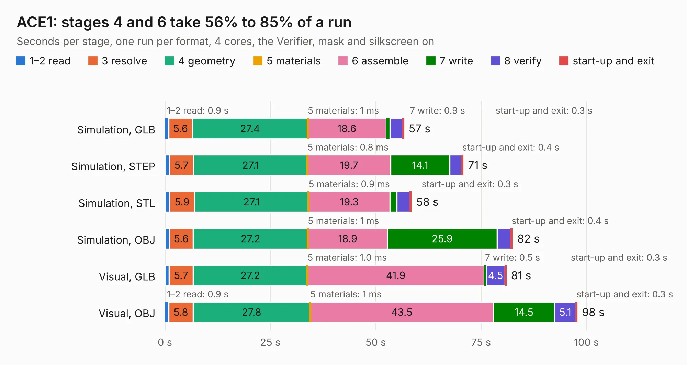

# 960. ACE1

Board 960 of the 3,125 of [Corpus Testing](../Corpus-Testing.md), on [Corpus Page 9](../CorpusTestingPages/Corpus-Testing-09.md#960-ace1).

| Mode and format | 1–2 read | 3 resolve | 4 geometry | 5 materials | 6 assemble | 7 write | 8 verify | start-up and exit | Total |
|---|---:|---:|---:|---:|---:|---:|---:|---:|---:|
| Simulation, GLB | 0.9 | 5.6 | 27.4 | 1&nbsp;ms | 18.6 | 0.9 | 3.0 | 0.3 | 56.7 |
| Simulation, STEP | 1.1 | 5.7 | 27.1 | 0.8&nbsp;ms | 19.7 | 14.1 | 2.8 | 0.4 | 70.7 |
| Simulation, STL | 1.1 | 5.9 | 27.1 | 0.9&nbsp;ms | 19.3 | 1.7 | 3.1 | 0.3 | 58.4 |
| Simulation, OBJ | 1.1 | 5.6 | 27.2 | 1&nbsp;ms | 18.9 | 25.9 | 3.3 | 0.4 | 82.4 |
| Visual, GLB | 1.0 | 5.7 | 27.2 | 1.0&nbsp;ms | 41.9 | 0.5 | 4.5 | 0.3 | 80.9 |
| Visual, OBJ | 0.9 | 5.8 | 27.8 | 1&nbsp;ms | 43.5 | 14.5 | 5.1 | 0.3 | 97.8 |

<table align="center"><tr><td valign="top">

| Board | Repo: [flypie/Ace-2019](https://github.com/flypie/Ace-2019) Board: `ACE1.kicad_pcb` |
|---|---|
| Folder | KiCad / ACE1 |
| Complexity | 254&nbsp;/&nbsp;1000 (size&nbsp;209, features&nbsp;45) |
| KESE&nbsp;features | through vias, slotted holes, rounded, trapezoid or chamfered pads, copper text |
| Tested | 9th November 2026 |
| Copper&nbsp;layers | 2 |
| File&nbsp;format | KiCad 7 (20221018) |
| Parts,&nbsp;tracks,&nbsp;vias | 146, 4,172, 128 |
| Triangles,&nbsp;simulation | 5,100,936 in 190 parts |
| Verifier | PASS in all six runs |

</td><td valign="top">

<table>
<tr><th>File type</th><th>File size</th><th>Peak memory used</th></tr>
<tr><th colspan="3" align="left">Simulation</th></tr>
<tr><td>GLB</td><td align="right">176&nbsp;MB</td><td align="right">1.5&nbsp;GB</td></tr>
<tr><td>STEP</td><td align="right">922&nbsp;MB</td><td align="right">1.9&nbsp;GB</td></tr>
<tr><td>STL</td><td align="right">255&nbsp;MB</td><td align="right">1.5&nbsp;GB</td></tr>
<tr><td>OBJ</td><td align="right">548&nbsp;MB</td><td align="right">3.3&nbsp;GB</td></tr>
<tr><th colspan="3" align="left">Visual</th></tr>
<tr><td>GLB</td><td align="right">100&nbsp;MB</td><td align="right">1.8&nbsp;GB</td></tr>
<tr><td>OBJ</td><td align="right">316&nbsp;MB</td><td align="right">2.1&nbsp;GB</td></tr>
</table>

</td></tr></table>

| Previous | Next |
|:---|---:|
| [959. ACE-COLOUR2](b0959b_Ace-2019_ACE-COLOUR2.md) | [961. ACE2NOKBV2](b0961b_Ace-2019_ACE2NOKBV2.md) |
