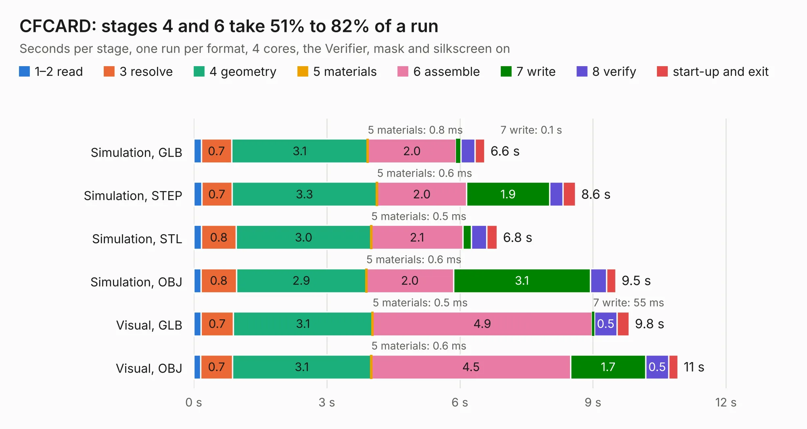

# 960. CFCARD

Board 960 of the 3,106 of [Corpus Testing](../Corpus-Testing.md), on [Corpus Page 9](../CorpusTestingPages/Corpus-Testing-09.md#960-cfcard).

| Mode and format | 1–2 read | 3 resolve | 4 geometry | 5 materials | 6 assemble | 7 write | 8 verify | start-up and exit | Total |
|---|---:|---:|---:|---:|---:|---:|---:|---:|---:|
| Simulation, GLB | 0.2 | 0.7 | 3.1 | 0.8&nbsp;ms | 2.0 | 0.1 | 0.3 | 0.2 | 6.6 |
| Simulation, STEP | 0.2 | 0.7 | 3.3 | 0.6&nbsp;ms | 2.0 | 1.9 | 0.3 | 0.3 | 8.6 |
| Simulation, STL | 0.2 | 0.8 | 3.0 | 0.5&nbsp;ms | 2.1 | 0.2 | 0.4 | 0.2 | 6.8 |
| Simulation, OBJ | 0.2 | 0.8 | 2.9 | 0.6&nbsp;ms | 2.0 | 3.1 | 0.4 | 0.2 | 9.5 |
| Visual, GLB | 0.2 | 0.7 | 3.1 | 0.5&nbsp;ms | 4.9 | 55&nbsp;ms | 0.5 | 0.3 | 9.8 |
| Visual, OBJ | 0.2 | 0.7 | 3.1 | 0.6&nbsp;ms | 4.5 | 1.7 | 0.5 | 0.2 | 10.9 |

<table align="center"><tr><td valign="top">

| Board | Repo: [flypie/Ace-2019](https://github.com/flypie/Ace-2019) Board: `CFCARD.kicad_pcb` |
|---|---|
| Folder | KiCad / CFCARD |
| Complexity | 170&nbsp;/&nbsp;1000 (size&nbsp;155, features&nbsp;15) |
| KESE&nbsp;features | through vias |
| Tested | 9th November 2026 |
| Copper&nbsp;layers | 2 |
| File&nbsp;format | KiCad 6 (20211014) |
| Parts,&nbsp;tracks,&nbsp;vias | 19, 542, 32 |
| Triangles,&nbsp;simulation | 606,862 in 121 parts |
| Verifier | PASS in all six runs |

</td><td valign="top">

<table>
<tr><th>File type</th><th>File size</th><th>Peak memory used</th></tr>
<tr><th colspan="3" align="left">Simulation</th></tr>
<tr><td>GLB</td><td align="right">21&nbsp;MB</td><td align="right">327&nbsp;MB</td></tr>
<tr><td>STEP</td><td align="right">99&nbsp;MB</td><td align="right">365&nbsp;MB</td></tr>
<tr><td>STL</td><td align="right">30&nbsp;MB</td><td align="right">329&nbsp;MB</td></tr>
<tr><td>OBJ</td><td align="right">63&nbsp;MB</td><td align="right">456&nbsp;MB</td></tr>
<tr><th colspan="3" align="left">Visual</th></tr>
<tr><td>GLB</td><td align="right">13&nbsp;MB</td><td align="right">362&nbsp;MB</td></tr>
<tr><td>OBJ</td><td align="right">38&nbsp;MB</td><td align="right">365&nbsp;MB</td></tr>
</table>

</td></tr></table>

| Previous | Next |
|:---|---:|
| [959. acez380](b0959b_Ace-2019_acez380.md) | [961. eBigRam](b0961b_Ace-2019_eBigRam.md) |
