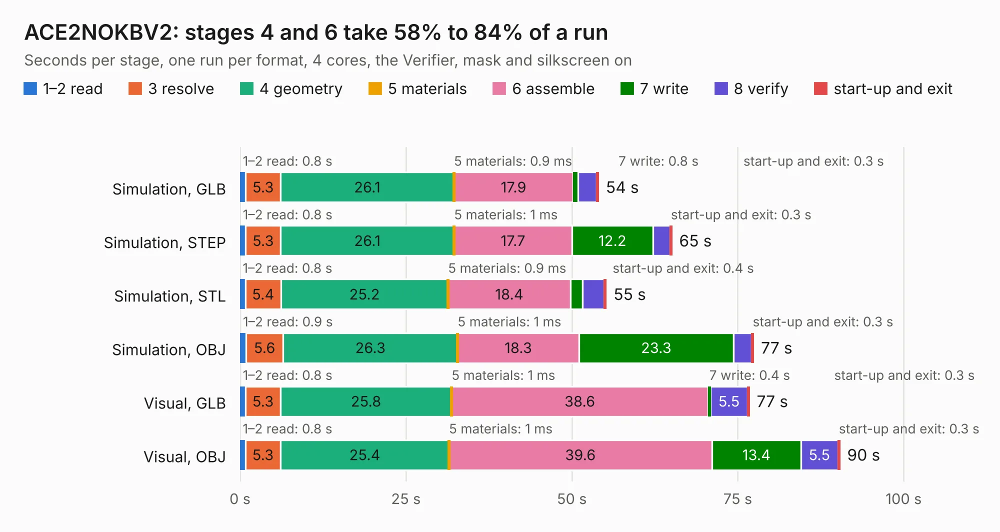

# 961. ACE2NOKBV2

Board 961 of the 3,123 of [Corpus Testing](../Corpus-Testing.md), on [Corpus Page 9](../CorpusTestingPages/Corpus-Testing-09.md#961-ace2nokbv2).

| Mode and format | 1–2 read | 3 resolve | 4 geometry | 5 materials | 6 assemble | 7 write | 8 verify | start-up and exit | Total |
|---|---:|---:|---:|---:|---:|---:|---:|---:|---:|
| Simulation, GLB | 0.8 | 5.3 | 26.1 | 0.9&nbsp;ms | 17.9 | 0.8 | 2.8 | 0.3 | 54.0 |
| Simulation, STEP | 0.8 | 5.3 | 26.1 | 1&nbsp;ms | 17.7 | 12.2 | 2.5 | 0.3 | 65.1 |
| Simulation, STL | 0.8 | 5.4 | 25.2 | 0.9&nbsp;ms | 18.4 | 1.9 | 3.2 | 0.4 | 55.2 |
| Simulation, OBJ | 0.9 | 5.6 | 26.3 | 1&nbsp;ms | 18.3 | 23.3 | 2.7 | 0.3 | 77.4 |
| Visual, GLB | 0.8 | 5.3 | 25.8 | 1&nbsp;ms | 38.6 | 0.4 | 5.5 | 0.3 | 76.8 |
| Visual, OBJ | 0.8 | 5.3 | 25.4 | 1&nbsp;ms | 39.6 | 13.4 | 5.5 | 0.3 | 90.4 |

<table align="center"><tr><td valign="top">

| Board | Repo: [flypie/Ace-2019](https://github.com/flypie/Ace-2019) Board: `ACE2NOKBV2.kicad_pcb` |
|---|---|
| Folder | KiCad / ACE2NOKBV2 |
| Complexity | 221&nbsp;/&nbsp;1000 (size&nbsp;206, features&nbsp;15) |
| KESE&nbsp;features | through vias |
| Tested | 9th November 2026 |
| Copper&nbsp;layers | 2 |
| File&nbsp;format | KiCad 5 (20171130) |
| Parts,&nbsp;tracks,&nbsp;vias | 106, 4,313, 168 |
| Triangles,&nbsp;simulation | 4,331,298 in 189 parts |
| Verifier | PASS in all six runs |

</td><td valign="top">

<table>
<tr><th>File type</th><th>File size</th><th>Peak memory used</th></tr>
<tr><th colspan="3" align="left">Simulation</th></tr>
<tr><td>GLB</td><td align="right">149&nbsp;MB</td><td align="right">1.3&nbsp;GB</td></tr>
<tr><td>STEP</td><td align="right">749&nbsp;MB</td><td align="right">1.7&nbsp;GB</td></tr>
<tr><td>STL</td><td align="right">217&nbsp;MB</td><td align="right">1.4&nbsp;GB</td></tr>
<tr><td>OBJ</td><td align="right">463&nbsp;MB</td><td align="right">2.9&nbsp;GB</td></tr>
<tr><th colspan="3" align="left">Visual</th></tr>
<tr><td>GLB</td><td align="right">86&nbsp;MB</td><td align="right">1.5&nbsp;GB</td></tr>
<tr><td>OBJ</td><td align="right">269&nbsp;MB</td><td align="right">1.8&nbsp;GB</td></tr>
</table>

</td></tr></table>

| Previous | Next |
|:---|---:|
| [960. ACE1](b0960b_Ace-2019_ACE1.md) | [962. ACE2NOKBV2MK2](b0962b_Ace-2019_ACE2NOKBV2MK2.md) |
