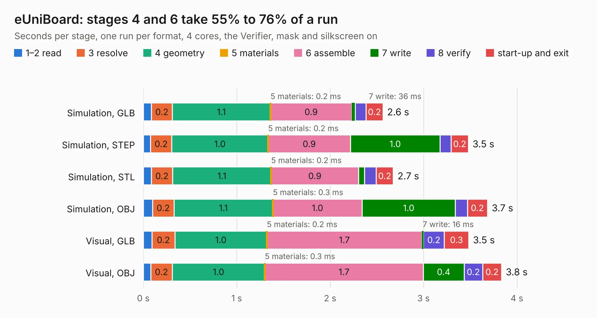

# 962. eUniBoard

Board 962 of the 3,103 of [Corpus Testing](../Corpus-Testing.md), on [Corpus Page 9](../CorpusTestingPages/Corpus-Testing-09.md#962-euniboard).

| Mode and format | 1–2 read | 3 resolve | 4 geometry | 5 materials | 6 assemble | 7 write | 8 verify | start-up and exit | Total |
|---|---:|---:|---:|---:|---:|---:|---:|---:|---:|
| Simulation, GLB | 87&nbsp;ms | 0.2 | 1.1 | 0.2&nbsp;ms | 0.9 | 36&nbsp;ms | 0.1 | 0.2 | 2.6 |
| Simulation, STEP | 77&nbsp;ms | 0.2 | 1.0 | 0.2&nbsp;ms | 0.9 | 1.0 | 0.1 | 0.2 | 3.5 |
| Simulation, STL | 85&nbsp;ms | 0.2 | 1.1 | 0.2&nbsp;ms | 0.9 | 63&nbsp;ms | 0.1 | 0.2 | 2.7 |
| Simulation, OBJ | 98&nbsp;ms | 0.2 | 1.1 | 0.3&nbsp;ms | 1.0 | 1.0 | 0.1 | 0.2 | 3.7 |
| Visual, GLB | 93&nbsp;ms | 0.2 | 1.0 | 0.2&nbsp;ms | 1.7 | 16&nbsp;ms | 0.2 | 0.3 | 3.5 |
| Visual, OBJ | 79&nbsp;ms | 0.2 | 1.0 | 0.3&nbsp;ms | 1.7 | 0.4 | 0.2 | 0.2 | 3.8 |

<table align="center"><tr><td valign="top">

| Board | Repo: [flypie/Ace-2019](https://github.com/flypie/Ace-2019) Board: `eUniBoard.kicad_pcb` |
|---|---|
| Folder | KiCad / eUniBoard |
| Complexity | 42&nbsp;/&nbsp;1000 (size&nbsp;42, features&nbsp;0) |
| Tested | 9th November 2026 |
| Copper&nbsp;layers | 2 |
| File&nbsp;format | KiCad 6 (20211014) |
| Parts,&nbsp;tracks,&nbsp;vias | 1, 2, 0 |
| Triangles,&nbsp;simulation | 268,800 in 60 parts |
| Verifier | PASS in all six runs |

</td><td valign="top">

<table>
<tr><th>File type</th><th>File size</th><th>Peak memory used</th></tr>
<tr><th colspan="3" align="left">Simulation</th></tr>
<tr><td>GLB</td><td align="right">8.8&nbsp;MB</td><td align="right">224&nbsp;MB</td></tr>
<tr><td>STEP</td><td align="right">39&nbsp;MB</td><td align="right">247&nbsp;MB</td></tr>
<tr><td>STL</td><td align="right">13&nbsp;MB</td><td align="right">218&nbsp;MB</td></tr>
<tr><td>OBJ</td><td align="right">27&nbsp;MB</td><td align="right">218&nbsp;MB</td></tr>
<tr><th colspan="3" align="left">Visual</th></tr>
<tr><td>GLB</td><td align="right">4.0&nbsp;MB</td><td align="right">262&nbsp;MB</td></tr>
<tr><td>OBJ</td><td align="right">11&nbsp;MB</td><td align="right">245&nbsp;MB</td></tr>
</table>

</td></tr></table>

| Previous | Next |
|:---|---:|
| [961. eMultiUniBoard](b0961b_Ace-2019_eMultiUniBoard.md) | [963. MultiUniBoard](b0963b_Ace-2019_MultiUniBoard.md) |
