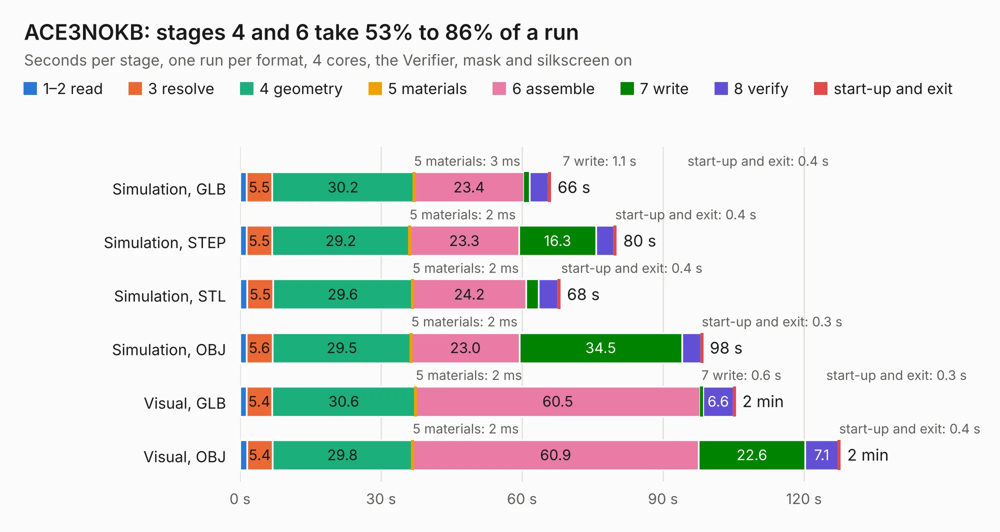

# 963. ACE3NOKB

Board 963 of the 3,128 of [Corpus Testing](../Corpus-Testing.md), on [Corpus Page 9](../CorpusTestingPages/Corpus-Testing-09.md#963-ace3nokb).

| Mode and format | 1–2 read | 3 resolve | 4 geometry | 5 materials | 6 assemble | 7 write | 8 verify | start-up and exit | Total |
|---|---:|---:|---:|---:|---:|---:|---:|---:|---:|
| Simulation, GLB | 1.4 | 5.5 | 30.2 | 3&nbsp;ms | 23.4 | 1.1 | 4.1 | 0.4 | 66.0 |
| Simulation, STEP | 1.4 | 5.5 | 29.2 | 2&nbsp;ms | 23.3 | 16.3 | 3.9 | 0.4 | 80.0 |
| Simulation, STL | 1.5 | 5.5 | 29.6 | 2&nbsp;ms | 24.2 | 2.6 | 4.1 | 0.4 | 68.0 |
| Simulation, OBJ | 1.3 | 5.6 | 29.5 | 2&nbsp;ms | 23.0 | 34.5 | 4.1 | 0.3 | 98.4 |
| Visual, GLB | 1.4 | 5.4 | 30.6 | 2&nbsp;ms | 60.5 | 0.6 | 6.6 | 0.3 | 105.4 |
| Visual, OBJ | 1.5 | 5.4 | 29.8 | 2&nbsp;ms | 60.9 | 22.6 | 7.1 | 0.4 | 127.7 |

<table align="center"><tr><td valign="top">

| Board | Repo: [flypie/Ace-2019](https://github.com/flypie/Ace-2019) Board: `ACE3NOKB.kicad_pcb` |
|---|---|
| Folder | KiCad / ACE3NOKB |
| Complexity | 364&nbsp;/&nbsp;1000 (size&nbsp;264, features&nbsp;100) |
| KESE&nbsp;features | through vias, rounded, trapezoid or chamfered pads, filled zones, copper drawings, stack-up, dielectric εr and tanδ, copper finish |
| Tested | 9th November 2026 |
| Copper&nbsp;layers | 2 |
| File&nbsp;format | KiCad 9 (20241229) |
| Parts,&nbsp;tracks,&nbsp;vias | 142, 5,351, 235 |
| Triangles,&nbsp;simulation | 5,704,722 in 318 parts |
| Verifier | PASS in all six runs |

</td><td valign="top">

<table>
<tr><th>File type</th><th>File size</th><th>Peak memory used</th></tr>
<tr><th colspan="3" align="left">Simulation</th></tr>
<tr><td>GLB</td><td align="right">192&nbsp;MB</td><td align="right">1.8&nbsp;GB</td></tr>
<tr><td>STEP</td><td align="right">859&nbsp;MB</td><td align="right">2.2&nbsp;GB</td></tr>
<tr><td>STL</td><td align="right">285&nbsp;MB</td><td align="right">1.8&nbsp;GB</td></tr>
<tr><td>OBJ</td><td align="right">606&nbsp;MB</td><td align="right">3.6&nbsp;GB</td></tr>
<tr><th colspan="3" align="left">Visual</th></tr>
<tr><td>GLB</td><td align="right">126&nbsp;MB</td><td align="right">2.1&nbsp;GB</td></tr>
<tr><td>OBJ</td><td align="right">404&nbsp;MB</td><td align="right">2.7&nbsp;GB</td></tr>
</table>

</td></tr></table>

| Previous | Next |
|:---|---:|
| [962. ACE2NOKBV2MK2](b0962b_Ace-2019_ACE2NOKBV2MK2.md) | [964. ACE4NOKB](b0964b_Ace-2019_ACE4NOKB.md) |
