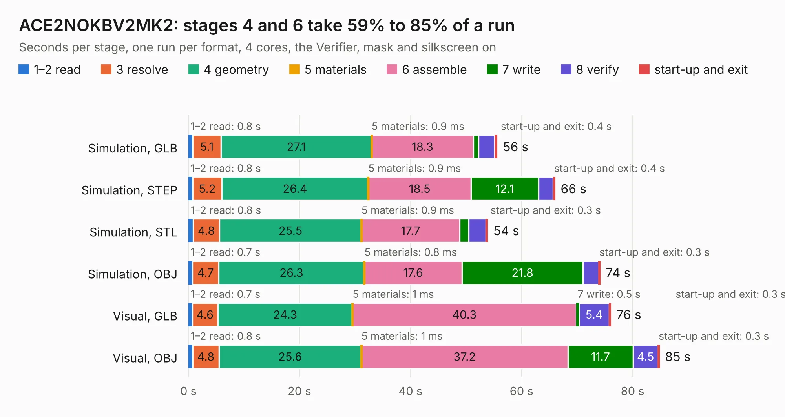

# 964 ACE2NOKBV2MK2

Board 964 of the 3,138 of [Corpus Testing](../Corpus-Testing.md), on [Corpus Page 9](../CorpusTestingPages/Corpus-Testing-09.md#964-ace2nokbv2mk2).

| Mode and format | 1–2 read | 3 resolve | 4 geometry | 5 materials | 6 assemble | 7 write | 8 verify | start-up and exit | Total |
|---|---:|---:|---:|---:|---:|---:|---:|---:|---:|
| Simulation, GLB | 0.8 | 5.1 | 27.1 | 0.9&nbsp;ms | 18.3 | 0.9 | 3.0 | 0.4 | 55.6 |
| Simulation, STEP | 0.8 | 5.2 | 26.4 | 0.9&nbsp;ms | 18.5 | 12.1 | 2.6 | 0.4 | 66.0 |
| Simulation, STL | 0.8 | 4.8 | 25.5 | 0.9&nbsp;ms | 17.7 | 1.6 | 3.1 | 0.3 | 53.9 |
| Simulation, OBJ | 0.7 | 4.7 | 26.3 | 0.8&nbsp;ms | 17.6 | 21.8 | 2.8 | 0.3 | 74.2 |
| Visual, GLB | 0.7 | 4.6 | 24.3 | 1&nbsp;ms | 40.3 | 0.5 | 5.4 | 0.3 | 76.1 |
| Visual, OBJ | 0.8 | 4.8 | 25.6 | 1&nbsp;ms | 37.2 | 11.7 | 4.5 | 0.3 | 84.8 |

<table align="center"><tr><td valign="top">

| Board | Repo: [flypie/Ace-2019](https://github.com/flypie/Ace-2019) Board: `ACE2NOKBV2MK2.kicad_pcb` |
|---|---|
| Folder | KiCad / ACE2NOKBV2MK2 |
| Complexity | 269&nbsp;/&nbsp;1000 (size&nbsp;254, features&nbsp;15) |
| KESE&nbsp;features | through vias |
| Tested | 9th November 2026 |
| Copper&nbsp;layers | 2 |
| File&nbsp;format | KiCad 7 (20221018) |
| Parts,&nbsp;tracks,&nbsp;vias | 108, 4,569, 171 |
| Triangles,&nbsp;simulation | 5,075,774 in 206 parts |
| Verifier | PASS in all six runs |

</td><td valign="top">

<table>
<tr><th>File type</th><th>File size</th><th>Peak memory used</th></tr>
<tr><th colspan="3" align="left">Simulation</th></tr>
<tr><td>GLB</td><td align="right">175&nbsp;MB</td><td align="right">1.5&nbsp;GB</td></tr>
<tr><td>STEP</td><td align="right">904&nbsp;MB</td><td align="right">1.8&nbsp;GB</td></tr>
<tr><td>STL</td><td align="right">254&nbsp;MB</td><td align="right">1.5&nbsp;GB</td></tr>
<tr><td>OBJ</td><td align="right">546&nbsp;MB</td><td align="right">3.3&nbsp;GB</td></tr>
<tr><th colspan="3" align="left">Visual</th></tr>
<tr><td>GLB</td><td align="right">98&nbsp;MB</td><td align="right">1.7&nbsp;GB</td></tr>
<tr><td>OBJ</td><td align="right">310&nbsp;MB</td><td align="right">2.1&nbsp;GB</td></tr>
</table>

</td></tr></table>

| Previous | Next |
|:---|---:|
| [963 ACE2NOKBV2](b0963b_Ace-2019_ACE2NOKBV2.md) | [965 ACE3NOKB](b0965b_Ace-2019_ACE3NOKB.md) |
