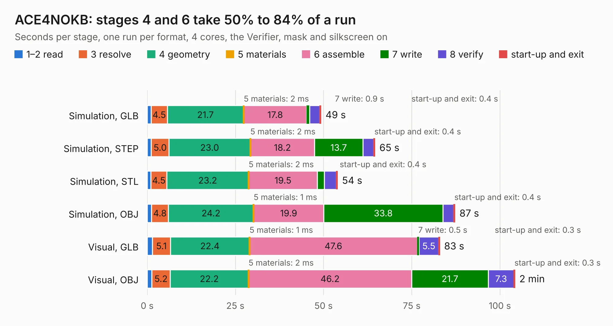

# 964. ACE4NOKB

Board 964 of the 3,124 of [Corpus Testing](../Corpus-Testing.md), on [Corpus Page 9](../CorpusTestingPages/Corpus-Testing-09.md#964-ace4nokb).

| Mode and format | 1–2 read | 3 resolve | 4 geometry | 5 materials | 6 assemble | 7 write | 8 verify | start-up and exit | Total |
|---|---:|---:|---:|---:|---:|---:|---:|---:|---:|
| Simulation, GLB | 1.2 | 4.5 | 21.7 | 2&nbsp;ms | 17.8 | 0.9 | 2.8 | 0.4 | 49.3 |
| Simulation, STEP | 1.2 | 5.0 | 23.0 | 2&nbsp;ms | 18.2 | 13.7 | 3.1 | 0.4 | 64.6 |
| Simulation, STL | 1.1 | 4.5 | 23.2 | 2&nbsp;ms | 19.5 | 2.0 | 3.4 | 0.4 | 54.0 |
| Simulation, OBJ | 1.2 | 4.8 | 24.2 | 1&nbsp;ms | 19.9 | 33.8 | 3.1 | 0.4 | 87.3 |
| Visual, GLB | 1.5 | 5.1 | 22.4 | 1&nbsp;ms | 47.6 | 0.5 | 5.5 | 0.3 | 83.0 |
| Visual, OBJ | 1.3 | 5.2 | 22.2 | 2&nbsp;ms | 46.2 | 21.7 | 7.3 | 0.3 | 104.3 |

<table align="center"><tr><td valign="top">

| Board | Repo: [flypie/Ace-2019](https://github.com/flypie/Ace-2019) Board: `ACE4NOKB.kicad_pcb` |
|---|---|
| Folder | KiCad / ACE4NOKB |
| Complexity | 318&nbsp;/&nbsp;1000 (size&nbsp;263, features&nbsp;55) |
| KESE&nbsp;features | through vias, rounded, trapezoid or chamfered pads, stack-up, dielectric εr and tanδ |
| Tested | 9th November 2026 |
| Copper&nbsp;layers | 2 |
| File&nbsp;format | KiCad 8 (20240108) |
| Parts,&nbsp;tracks,&nbsp;vias | 136, 4,351, 198 |
| Triangles,&nbsp;simulation | 4,384,454 in 286 parts |
| Verifier | PASS in all six runs |

</td><td valign="top">

<table>
<tr><th>File type</th><th>File size</th><th>Peak memory used</th></tr>
<tr><th colspan="3" align="left">Simulation</th></tr>
<tr><td>GLB</td><td align="right">148&nbsp;MB</td><td align="right">1.4&nbsp;GB</td></tr>
<tr><td>STEP</td><td align="right">643&nbsp;MB</td><td align="right">1.7&nbsp;GB</td></tr>
<tr><td>STL</td><td align="right">219&nbsp;MB</td><td align="right">1.4&nbsp;GB</td></tr>
<tr><td>OBJ</td><td align="right">461&nbsp;MB</td><td align="right">2.7&nbsp;GB</td></tr>
<tr><th colspan="3" align="left">Visual</th></tr>
<tr><td>GLB</td><td align="right">98&nbsp;MB</td><td align="right">1.8&nbsp;GB</td></tr>
<tr><td>OBJ</td><td align="right">310&nbsp;MB</td><td align="right">2.0&nbsp;GB</td></tr>
</table>

</td></tr></table>

| Previous | Next |
|:---|---:|
| [963. ACE3NOKB](b0963b_Ace-2019_ACE3NOKB.md) | [965. ACEBREAKPOINT](b0965b_Ace-2019_ACEBREAKPOINT.md) |
