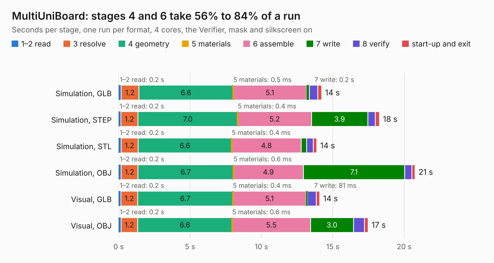

# 965. MultiUniBoard

Board 965 of the 3,108 of [Corpus Testing](../Corpus-Testing.md), on [Corpus Page 9](../CorpusTestingPages/Corpus-Testing-09.md#965-multiuniboard).

| Mode and format | 1–2 read | 3 resolve | 4 geometry | 5 materials | 6 assemble | 7 write | 8 verify | start-up and exit | Total |
|---|---:|---:|---:|---:|---:|---:|---:|---:|---:|
| Simulation, GLB | 0.2 | 1.2 | 6.6 | 0.5&nbsp;ms | 5.1 | 0.2 | 0.6 | 0.3 | 14.2 |
| Simulation, STEP | 0.2 | 1.2 | 7.0 | 0.4&nbsp;ms | 5.2 | 3.9 | 0.5 | 0.3 | 18.3 |
| Simulation, STL | 0.2 | 1.2 | 6.6 | 0.4&nbsp;ms | 4.8 | 0.4 | 0.5 | 0.3 | 13.9 |
| Simulation, OBJ | 0.2 | 1.2 | 6.7 | 0.6&nbsp;ms | 4.9 | 7.1 | 0.5 | 0.2 | 20.8 |
| Visual, GLB | 0.2 | 1.2 | 6.7 | 0.4&nbsp;ms | 5.1 | 81&nbsp;ms | 0.6 | 0.2 | 14.1 |
| Visual, OBJ | 0.2 | 1.2 | 6.6 | 0.6&nbsp;ms | 5.5 | 3.0 | 0.8 | 0.3 | 17.5 |

<table align="center"><tr><td valign="top">

| Board | Repo: [flypie/Ace-2019](https://github.com/flypie/Ace-2019) Board: `MultiUniBoard.kicad_pcb` |
|---|---|
| Folder | KiCad / MultiUniBoard |
| Complexity | 36&nbsp;/&nbsp;1000 (size&nbsp;36, features&nbsp;0) |
| Tested | 9th November 2026 |
| Copper&nbsp;layers | 2 |
| File&nbsp;format | KiCad 6 (20211014) |
| Parts,&nbsp;tracks,&nbsp;vias | 5, 0, 0 |
| Triangles,&nbsp;simulation | 1,216,112 in 72 parts |
| Verifier | PASS in all six runs |

</td><td valign="top">

<table>
<tr><th>File type</th><th>File size</th><th>Peak memory used</th></tr>
<tr><th colspan="3" align="left">Simulation</th></tr>
<tr><td>GLB</td><td align="right">37&nbsp;MB</td><td align="right">478&nbsp;MB</td></tr>
<tr><td>STEP</td><td align="right">184&nbsp;MB</td><td align="right">605&nbsp;MB</td></tr>
<tr><td>STL</td><td align="right">61&nbsp;MB</td><td align="right">458&nbsp;MB</td></tr>
<tr><td>OBJ</td><td align="right">124&nbsp;MB</td><td align="right">861&nbsp;MB</td></tr>
<tr><th colspan="3" align="left">Visual</th></tr>
<tr><td>GLB</td><td align="right">17&nbsp;MB</td><td align="right">480&nbsp;MB</td></tr>
<tr><td>OBJ</td><td align="right">53&nbsp;MB</td><td align="right">494&nbsp;MB</td></tr>
</table>

</td></tr></table>

| Previous | Next |
|:---|---:|
| [964. eUniBoard](b0964b_Ace-2019_eUniBoard.md) | [966. PS2](b0966b_Ace-2019_PS2.md) |
