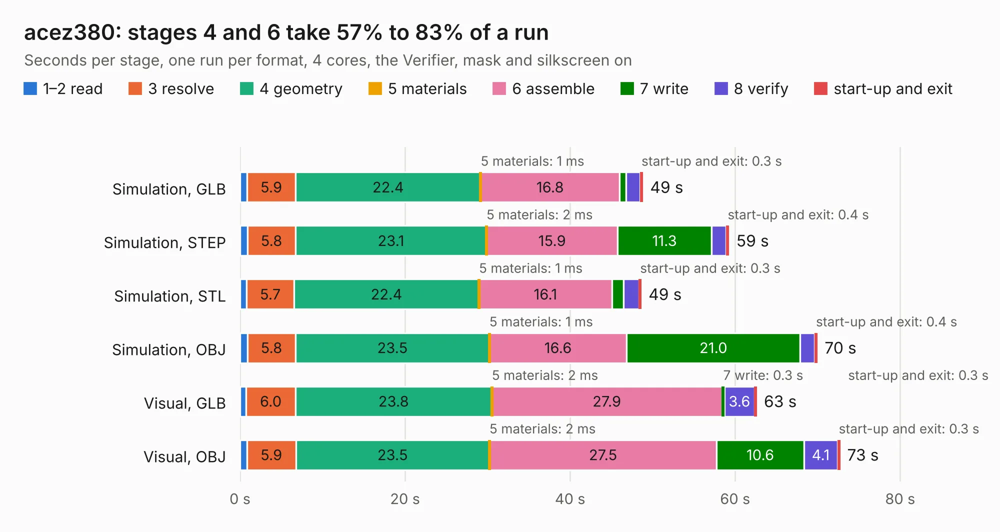

# 965. acez380

Board 965 of the 3,117 of [Corpus Testing](../Corpus-Testing.md), on [Corpus Page 9](../CorpusTestingPages/Corpus-Testing-09.md#965-acez380).

| Mode and format | 1–2 read | 3 resolve | 4 geometry | 5 materials | 6 assemble | 7 write | 8 verify | start-up and exit | Total |
|---|---:|---:|---:|---:|---:|---:|---:|---:|---:|
| Simulation, GLB | 0.8 | 5.9 | 22.4 | 1&nbsp;ms | 16.8 | 0.8 | 1.7 | 0.3 | 48.8 |
| Simulation, STEP | 0.9 | 5.8 | 23.1 | 2&nbsp;ms | 15.9 | 11.3 | 1.8 | 0.4 | 59.3 |
| Simulation, STL | 0.8 | 5.7 | 22.4 | 1&nbsp;ms | 16.1 | 1.4 | 1.9 | 0.3 | 48.6 |
| Simulation, OBJ | 0.9 | 5.8 | 23.5 | 1&nbsp;ms | 16.6 | 21.0 | 1.7 | 0.4 | 70.0 |
| Visual, GLB | 0.8 | 6.0 | 23.8 | 2&nbsp;ms | 27.9 | 0.3 | 3.6 | 0.3 | 62.6 |
| Visual, OBJ | 0.8 | 5.9 | 23.5 | 2&nbsp;ms | 27.5 | 10.6 | 4.1 | 0.3 | 72.7 |

<table align="center"><tr><td valign="top">

| Board | Repo: [flypie/Ace-2019](https://github.com/flypie/Ace-2019) Board: `acez380.kicad_pcb` |
|---|---|
| Folder | KiCad / ACEZ380 |
| Complexity | 134&nbsp;/&nbsp;1000 (size&nbsp;124, features&nbsp;10) |
| KESE&nbsp;features | rounded, trapezoid or chamfered pads |
| Tested | 9th November 2026 |
| Copper&nbsp;layers | 2 |
| File&nbsp;format | KiCad 6 (20211014) |
| Parts,&nbsp;tracks,&nbsp;vias | 140, 0, 0 |
| Triangles,&nbsp;simulation | 4,005,516 in 410 parts |
| Note | mostly unrouted |
| Verifier | PASS in all six runs |

</td><td valign="top">

<table>
<tr><th>File type</th><th>File size</th><th>Peak memory used</th></tr>
<tr><th colspan="3" align="left">Simulation</th></tr>
<tr><td>GLB</td><td align="right">135&nbsp;MB</td><td align="right">1.4&nbsp;GB</td></tr>
<tr><td>STEP</td><td align="right">642&nbsp;MB</td><td align="right">1.5&nbsp;GB</td></tr>
<tr><td>STL</td><td align="right">200&nbsp;MB</td><td align="right">1.3&nbsp;GB</td></tr>
<tr><td>OBJ</td><td align="right">428&nbsp;MB</td><td align="right">2.7&nbsp;GB</td></tr>
<tr><th colspan="3" align="left">Visual</th></tr>
<tr><td>GLB</td><td align="right">68&nbsp;MB</td><td align="right">1.3&nbsp;GB</td></tr>
<tr><td>OBJ</td><td align="right">213&nbsp;MB</td><td align="right">1.5&nbsp;GB</td></tr>
</table>

</td></tr></table>

| Previous | Next |
|:---|---:|
| [964. acez180](b0964b_Ace-2019_acez180.md) | [966. CFCARD](b0966b_Ace-2019_CFCARD.md) |
