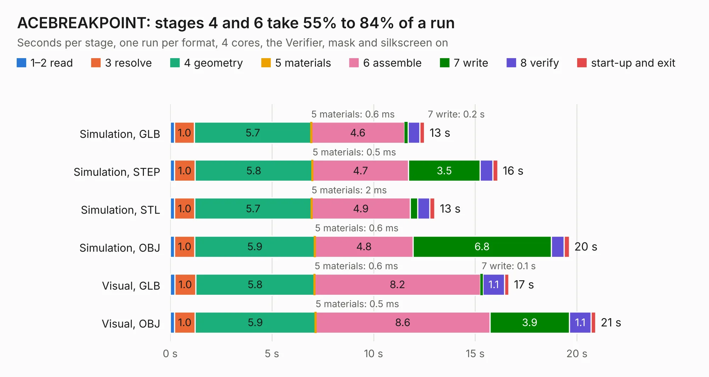

# 967. ACEBREAKPOINT

Board 967 of the 3,138 of [Corpus Testing](../Corpus-Testing.md), on [Corpus Page 9](../CorpusTestingPages/Corpus-Testing-09.md#967-acebreakpoint).

| Mode and format | 1–2 read | 3 resolve | 4 geometry | 5 materials | 6 assemble | 7 write | 8 verify | start-up and exit | Total |
|---|---:|---:|---:|---:|---:|---:|---:|---:|---:|
| Simulation, GLB | 0.2 | 1.0 | 5.7 | 0.6&nbsp;ms | 4.6 | 0.2 | 0.6 | 0.2 | 12.5 |
| Simulation, STEP | 0.2 | 1.0 | 5.8 | 0.5&nbsp;ms | 4.7 | 3.5 | 0.6 | 0.2 | 16.1 |
| Simulation, STL | 0.2 | 1.0 | 5.7 | 2&nbsp;ms | 4.9 | 0.4 | 0.6 | 0.2 | 13.0 |
| Simulation, OBJ | 0.2 | 1.0 | 5.9 | 0.6&nbsp;ms | 4.8 | 6.8 | 0.6 | 0.3 | 19.6 |
| Visual, GLB | 0.2 | 1.0 | 5.8 | 0.6&nbsp;ms | 8.2 | 0.1 | 1.1 | 0.2 | 16.7 |
| Visual, OBJ | 0.2 | 1.0 | 5.9 | 0.5&nbsp;ms | 8.6 | 3.9 | 1.1 | 0.2 | 20.9 |

<table align="center"><tr><td valign="top">

| Board | Repo: [flypie/Ace-2019](https://github.com/flypie/Ace-2019) Board: `ACEBREAKPOINT.kicad_pcb` |
|---|---|
| Folder | KiCad / ACEBREAKPOINT |
| Complexity | 192&nbsp;/&nbsp;1000 (size&nbsp;162, features&nbsp;30) |
| KESE&nbsp;features | stack-up, dielectric εr and tanδ |
| Tested | 9th November 2026 |
| Copper&nbsp;layers | 2 |
| File&nbsp;format | KiCad 6 (20211014) |
| Parts,&nbsp;tracks,&nbsp;vias | 29, 749, 0 |
| Triangles,&nbsp;simulation | 1,187,190 in 117 parts |
| Verifier | PASS in all six runs |

</td><td valign="top">

<table>
<tr><th>File type</th><th>File size</th><th>Peak memory used</th></tr>
<tr><th colspan="3" align="left">Simulation</th></tr>
<tr><td>GLB</td><td align="right">40&nbsp;MB</td><td align="right">479&nbsp;MB</td></tr>
<tr><td>STEP</td><td align="right">163&nbsp;MB</td><td align="right">581&nbsp;MB</td></tr>
<tr><td>STL</td><td align="right">59&nbsp;MB</td><td align="right">459&nbsp;MB</td></tr>
<tr><td>OBJ</td><td align="right">120&nbsp;MB</td><td align="right">815&nbsp;MB</td></tr>
<tr><th colspan="3" align="left">Visual</th></tr>
<tr><td>GLB</td><td align="right">23&nbsp;MB</td><td align="right">536&nbsp;MB</td></tr>
<tr><td>OBJ</td><td align="right">70&nbsp;MB</td><td align="right">671&nbsp;MB</td></tr>
</table>

</td></tr></table>

| Previous | Next |
|:---|---:|
| [966. ACE4NOKB](b0966b_Ace-2019_ACE4NOKB.md) | [968. ACEDIAGBOARD](b0968b_Ace-2019_ACEDIAGBOARD.md) |
