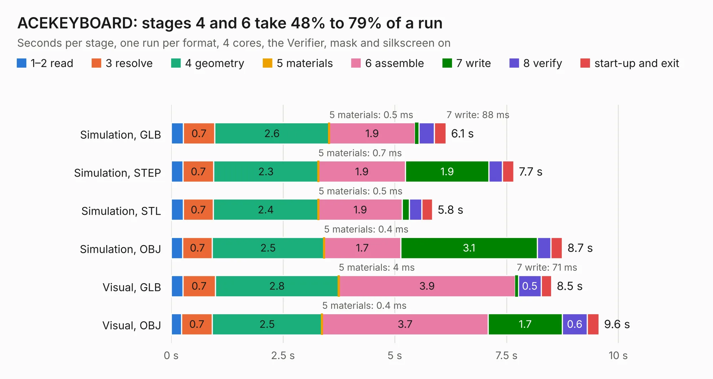

# 967. ACEKEYBOARD

Board 967 of the 3,128 of [Corpus Testing](../Corpus-Testing.md), on [Corpus Page 9](../CorpusTestingPages/Corpus-Testing-09.md#967-acekeyboard).

| Mode and format | 1–2 read | 3 resolve | 4 geometry | 5 materials | 6 assemble | 7 write | 8 verify | start-up and exit | Total |
|---|---:|---:|---:|---:|---:|---:|---:|---:|---:|
| Simulation, GLB | 0.3 | 0.7 | 2.6 | 0.5&nbsp;ms | 1.9 | 88&nbsp;ms | 0.3 | 0.3 | 6.1 |
| Simulation, STEP | 0.3 | 0.7 | 2.3 | 0.7&nbsp;ms | 1.9 | 1.9 | 0.3 | 0.3 | 7.7 |
| Simulation, STL | 0.3 | 0.7 | 2.4 | 0.5&nbsp;ms | 1.9 | 0.2 | 0.3 | 0.2 | 5.8 |
| Simulation, OBJ | 0.3 | 0.7 | 2.5 | 0.4&nbsp;ms | 1.7 | 3.1 | 0.3 | 0.3 | 8.7 |
| Visual, GLB | 0.3 | 0.7 | 2.8 | 4&nbsp;ms | 3.9 | 71&nbsp;ms | 0.5 | 0.2 | 8.5 |
| Visual, OBJ | 0.2 | 0.7 | 2.5 | 0.4&nbsp;ms | 3.7 | 1.7 | 0.6 | 0.3 | 9.6 |

<table align="center"><tr><td valign="top">

| Board | Repo: [flypie/Ace-2019](https://github.com/flypie/Ace-2019) Board: `ACEKEYBOARD.kicad_pcb` |
|---|---|
| Folder | KiCad / ACEKEYBOARD |
| Complexity | 209&nbsp;/&nbsp;1000 (size&nbsp;149, features&nbsp;60) |
| KESE&nbsp;features | through vias, TrueType text, stack-up, dielectric εr and tanδ |
| Tested | 9th November 2026 |
| Copper&nbsp;layers | 2 |
| File&nbsp;format | KiCad 7 (20221018) |
| Parts,&nbsp;tracks,&nbsp;vias | 44, 254, 3 |
| Triangles,&nbsp;simulation | 641,244 in 27 parts |
| Verifier | PASS in all six runs |

</td><td valign="top">

<table>
<tr><th>File type</th><th>File size</th><th>Peak memory used</th></tr>
<tr><th colspan="3" align="left">Simulation</th></tr>
<tr><td>GLB</td><td align="right">21&nbsp;MB</td><td align="right">348&nbsp;MB</td></tr>
<tr><td>STEP</td><td align="right">75&nbsp;MB</td><td align="right">395&nbsp;MB</td></tr>
<tr><td>STL</td><td align="right">32&nbsp;MB</td><td align="right">341&nbsp;MB</td></tr>
<tr><td>OBJ</td><td align="right">64&nbsp;MB</td><td align="right">466&nbsp;MB</td></tr>
<tr><th colspan="3" align="left">Visual</th></tr>
<tr><td>GLB</td><td align="right">13&nbsp;MB</td><td align="right">388&nbsp;MB</td></tr>
<tr><td>OBJ</td><td align="right">38&nbsp;MB</td><td align="right">396&nbsp;MB</td></tr>
</table>

</td></tr></table>

| Previous | Next |
|:---|---:|
| [966. ACEDIAGBOARD](b0966b_Ace-2019_ACEDIAGBOARD.md) | [968. acez180](b0968b_Ace-2019_acez180.md) |
