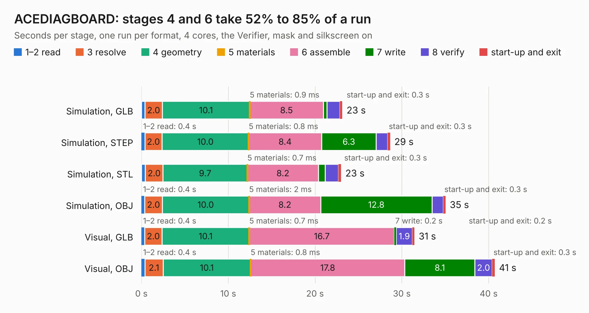

# 968. ACEDIAGBOARD

Board 968 of the 3,138 of [Corpus Testing](../Corpus-Testing.md), on [Corpus Page 9](../CorpusTestingPages/Corpus-Testing-09.md#968-acediagboard).

| Mode and format | 1–2 read | 3 resolve | 4 geometry | 5 materials | 6 assemble | 7 write | 8 verify | start-up and exit | Total |
|---|---:|---:|---:|---:|---:|---:|---:|---:|---:|
| Simulation, GLB | 0.4 | 2.0 | 10.1 | 0.9&nbsp;ms | 8.5 | 0.4 | 1.5 | 0.3 | 23.1 |
| Simulation, STEP | 0.4 | 2.0 | 10.0 | 0.8&nbsp;ms | 8.4 | 6.3 | 1.3 | 0.3 | 28.7 |
| Simulation, STL | 0.5 | 2.0 | 9.7 | 0.7&nbsp;ms | 8.2 | 0.8 | 1.5 | 0.3 | 23.0 |
| Simulation, OBJ | 0.4 | 2.0 | 10.0 | 2&nbsp;ms | 8.2 | 12.8 | 1.3 | 0.3 | 35.0 |
| Visual, GLB | 0.4 | 2.0 | 10.1 | 0.7&nbsp;ms | 16.7 | 0.2 | 1.9 | 0.2 | 31.5 |
| Visual, OBJ | 0.4 | 2.1 | 10.1 | 0.8&nbsp;ms | 17.8 | 8.1 | 2.0 | 0.3 | 40.7 |

<table align="center"><tr><td valign="top">

| Board | Repo: [flypie/Ace-2019](https://github.com/flypie/Ace-2019) Board: `ACEDIAGBOARD.kicad_pcb` |
|---|---|
| Folder | KiCad / ACEDIAGBOARD |
| Complexity | 225&nbsp;/&nbsp;1000 (size&nbsp;180, features&nbsp;45) |
| KESE&nbsp;features | through vias, stack-up, dielectric εr and tanδ |
| Tested | 9th November 2026 |
| Copper&nbsp;layers | 2 |
| File&nbsp;format | KiCad 8 (20240108) |
| Parts,&nbsp;tracks,&nbsp;vias | 44, 1,624, 39 |
| Triangles,&nbsp;simulation | 2,163,402 in 160 parts |
| Verifier | PASS in all six runs |

</td><td valign="top">

<table>
<tr><th>File type</th><th>File size</th><th>Peak memory used</th></tr>
<tr><th colspan="3" align="left">Simulation</th></tr>
<tr><td>GLB</td><td align="right">73&nbsp;MB</td><td align="right">701&nbsp;MB</td></tr>
<tr><td>STEP</td><td align="right">306&nbsp;MB</td><td align="right">928&nbsp;MB</td></tr>
<tr><td>STL</td><td align="right">108&nbsp;MB</td><td align="right">702&nbsp;MB</td></tr>
<tr><td>OBJ</td><td align="right">224&nbsp;MB</td><td align="right">1.4&nbsp;GB</td></tr>
<tr><th colspan="3" align="left">Visual</th></tr>
<tr><td>GLB</td><td align="right">46&nbsp;MB</td><td align="right">867&nbsp;MB</td></tr>
<tr><td>OBJ</td><td align="right">140&nbsp;MB</td><td align="right">1.0&nbsp;GB</td></tr>
</table>

</td></tr></table>

| Previous | Next |
|:---|---:|
| [967. ACEBREAKPOINT](b0967b_Ace-2019_ACEBREAKPOINT.md) | [969. ACEKEYBOARD](b0969b_Ace-2019_ACEKEYBOARD.md) |
