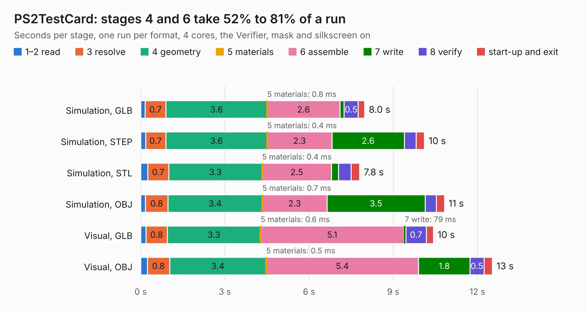

# 968. PS2TestCard

Board 968 of the 3,110 of [Corpus Testing](../Corpus-Testing.md), on [Corpus Page 9](../CorpusTestingPages/Corpus-Testing-09.md#968-ps2testcard).

| Mode and format | 1–2 read | 3 resolve | 4 geometry | 5 materials | 6 assemble | 7 write | 8 verify | start-up and exit | Total |
|---|---:|---:|---:|---:|---:|---:|---:|---:|---:|
| Simulation, GLB | 0.2 | 0.7 | 3.6 | 0.8&nbsp;ms | 2.6 | 0.1 | 0.5 | 0.2 | 8.0 |
| Simulation, STEP | 0.2 | 0.7 | 3.6 | 0.4&nbsp;ms | 2.3 | 2.6 | 0.4 | 0.3 | 10.1 |
| Simulation, STL | 0.3 | 0.7 | 3.3 | 0.4&nbsp;ms | 2.5 | 0.2 | 0.4 | 0.3 | 7.8 |
| Simulation, OBJ | 0.2 | 0.8 | 3.4 | 0.7&nbsp;ms | 2.3 | 3.5 | 0.4 | 0.3 | 10.8 |
| Visual, GLB | 0.2 | 0.8 | 3.3 | 0.6&nbsp;ms | 5.1 | 79&nbsp;ms | 0.7 | 0.2 | 10.4 |
| Visual, OBJ | 0.2 | 0.8 | 3.4 | 0.5&nbsp;ms | 5.4 | 1.8 | 0.5 | 0.3 | 12.5 |

<table align="center"><tr><td valign="top">

| Board | Repo: [flypie/Ace-2019](https://github.com/flypie/Ace-2019) Board: `PS2TestCard.kicad_pcb` |
|---|---|
| Folder | KiCad / PS2TestCard |
| Complexity | 161&nbsp;/&nbsp;1000 (size&nbsp;146, features&nbsp;15) |
| KESE&nbsp;features | through vias |
| Tested | 9th November 2026 |
| Copper&nbsp;layers | 2 |
| File&nbsp;format | KiCad 6 (20211014) |
| Parts,&nbsp;tracks,&nbsp;vias | 13, 401, 20 |
| Triangles,&nbsp;simulation | 569,862 in 106 parts |
| Verifier | PASS in all six runs |

</td><td valign="top">

<table>
<tr><th>File type</th><th>File size</th><th>Peak memory used</th></tr>
<tr><th colspan="3" align="left">Simulation</th></tr>
<tr><td>GLB</td><td align="right">20&nbsp;MB</td><td align="right">305&nbsp;MB</td></tr>
<tr><td>STEP</td><td align="right">93&nbsp;MB</td><td align="right">343&nbsp;MB</td></tr>
<tr><td>STL</td><td align="right">29&nbsp;MB</td><td align="right">329&nbsp;MB</td></tr>
<tr><td>OBJ</td><td align="right">59&nbsp;MB</td><td align="right">425&nbsp;MB</td></tr>
<tr><th colspan="3" align="left">Visual</th></tr>
<tr><td>GLB</td><td align="right">11&nbsp;MB</td><td align="right">339&nbsp;MB</td></tr>
<tr><td>OBJ</td><td align="right">33&nbsp;MB</td><td align="right">328&nbsp;MB</td></tr>
</table>

</td></tr></table>

| Previous | Next |
|:---|---:|
| [967. PS2](b0967b_Ace-2019_PS2.md) | [969. STM8SUBSYS](b0969b_Ace-2019_STM8SUBSYS.md) |
