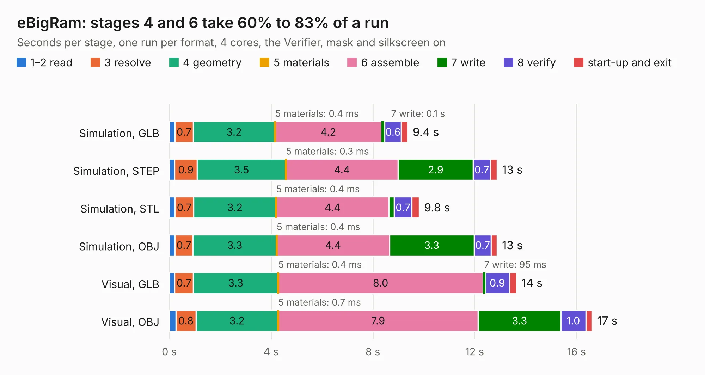

# 968. eBigRam

Board 968 of the 3,118 of [Corpus Testing](../Corpus-Testing.md), on [Corpus Page 9](../CorpusTestingPages/Corpus-Testing-09.md#968-ebigram).

| Mode and format | 1–2 read | 3 resolve | 4 geometry | 5 materials | 6 assemble | 7 write | 8 verify | start-up and exit | Total |
|---|---:|---:|---:|---:|---:|---:|---:|---:|---:|
| Simulation, GLB | 0.2 | 0.7 | 3.2 | 0.4&nbsp;ms | 4.2 | 0.1 | 0.6 | 0.3 | 9.4 |
| Simulation, STEP | 0.2 | 0.9 | 3.5 | 0.3&nbsp;ms | 4.4 | 2.9 | 0.7 | 0.3 | 12.9 |
| Simulation, STL | 0.2 | 0.7 | 3.2 | 0.4&nbsp;ms | 4.4 | 0.2 | 0.7 | 0.3 | 9.8 |
| Simulation, OBJ | 0.2 | 0.7 | 3.3 | 0.4&nbsp;ms | 4.4 | 3.3 | 0.7 | 0.2 | 12.9 |
| Visual, GLB | 0.2 | 0.7 | 3.3 | 0.4&nbsp;ms | 8.0 | 95&nbsp;ms | 0.9 | 0.3 | 13.6 |
| Visual, OBJ | 0.3 | 0.8 | 3.2 | 0.7&nbsp;ms | 7.9 | 3.3 | 1.0 | 0.3 | 16.6 |

<table align="center"><tr><td valign="top">

| Board | Repo: [flypie/Ace-2019](https://github.com/flypie/Ace-2019) Board: `eBigRam.kicad_pcb` |
|---|---|
| Folder | KiCad / eBigRam |
| Complexity | 184&nbsp;/&nbsp;1000 (size&nbsp;169, features&nbsp;15) |
| KESE&nbsp;features | through vias |
| Tested | 9th November 2026 |
| Copper&nbsp;layers | 2 |
| File&nbsp;format | KiCad 6 (20211014) |
| Parts,&nbsp;tracks,&nbsp;vias | 8, 2,022, 151 |
| Triangles,&nbsp;simulation | 730,898 in 135 parts |
| Verifier | PASS in all six runs |

</td><td valign="top">

<table>
<tr><th>File type</th><th>File size</th><th>Peak memory used</th></tr>
<tr><th colspan="3" align="left">Simulation</th></tr>
<tr><td>GLB</td><td align="right">25&nbsp;MB</td><td align="right">400&nbsp;MB</td></tr>
<tr><td>STEP</td><td align="right">126&nbsp;MB</td><td align="right">465&nbsp;MB</td></tr>
<tr><td>STL</td><td align="right">37&nbsp;MB</td><td align="right">402&nbsp;MB</td></tr>
<tr><td>OBJ</td><td align="right">75&nbsp;MB</td><td align="right">531&nbsp;MB</td></tr>
<tr><th colspan="3" align="left">Visual</th></tr>
<tr><td>GLB</td><td align="right">23&nbsp;MB</td><td align="right">582&nbsp;MB</td></tr>
<tr><td>OBJ</td><td align="right">68&nbsp;MB</td><td align="right">632&nbsp;MB</td></tr>
</table>

</td></tr></table>

| Previous | Next |
|:---|---:|
| [967. CFCARD](b0967b_Ace-2019_CFCARD.md) | [969. Edgeboard](b0969b_Ace-2019_Edgeboard.md) |
