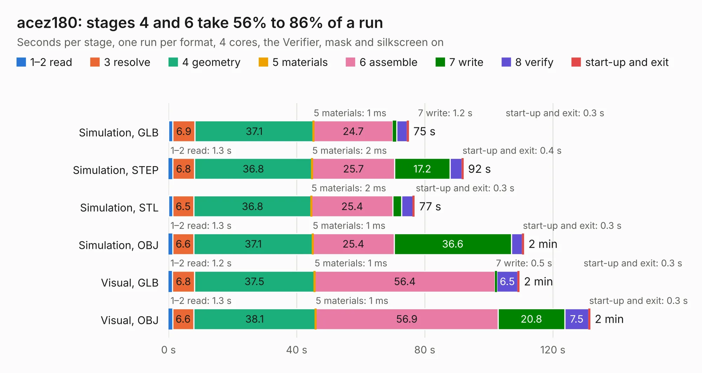

# 970. acez180

Board 970 of the 3,138 of [Corpus Testing](../Corpus-Testing.md), on [Corpus Page 9](../CorpusTestingPages/Corpus-Testing-09.md#970-acez180).

| Mode and format | 1–2 read | 3 resolve | 4 geometry | 5 materials | 6 assemble | 7 write | 8 verify | start-up and exit | Total |
|---|---:|---:|---:|---:|---:|---:|---:|---:|---:|
| Simulation, GLB | 1.3 | 6.9 | 37.1 | 1&nbsp;ms | 24.7 | 1.2 | 3.3 | 0.3 | 74.9 |
| Simulation, STEP | 1.3 | 6.8 | 36.8 | 2&nbsp;ms | 25.7 | 17.2 | 3.7 | 0.4 | 92.0 |
| Simulation, STL | 1.3 | 6.5 | 36.8 | 2&nbsp;ms | 25.4 | 2.7 | 3.6 | 0.3 | 76.7 |
| Simulation, OBJ | 1.3 | 6.6 | 37.1 | 1&nbsp;ms | 25.4 | 36.6 | 3.4 | 0.3 | 110.8 |
| Visual, GLB | 1.2 | 6.8 | 37.5 | 1&nbsp;ms | 56.4 | 0.5 | 6.5 | 0.3 | 109.4 |
| Visual, OBJ | 1.3 | 6.6 | 38.1 | 1&nbsp;ms | 56.9 | 20.8 | 7.5 | 0.3 | 131.5 |

<table align="center"><tr><td valign="top">

| Board | Repo: [flypie/Ace-2019](https://github.com/flypie/Ace-2019) Board: `acez180.kicad_pcb` |
|---|---|
| Folder | KiCad / ACEZ180 |
| Complexity | 312&nbsp;/&nbsp;1000 (size&nbsp;267, features&nbsp;45) |
| KESE&nbsp;features | through vias, rounded, trapezoid or chamfered pads, filled zones |
| Tested | 9th November 2026 |
| Copper&nbsp;layers | 2 |
| File&nbsp;format | KiCad 6 (20211014) |
| Parts,&nbsp;tracks,&nbsp;vias | 137, 5,331, 338 |
| Triangles,&nbsp;simulation | 5,785,928 in 419 parts |
| Verifier | PASS in all six runs |

</td><td valign="top">

<table>
<tr><th>File type</th><th>File size</th><th>Peak memory used</th></tr>
<tr><th colspan="3" align="left">Simulation</th></tr>
<tr><td>GLB</td><td align="right">200&nbsp;MB</td><td align="right">1.7&nbsp;GB</td></tr>
<tr><td>STEP</td><td align="right">1.1&nbsp;GB</td><td align="right">2.2&nbsp;GB</td></tr>
<tr><td>STL</td><td align="right">289&nbsp;MB</td><td align="right">1.5&nbsp;GB</td></tr>
<tr><td>OBJ</td><td align="right">625&nbsp;MB</td><td align="right">3.8&nbsp;GB</td></tr>
<tr><th colspan="3" align="left">Visual</th></tr>
<tr><td>GLB</td><td align="right">120&nbsp;MB</td><td align="right">2.0&nbsp;GB</td></tr>
<tr><td>OBJ</td><td align="right">380&nbsp;MB</td><td align="right">2.4&nbsp;GB</td></tr>
</table>

</td></tr></table>

| Previous | Next |
|:---|---:|
| [969. ACEKEYBOARD](b0969b_Ace-2019_ACEKEYBOARD.md) | [971. acez380](b0971b_Ace-2019_acez380.md) |
