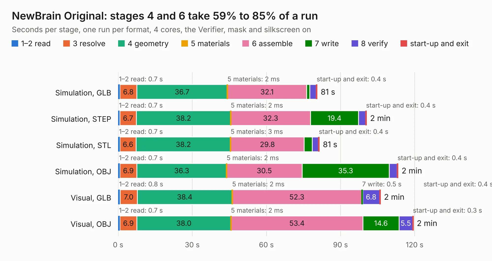

# 970. NewBrain Original

Board 970 of the 3,100 of [Corpus Testing](../Corpus-Testing.md), on [Corpus Page 9](../CorpusTestingPages/Corpus-Testing-09.md#970-newbrain-original).

| Mode and format | 1–2 read | 3 resolve | 4 geometry | 5 materials | 6 assemble | 7 write | 8 verify | start-up and exit | Total |
|---|---:|---:|---:|---:|---:|---:|---:|---:|---:|
| Simulation, GLB | 0.7 | 6.8 | 36.7 | 2&nbsp;ms | 32.1 | 1.2 | 2.6 | 0.4 | 80.6 |
| Simulation, STEP | 0.7 | 6.7 | 38.2 | 2&nbsp;ms | 32.3 | 19.4 | 2.9 | 0.4 | 100.6 |
| Simulation, STL | 0.7 | 6.6 | 38.2 | 3&nbsp;ms | 29.8 | 3.3 | 2.5 | 0.4 | 81.4 |
| Simulation, OBJ | 0.7 | 6.9 | 36.3 | 2&nbsp;ms | 30.5 | 35.3 | 3.1 | 0.4 | 113.3 |
| Visual, GLB | 0.8 | 7.0 | 38.4 | 2&nbsp;ms | 52.3 | 0.5 | 6.8 | 0.4 | 106.2 |
| Visual, OBJ | 0.7 | 6.9 | 38.0 | 2&nbsp;ms | 53.4 | 14.6 | 5.5 | 0.3 | 119.5 |

<table align="center"><tr><td valign="top">

| Board | Repo: [flypie/NewBrain](https://github.com/flypie/NewBrain) Board: `NewBrain Original.kicad_pcb` |
|---|---|
| Folder | NewBrain MainBoard Original KiCad |
| Complexity | 85&nbsp;/&nbsp;1000 (size&nbsp;75, features&nbsp;10) |
| KESE&nbsp;features | rounded, trapezoid or chamfered pads |
| Tested | 9th November 2026 |
| Copper&nbsp;layers | 2 |
| File&nbsp;format | KiCad 5 (20171130) |
| Parts,&nbsp;tracks,&nbsp;vias | 209, 0, 0 |
| Triangles,&nbsp;simulation | 7,779,384 in 422 parts |
| Note | mostly unrouted |
| Verifier | Simulation, GLB: Verifier FAIL Simulation, STEP: Verifier FAIL Simulation, STL: Verifier FAIL Simulation, OBJ: Verifier FAIL |
| Bad&nbsp;design | Bad design according to KESE: copper of two nets on top of each other in the file, a short KiCad's DRC reports; C118 pad 2 and C82 pad 1 overlap at (100.32, 170.52) mm, plated holes 0.25 mm apart (the file also has no Edge.Cuts outline). KESE models what the file says, so the Verifier rightly finds the two nets' solids overlapping |

</td><td valign="top">

<table>
<tr><th>File type</th><th>File size</th><th>Peak memory used</th></tr>
<tr><th colspan="3" align="left">Simulation</th></tr>
<tr><td>GLB</td><td align="right">244&nbsp;MB</td><td align="right">2.0&nbsp;GB</td></tr>
<tr><td>STEP</td><td align="right">1.2&nbsp;GB</td><td align="right">2.8&nbsp;GB</td></tr>
<tr><td>STL</td><td align="right">389&nbsp;MB</td><td align="right">2.0&nbsp;GB</td></tr>
<tr><td>OBJ</td><td align="right">831&nbsp;MB</td><td align="right">4.9&nbsp;GB</td></tr>
<tr><th colspan="3" align="left">Visual</th></tr>
<tr><td>GLB</td><td align="right">116&nbsp;MB</td><td align="right">2.3&nbsp;GB</td></tr>
<tr><td>OBJ</td><td align="right">368&nbsp;MB</td><td align="right">2.5&nbsp;GB</td></tr>
</table>

</td></tr></table>

| Previous | Next |
|:---|---:|
| [969. NewBrain Keyboard A](b0969b_NewBrain_NewBrain-Keyboard-A.md) | [971. NewBrain PSU](b0971b_NewBrain_NewBrain-PSU.md) |
