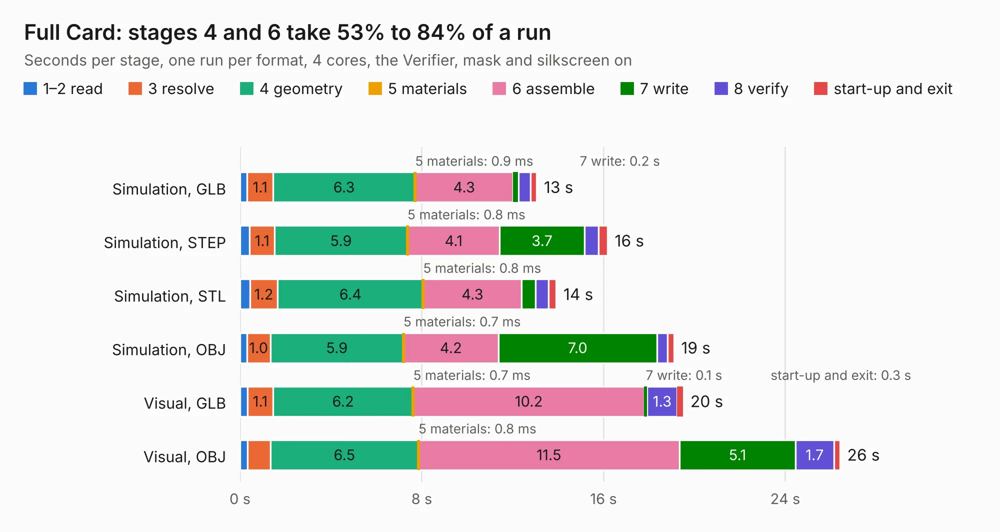

# 971. Full Card

Board 971 of the 3,111 of [Corpus Testing](../Corpus-Testing.md), on [Corpus Page 9](../CorpusTestingPages/Corpus-Testing-09.md#971-full-card).

| Mode and format | 1–2 read | 3 resolve | 4 geometry | 5 materials | 6 assemble | 7 write | 8 verify | start-up and exit | Total |
|---|---:|---:|---:|---:|---:|---:|---:|---:|---:|
| Simulation, GLB | 0.3 | 1.1 | 6.3 | 0.9&nbsp;ms | 4.3 | 0.2 | 0.5 | 0.3 | 13.1 |
| Simulation, STEP | 0.4 | 1.1 | 5.9 | 0.8&nbsp;ms | 4.1 | 3.7 | 0.6 | 0.4 | 16.2 |
| Simulation, STL | 0.4 | 1.2 | 6.4 | 0.8&nbsp;ms | 4.3 | 0.6 | 0.6 | 0.3 | 13.9 |
| Simulation, OBJ | 0.3 | 1.0 | 5.9 | 0.7&nbsp;ms | 4.2 | 7.0 | 0.5 | 0.3 | 19.1 |
| Visual, GLB | 0.3 | 1.1 | 6.2 | 0.7&nbsp;ms | 10.2 | 0.1 | 1.3 | 0.3 | 19.5 |
| Visual, OBJ | 0.3 | 1.0 | 6.5 | 0.8&nbsp;ms | 11.5 | 5.1 | 1.7 | 0.3 | 26.4 |

<table align="center"><tr><td valign="top">

| Board | Repo: [flypie/Ace-2019](https://github.com/flypie/Ace-2019) Board: `Full Card.kicad_pcb` |
|---|---|
| Folder | VGA / Full Card |
| Complexity | 74&nbsp;/&nbsp;1000 (size&nbsp;64, features&nbsp;10) |
| KESE&nbsp;features | rounded, trapezoid or chamfered pads |
| Tested | 9th November 2026 |
| Copper&nbsp;layers | 2 |
| File&nbsp;format | KiCad 6 (20211014) |
| Parts,&nbsp;tracks,&nbsp;vias | 76, 0, 0 |
| Triangles,&nbsp;simulation | 1,119,752 in 201 parts |
| Note | mostly unrouted |
| Verifier | PASS in all six runs |

</td><td valign="top">

<table>
<tr><th>File type</th><th>File size</th><th>Peak memory used</th></tr>
<tr><th colspan="3" align="left">Simulation</th></tr>
<tr><td>GLB</td><td align="right">37&nbsp;MB</td><td align="right">510&nbsp;MB</td></tr>
<tr><td>STEP</td><td align="right">146&nbsp;MB</td><td align="right">564&nbsp;MB</td></tr>
<tr><td>STL</td><td align="right">56&nbsp;MB</td><td align="right">490&nbsp;MB</td></tr>
<tr><td>OBJ</td><td align="right">115&nbsp;MB</td><td align="right">765&nbsp;MB</td></tr>
<tr><th colspan="3" align="left">Visual</th></tr>
<tr><td>GLB</td><td align="right">26&nbsp;MB</td><td align="right">588&nbsp;MB</td></tr>
<tr><td>OBJ</td><td align="right">79&nbsp;MB</td><td align="right">596&nbsp;MB</td></tr>
</table>

</td></tr></table>

| Previous | Next |
|:---|---:|
| [970. UniBoard](b0970b_Ace-2019_UniBoard.md) | [972. VGAGAL](b0972b_Ace-2019_VGAGAL.md) |
