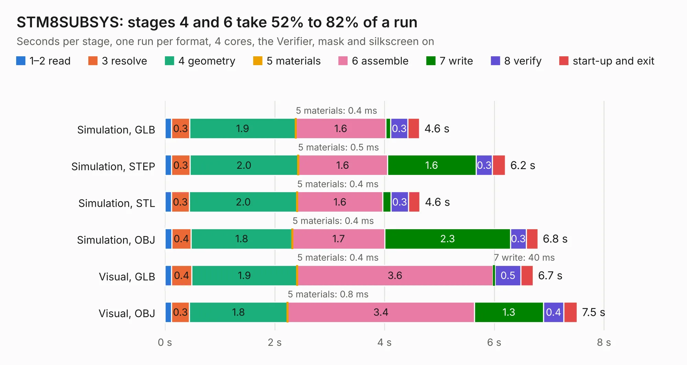

# 973. STM8SUBSYS

Board 973 of the 3,116 of [Corpus Testing](../Corpus-Testing.md), on [Corpus Page 10](../CorpusTestingPages/Corpus-Testing-10.md#973-stm8subsys).

| Mode and format | 1–2 read | 3 resolve | 4 geometry | 5 materials | 6 assemble | 7 write | 8 verify | start-up and exit | Total |
|---|---:|---:|---:|---:|---:|---:|---:|---:|---:|
| Simulation, GLB | 0.1 | 0.3 | 1.9 | 0.4&nbsp;ms | 1.6 | 89&nbsp;ms | 0.3 | 0.2 | 4.6 |
| Simulation, STEP | 0.1 | 0.3 | 2.0 | 0.5&nbsp;ms | 1.6 | 1.6 | 0.3 | 0.2 | 6.2 |
| Simulation, STL | 0.1 | 0.3 | 2.0 | 0.4&nbsp;ms | 1.6 | 0.2 | 0.3 | 0.2 | 4.6 |
| Simulation, OBJ | 0.1 | 0.4 | 1.8 | 0.4&nbsp;ms | 1.7 | 2.3 | 0.3 | 0.2 | 6.8 |
| Visual, GLB | 0.1 | 0.4 | 1.9 | 0.4&nbsp;ms | 3.6 | 40&nbsp;ms | 0.5 | 0.2 | 6.7 |
| Visual, OBJ | 0.1 | 0.3 | 1.8 | 0.8&nbsp;ms | 3.4 | 1.3 | 0.4 | 0.2 | 7.5 |

<table align="center"><tr><td valign="top">

| Board | Repo: [flypie/Ace-2019](https://github.com/flypie/Ace-2019) Board: `STM8SUBSYS.kicad_pcb` |
|---|---|
| Folder | KiCad / STM8SUBSYS |
| Complexity | 162&nbsp;/&nbsp;1000 (size&nbsp;137, features&nbsp;25) |
| KESE&nbsp;features | through vias, rounded, trapezoid or chamfered pads |
| Tested | 9th November 2026 |
| Copper&nbsp;layers | 2 |
| File&nbsp;format | KiCad 6 (20211014) |
| Parts,&nbsp;tracks,&nbsp;vias | 12, 277, 3 |
| Triangles,&nbsp;simulation | 465,296 in 70 parts |
| Verifier | PASS in all six runs |

</td><td valign="top">

<table>
<tr><th>File type</th><th>File size</th><th>Peak memory used</th></tr>
<tr><th colspan="3" align="left">Simulation</th></tr>
<tr><td>GLB</td><td align="right">15&nbsp;MB</td><td align="right">271&nbsp;MB</td></tr>
<tr><td>STEP</td><td align="right">60&nbsp;MB</td><td align="right">313&nbsp;MB</td></tr>
<tr><td>STL</td><td align="right">23&nbsp;MB</td><td align="right">269&nbsp;MB</td></tr>
<tr><td>OBJ</td><td align="right">46&nbsp;MB</td><td align="right">354&nbsp;MB</td></tr>
<tr><th colspan="3" align="left">Visual</th></tr>
<tr><td>GLB</td><td align="right">8.8&nbsp;MB</td><td align="right">306&nbsp;MB</td></tr>
<tr><td>OBJ</td><td align="right">26&nbsp;MB</td><td align="right">314&nbsp;MB</td></tr>
</table>

</td></tr></table>

| Previous | Next |
|:---|---:|
| [972. PS2TestCard](b0972b_Ace-2019_PS2TestCard.md) | [974. UniBoard](b0974b_Ace-2019_UniBoard.md) |
