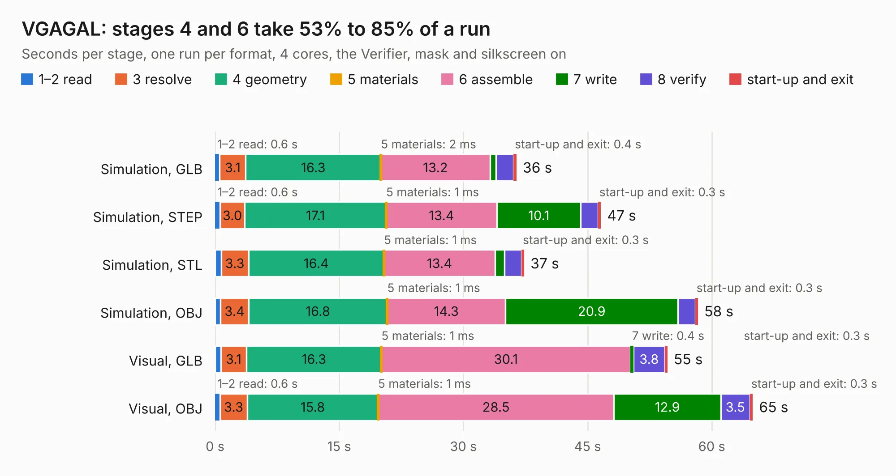

# 973. VGAGAL

Board 973 of the 3,112 of [Corpus Testing](../Corpus-Testing.md), on [Corpus Page 10](../CorpusTestingPages/Corpus-Testing-10.md#973-vgagal).

| Mode and format | 1–2 read | 3 resolve | 4 geometry | 5 materials | 6 assemble | 7 write | 8 verify | start-up and exit | Total |
|---|---:|---:|---:|---:|---:|---:|---:|---:|---:|
| Simulation, GLB | 0.6 | 3.1 | 16.3 | 2&nbsp;ms | 13.2 | 0.7 | 2.1 | 0.4 | 36.4 |
| Simulation, STEP | 0.6 | 3.0 | 17.1 | 1&nbsp;ms | 13.4 | 10.1 | 2.1 | 0.3 | 46.6 |
| Simulation, STL | 0.7 | 3.3 | 16.4 | 1&nbsp;ms | 13.4 | 1.1 | 2.1 | 0.3 | 37.3 |
| Simulation, OBJ | 0.7 | 3.4 | 16.8 | 1&nbsp;ms | 14.3 | 20.9 | 2.1 | 0.3 | 58.3 |
| Visual, GLB | 0.7 | 3.1 | 16.3 | 1&nbsp;ms | 30.1 | 0.4 | 3.8 | 0.3 | 54.6 |
| Visual, OBJ | 0.6 | 3.3 | 15.8 | 1&nbsp;ms | 28.5 | 12.9 | 3.5 | 0.3 | 64.9 |

<table align="center"><tr><td valign="top">

| Board | Repo: [flypie/Ace-2019](https://github.com/flypie/Ace-2019) Board: `VGAGAL.kicad_pcb` |
|---|---|
| Folder | VGA / VGAGAL |
| Complexity | 278&nbsp;/&nbsp;1000 (size&nbsp;253, features&nbsp;25) |
| KESE&nbsp;features | through vias, rounded, trapezoid or chamfered pads |
| Tested | 9th November 2026 |
| Copper&nbsp;layers | 2 |
| File&nbsp;format | KiCad 6 (20211014) |
| Parts,&nbsp;tracks,&nbsp;vias | 77, 3,325, 230 |
| Triangles,&nbsp;simulation | 3,129,196 in 217 parts |
| Verifier | PASS in all six runs |

</td><td valign="top">

<table>
<tr><th>File type</th><th>File size</th><th>Peak memory used</th></tr>
<tr><th colspan="3" align="left">Simulation</th></tr>
<tr><td>GLB</td><td align="right">105&nbsp;MB</td><td align="right">1.1&nbsp;GB</td></tr>
<tr><td>STEP</td><td align="right">452&nbsp;MB</td><td align="right">1.3&nbsp;GB</td></tr>
<tr><td>STL</td><td align="right">156&nbsp;MB</td><td align="right">1.1&nbsp;GB</td></tr>
<tr><td>OBJ</td><td align="right">326&nbsp;MB</td><td align="right">2.0&nbsp;GB</td></tr>
<tr><th colspan="3" align="left">Visual</th></tr>
<tr><td>GLB</td><td align="right">67&nbsp;MB</td><td align="right">1.2&nbsp;GB</td></tr>
<tr><td>OBJ</td><td align="right">211&nbsp;MB</td><td align="right">1.5&nbsp;GB</td></tr>
</table>

</td></tr></table>

| Previous | Next |
|:---|---:|
| [972. Full Card](b0972b_Ace-2019_Full-Card.md) | [974. VGAVDG](b0974b_Ace-2019_VGAVDG.md) |
