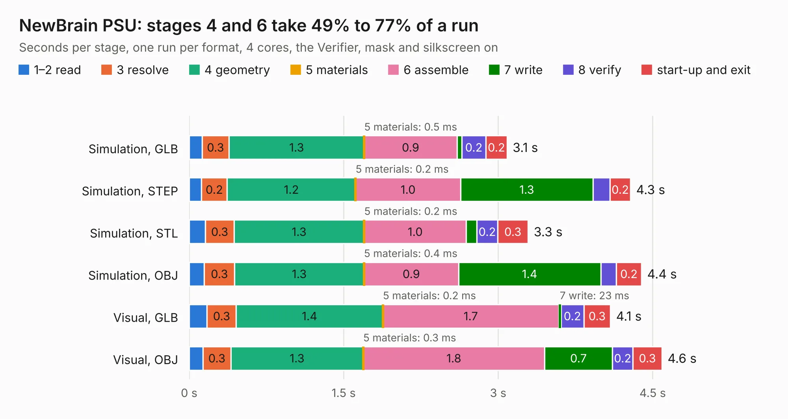

# 974. NewBrain PSU

Board 974 of the 3,103 of [Corpus Testing](../Corpus-Testing.md), on [Corpus Page 10](../CorpusTestingPages/Corpus-Testing-10.md#974-newbrain-psu).

| Mode and format | 1–2 read | 3 resolve | 4 geometry | 5 materials | 6 assemble | 7 write | 8 verify | start-up and exit | Total |
|---|---:|---:|---:|---:|---:|---:|---:|---:|---:|
| Simulation, GLB | 0.1 | 0.3 | 1.3 | 0.5&nbsp;ms | 0.9 | 48&nbsp;ms | 0.2 | 0.2 | 3.1 |
| Simulation, STEP | 0.1 | 0.2 | 1.2 | 0.2&nbsp;ms | 1.0 | 1.3 | 0.2 | 0.2 | 4.3 |
| Simulation, STL | 0.2 | 0.3 | 1.3 | 0.2&nbsp;ms | 1.0 | 0.1 | 0.2 | 0.3 | 3.3 |
| Simulation, OBJ | 0.1 | 0.3 | 1.3 | 0.4&nbsp;ms | 0.9 | 1.4 | 0.2 | 0.2 | 4.4 |
| Visual, GLB | 0.2 | 0.3 | 1.4 | 0.2&nbsp;ms | 1.7 | 23&nbsp;ms | 0.2 | 0.3 | 4.1 |
| Visual, OBJ | 0.1 | 0.3 | 1.3 | 0.3&nbsp;ms | 1.8 | 0.7 | 0.2 | 0.3 | 4.6 |

<table align="center"><tr><td valign="top">

| Board | Repo: [flypie/NewBrain](https://github.com/flypie/NewBrain) Board: `NewBrain PSU.kicad_pcb` |
|---|---|
| Folder | NewBrain PSU |
| Complexity | 50&nbsp;/&nbsp;1000 (size&nbsp;50, features&nbsp;0) |
| Tested | 9th November 2026 |
| Copper&nbsp;layers | 2 |
| File&nbsp;format | KiCad 5 (20171130) |
| Parts,&nbsp;tracks,&nbsp;vias | 20, 0, 0 |
| Triangles,&nbsp;simulation | 289,290 in 32 parts |
| Verifier | PASS in all six runs |

</td><td valign="top">

<table>
<tr><th>File type</th><th>File size</th><th>Peak memory used</th></tr>
<tr><th colspan="3" align="left">Simulation</th></tr>
<tr><td>GLB</td><td align="right">9.3&nbsp;MB</td><td align="right">225&nbsp;MB</td></tr>
<tr><td>STEP</td><td align="right">42&nbsp;MB</td><td align="right">257&nbsp;MB</td></tr>
<tr><td>STL</td><td align="right">14&nbsp;MB</td><td align="right">222&nbsp;MB</td></tr>
<tr><td>OBJ</td><td align="right">29&nbsp;MB</td><td align="right">245&nbsp;MB</td></tr>
<tr><th colspan="3" align="left">Visual</th></tr>
<tr><td>GLB</td><td align="right">4.7&nbsp;MB</td><td align="right">220&nbsp;MB</td></tr>
<tr><td>OBJ</td><td align="right">14&nbsp;MB</td><td align="right">220&nbsp;MB</td></tr>
</table>

</td></tr></table>

| Previous | Next |
|:---|---:|
| [973. NewBrain Original](b0973b_NewBrain_NewBrain-Original.md) | [975. NewBrain StoreBoard](b0975b_NewBrain_NewBrain-StoreBoard.md) |
