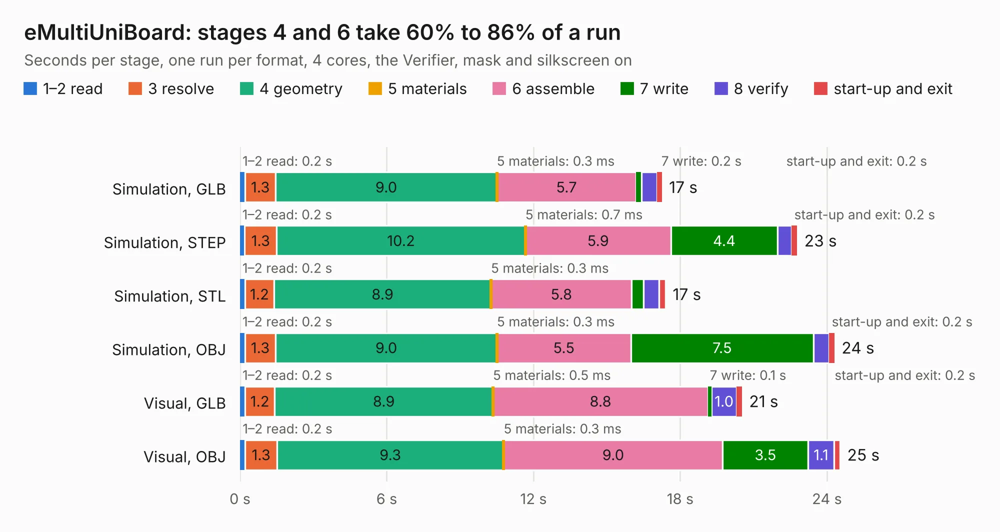

# 975. eMultiUniBoard

Board 975 of the 3,138 of [Corpus Testing](../Corpus-Testing.md), on [Corpus Page 10](../CorpusTestingPages/Corpus-Testing-10.md#975-emultiuniboard).

| Mode and format | 1–2 read | 3 resolve | 4 geometry | 5 materials | 6 assemble | 7 write | 8 verify | start-up and exit | Total |
|---|---:|---:|---:|---:|---:|---:|---:|---:|---:|
| Simulation, GLB | 0.2 | 1.3 | 9.0 | 0.3&nbsp;ms | 5.7 | 0.2 | 0.6 | 0.2 | 17.2 |
| Simulation, STEP | 0.2 | 1.3 | 10.2 | 0.7&nbsp;ms | 5.9 | 4.4 | 0.6 | 0.2 | 22.8 |
| Simulation, STL | 0.2 | 1.2 | 8.9 | 0.3&nbsp;ms | 5.8 | 0.5 | 0.6 | 0.3 | 17.4 |
| Simulation, OBJ | 0.2 | 1.3 | 9.0 | 0.3&nbsp;ms | 5.5 | 7.5 | 0.6 | 0.2 | 24.3 |
| Visual, GLB | 0.2 | 1.2 | 8.9 | 0.5&nbsp;ms | 8.8 | 0.1 | 1.0 | 0.2 | 20.5 |
| Visual, OBJ | 0.2 | 1.3 | 9.3 | 0.3&nbsp;ms | 9.0 | 3.5 | 1.1 | 0.3 | 24.5 |

<table align="center"><tr><td valign="top">

| Board | Repo: [flypie/Ace-2019](https://github.com/flypie/Ace-2019) Board: `eMultiUniBoard.kicad_pcb` |
|---|---|
| Folder | KiCad / eMultiUniBoard |
| Complexity | 151&nbsp;/&nbsp;1000 (size&nbsp;151, features&nbsp;0) |
| Tested | 9th November 2026 |
| Copper&nbsp;layers | 2 |
| File&nbsp;format | KiCad 6 (20211014) |
| Parts,&nbsp;tracks,&nbsp;vias | 5, 1,093, 0 |
| Triangles,&nbsp;simulation | 1,477,974 in 60 parts |
| Verifier | PASS in all six runs |

</td><td valign="top">

<table>
<tr><th>File type</th><th>File size</th><th>Peak memory used</th></tr>
<tr><th colspan="3" align="left">Simulation</th></tr>
<tr><td>GLB</td><td align="right">51&nbsp;MB</td><td align="right">584&nbsp;MB</td></tr>
<tr><td>STEP</td><td align="right">253&nbsp;MB</td><td align="right">686&nbsp;MB</td></tr>
<tr><td>STL</td><td align="right">74&nbsp;MB</td><td align="right">580&nbsp;MB</td></tr>
<tr><td>OBJ</td><td align="right">154&nbsp;MB</td><td align="right">1.0&nbsp;GB</td></tr>
<tr><th colspan="3" align="left">Visual</th></tr>
<tr><td>GLB</td><td align="right">24&nbsp;MB</td><td align="right">625&nbsp;MB</td></tr>
<tr><td>OBJ</td><td align="right">72&nbsp;MB</td><td align="right">632&nbsp;MB</td></tr>
</table>

</td></tr></table>

| Previous | Next |
|:---|---:|
| [974. Edgeboard](b0974b_Ace-2019_Edgeboard.md) | [976. eUniBoard](b0976b_Ace-2019_eUniBoard.md) |
