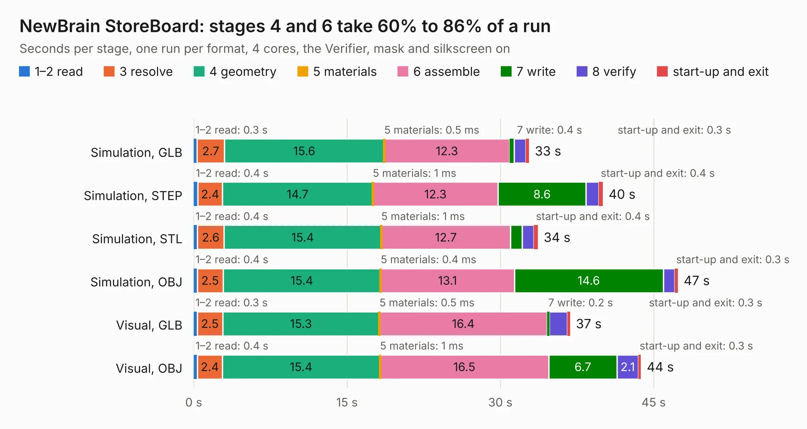

# 976. NewBrain StoreBoard

Board 976 of the 3,104 of [Corpus Testing](../Corpus-Testing.md), on [Corpus Page 10](../CorpusTestingPages/Corpus-Testing-10.md#976-newbrain-storeboard).

| Mode and format | 1–2 read | 3 resolve | 4 geometry | 5 materials | 6 assemble | 7 write | 8 verify | start-up and exit | Total |
|---|---:|---:|---:|---:|---:|---:|---:|---:|---:|
| Simulation, GLB | 0.3 | 2.7 | 15.6 | 0.5&nbsp;ms | 12.3 | 0.4 | 1.2 | 0.3 | 32.8 |
| Simulation, STEP | 0.4 | 2.4 | 14.7 | 1&nbsp;ms | 12.3 | 8.6 | 1.3 | 0.4 | 40.0 |
| Simulation, STL | 0.4 | 2.6 | 15.4 | 1&nbsp;ms | 12.7 | 1.2 | 1.1 | 0.4 | 33.7 |
| Simulation, OBJ | 0.4 | 2.5 | 15.4 | 0.4&nbsp;ms | 13.1 | 14.6 | 1.1 | 0.3 | 47.4 |
| Visual, GLB | 0.3 | 2.5 | 15.3 | 0.5&nbsp;ms | 16.4 | 0.2 | 1.8 | 0.3 | 36.8 |
| Visual, OBJ | 0.4 | 2.4 | 15.4 | 1&nbsp;ms | 16.5 | 6.7 | 2.1 | 0.3 | 43.8 |

<table align="center"><tr><td valign="top">

| Board | Repo: [flypie/NewBrain](https://github.com/flypie/NewBrain) Board: `NewBrain StoreBoard.kicad_pcb` |
|---|---|
| Folder | NewBrain StoreBoard |
| Complexity | 75&nbsp;/&nbsp;1000 (size&nbsp;65, features&nbsp;10) |
| KESE&nbsp;features | rounded, trapezoid or chamfered pads |
| Tested | 9th November 2026 |
| Copper&nbsp;layers | 2 |
| File&nbsp;format | KiCad 5 (20171130) |
| Parts,&nbsp;tracks,&nbsp;vias | 85, 0, 0 |
| Triangles,&nbsp;simulation | 3,036,484 in 98 parts |
| Note | mostly unrouted |
| Verifier | PASS in all six runs |

</td><td valign="top">

<table>
<tr><th>File type</th><th>File size</th><th>Peak memory used</th></tr>
<tr><th colspan="3" align="left">Simulation</th></tr>
<tr><td>GLB</td><td align="right">95&nbsp;MB</td><td align="right">904&nbsp;MB</td></tr>
<tr><td>STEP</td><td align="right">463&nbsp;MB</td><td align="right">1.2&nbsp;GB</td></tr>
<tr><td>STL</td><td align="right">152&nbsp;MB</td><td align="right">910&nbsp;MB</td></tr>
<tr><td>OBJ</td><td align="right">320&nbsp;MB</td><td align="right">2.0&nbsp;GB</td></tr>
<tr><th colspan="3" align="left">Visual</th></tr>
<tr><td>GLB</td><td align="right">45&nbsp;MB</td><td align="right">935&nbsp;MB</td></tr>
<tr><td>OBJ</td><td align="right">137&nbsp;MB</td><td align="right">1.1&nbsp;GB</td></tr>
</table>

</td></tr></table>

| Previous | Next |
|:---|---:|
| [975. NewBrain PSU](b0975b_NewBrain_NewBrain-PSU.md) | [977. corne-cherry](b0977b_crkbd_corne-cherry.md) |
